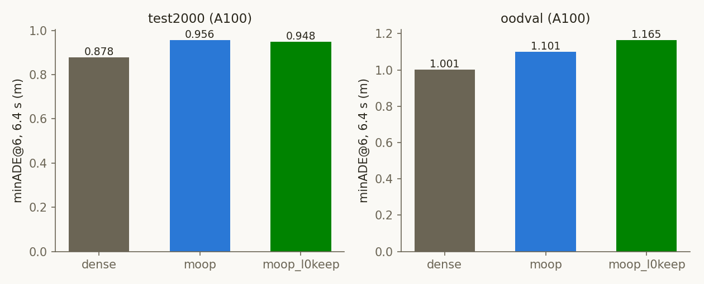

# Experiment: KISTI A100 개루프 트랙 — dense·MoOP·MoOP l0keep

2026-10-29 · 모델 `nvidia/Alpamayo-1.5-10B`(rev `7aba829`) · KISTI NEURON A100-SXM4-80GB
계획 `cvpr27/plans/2026-10-29_kisti-a100-openloop.md` · 코드 `cvpr27/code/` · 결과 `cvpr27/outputs/a100/`

## Purpose
- 앞으로 개루프 평가를 KISTI A100에서 돌린다. 그 전제로 두 가지를 확인한다.
  1. A100 결과를 믿고 쓸 수 있는가(게이트 G0–G2)
  2. A100 전용 비교표의 기준 arm은 얼마인가
- 카드 종류를 arm의 일부로 본다. 같은 카드 재실행은 비트 동일하지만, A100↔Ada 사이에서 dense는 ±0.003 m,
  MoOP는 최대 0.018 m 움직인다(2026-10-29 기존 런 대조). 그래서 이 표는 Ada 표와 섞지 않는다.

## Setup
- **arm:**
  - `dense`: 무압축
  - `moop`: `slim_dual_u40_v2`(출하본, 논문 MoOP)
  - `moop_l0keep`: `slim_dual_u40_l0keep_v2`(0번 층 Q head 32개 유지, CLAUDE.md 권장 레시피)
  - 두 MoOP는 모두 선택 전용 recipe여서, NEURON에서 기본 가중치로부터 재구성했다.
- **세트:** test_2000(2,000클립), OOD-Val262, LingoQA(500문항, Lingo-Judge).
- **프로토콜:** `run_baseline.py --no-tf`, k=8, 클립별 seed 42, max_gen 256, 결정론 모드.
  minADE@6 / minFDE@6은 8개 샘플 중 앞 6개의 최솟값이다. 1.6 / 3.2 / 6.4 s는 같은 예측 경로의 앞 16 / 32 / 64스텝이다.
- **통계:** dense와 클립별로 짝지은 Δ, 95% 부트스트랩 CI(200,000회). LingoQA는 100개 세그먼트를 재표집했다.
- **하드웨어:** NEURON `amd_a100nv_8`. 4장 홀더 잡 `953022`(gpu37)와 2장 백필 잡 `953023`(gpu38)이 한 작업 큐를
  나눠 처리했다. 17:08–20:31 KST, 약 18 GPU-시간, 클립당 약 6 s.
- **코드:** NEURON 코드는 10-27 kd2 전송분이다. `run_baseline`·LingoQA는 main과 md5가 같다.
  `slim_lib`는 minitron 버전이지만 MT-W 전용 `vlm_hidden` 경로만 다르다.

## Results (Facts)

### 게이트 (`cvpr27/outputs/a100/gate/`)

| 판정 | 기준 | 결과 |
|---|---|---|
| G0 환경 | 모든 카드 A100-SXM4-80GB, rev `7aba829`, `alpamayo1_5` `f42e594` | PASS (6장, torch 2.8.0+cu128, 드라이버 580.105.08) |
| G1 A100 결정론 | dense test_2000 shard 0 재실행 500/500 비트 동일 | PASS (500/500) |
| G2 버전 일치 | A100 dense vs Ada dense: \|Δ minADE@6\| ≤ 0.005 m, CoC 일치율 ≥ 95% | PASS (0.878 vs 0.878, Δ +0.0004 [−0.0012, +0.0021], CoC 97.7%) |

**노드·날짜 간 재현:** 이번 A100 OOD-Val 결과를 9월 NEURON 런(다른 노드, 한 달 전, TF 포함 실행)과 비교했다.
dense는 262/262, MoOP는 262/262 클립이 비트 동일하다.

### A100 개루프 (평균)

| 세트 | arm | n | minADE@6 1.6 s | 3.2 s | 6.4 s | minFDE@6 1.6 s | 3.2 s | 6.4 s | CoC 퇴화 |
|---|---|---|---|---|---|---|---|---|---|
| test_2000 | dense | 2000 | 0.053 | 0.211 | **0.878** | 0.137 | 0.561 | **2.393** | 0.4% |
| test_2000 | moop | 2000 | 0.061 | 0.238 | **0.956** | 0.155 | 0.623 | **2.559** | 2.2% |
| test_2000 | moop_l0keep | 2000 | 0.060 | 0.233 | **0.948** | 0.153 | 0.615 | **2.561** | 2.6% |
| OOD-Val262 | dense | 262 | 0.065 | 0.259 | **1.001** | 0.175 | 0.685 | **2.497** | 0.4% |
| OOD-Val262 | moop | 262 | 0.073 | 0.284 | **1.101** | 0.194 | 0.734 | **2.798** | 4.2% |
| OOD-Val262 | moop_l0keep | 262 | 0.077 | 0.304 | **1.165** | 0.206 | 0.795 | **3.017** | 2.3% |

### dense 대비 짝지은 차이 (6.4 s)

| 세트 | arm | Δ minADE@6 [95% CI] | 중앙값 | Δ minFDE@6 [95% CI] | 중앙값 |
|---|---|---|---|---|---|
| test_2000 | moop | +0.078 [+0.051, +0.105] | +0.053 | +0.166 [+0.075, +0.256] | +0.109 |
| test_2000 | moop_l0keep | +0.070 [+0.044, +0.095] | +0.047 | +0.168 [+0.081, +0.255] | +0.105 |
| OOD-Val262 | moop | +0.101 [+0.011, +0.195] | +0.067 | +0.300 [+0.014, +0.608] | +0.207 |
| OOD-Val262 | moop_l0keep | +0.164 [+0.039, +0.317] | +0.071 | +0.520 [+0.133, +0.992] | +0.208 |

### moop_l0keep − moop (짝지음, 6.4 s)

| 세트 | Δ minADE@6 [95% CI] | 중앙값 | Δ minFDE@6 [95% CI] | 상위 5클립을 뺀 Δ minADE@6 | CoC 문장 일치 |
|---|---|---|---|---|---|
| test_2000 | −0.008 [−0.020, +0.004] | −0.004 | +0.002 [−0.036, +0.042] | −0.012 | 85.8% |
| OOD-Val262 | +0.063 [−0.026, +0.192] | −0.002 | +0.219 [−0.020, +0.582] | −0.005 | 79.8% |

- **test_2000 유형별 Δ minADE@6:** cruise −0.016, accel −0.020, decel_stop +0.013, turn +0.011.
- **OOD-Val 유형별 Δ minADE@6:** cruise +0.064, accel −0.094, decel_stop +0.244, turn −0.030. 유형별 n은 29–140이다.

### LingoQA (500문항)

| arm | 정확도 | dense 대비 [95% CI] |
|---|---|---|
| dense | 72.6% | — |
| moop | 66.6% | −6.0 pp [−10.8, −1.2] |
| moop_l0keep | 75.4% | +2.8 pp [−1.8, +7.4] |

- **l0keep − moop(짝지음):** +8.8 pp [+4.8, +12.8]. l0keep만 맞힌 문항이 76개, moop만 맞힌 문항이 32개다.

### 참고: 같은 arm의 Ada 값 (짝짓기 아님, 다른 카드)

| arm | test_2000 minADE@6 (Ada / A100) | OOD-Val minADE@6 (Ada / A100) | LingoQA (Ada / A100) |
|---|---|---|---|
| dense | 0.878 / 0.878 | 1.000 / 1.001 | 73.2% / 72.6% |
| moop | 0.953 / 0.956 | 1.119 / 1.101 | 68.8% / 66.6% |

## Analysis (Opinion)
- **A100 트랙은 쓸 수 있다.**
  - 게이트 셋이 모두 통과했다.
  - A100끼리는 노드와 날짜가 달라도 비트 동일했다. 그래서 앞으로 KISTI에서 잰 arm은 이 표의 기준 arm과 바로 짝지을 수 있다.
  - 다만 Ada 표와는 섞지 않는다. 같은 arm의 Ada↔A100 차이가 MoOP OOD-Val에서 0.018 m, LingoQA에서 2.2 pp로, 우리가 보고하는 작은 효과와 크기가 같다.
- **MoOP의 dense 대비 비용은 카드가 바뀌어도 같다.**
  - test_2000에서 +0.078 m(Ada +0.075)로, 부호와 크기가 그대로다(G3).
- **l0keep은 주행에서 MoOP와 구별되지 않고, LingoQA에서는 분명히 낫다.**
  - test_2000은 −0.008(CI 0 포함)이다.
  - OOD-Val의 +0.063은 클립 5개가 만든 꼬리다. 그 5개를 빼면 −0.005이고, 중앙값은 −0.002다.
  - 반면 LingoQA는 +8.8 pp로 유의하고, dense(72.6%)보다도 높다.
  - 0번 층 Q head 32개를 지키는 것이 언어 능력 보존에 기여한다고 보는 것이 자연스럽다. 다만 이것은 한 번의 추출에 대한 관찰이다.
- **OOD-Val의 l0keep 꼬리는 따로 볼 만하다.**
  - decel_stop(+0.244, n=51)에 몰려 있다.
  - 이 꼬리가 l0keep의 성질인지 해당 클립 몇 개의 CoC 분기인지는 CoC 문장 비교로 확인할 수 있다. 문장 일치율은 79.8%다.
- **다음 단계:**
  1. OOD-Val 꼬리 5클립의 CoC·궤적을 점검한다.
  2. 이후 KISTI에서 새 arm을 돌릴 때는 `a100_queue.sh`에 해당 arm만 추가하고 이 표의 dense와 짝지어 보고한다.
  3. MT-W·R0를 A100 표에 넣을지는 별도로 결정한다(이번 범위에서 제외).
