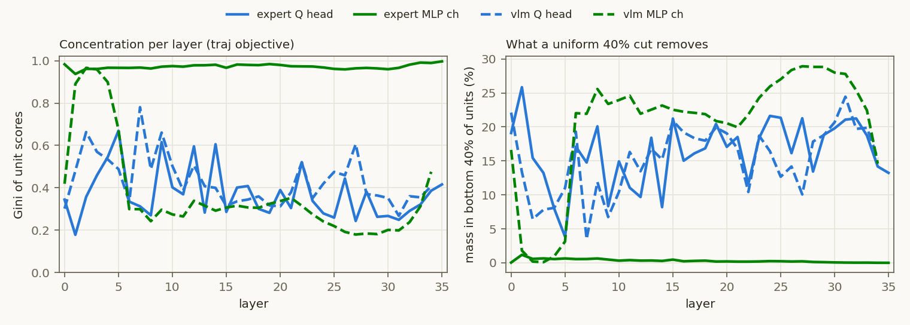

# Experiment: VLM MLP 중요도 편중의 층별 분해

2026-10-29 · 모델 `nvidia/Alpamayo-1.5-10B` · GPU 미사용(저장된 중요도 재분석)
코드 `cvpr27/code/analyze_layer_concentration.py` · 결과 `cvpr27/outputs/layer_concentration/`

## Purpose
- expert에서는 Q head 중요도가 비교적 고르게 퍼져 있고 MLP channel은 소수에 몰려 있다
  (`reports/evaluation/2026-08-28_expert-axis.html`: 하위 50% 유닛이 가진 질량이 Q 24.96%, MLP 0.44%).
  VLM에서도 같은 구조인지 확인한다.
- 전 층을 묶은 답은 이미 있다(`reports/evaluation/2026-08-30_axis-taylor-comparability.html` 3.1절):
  VLM MLP는 Gini 0.369, 하위 50%가 27.39%를 가져 expert와 달리 평평하다.
  이번에 확인할 가설은 **"묶은 통계가 특정 층에만 있는 편중을 가린다"**이다.

## Setup
- 중요도: raw 1차 Taylor(`prune_lib.UnitGates`의 곱셈 게이트), calib_100.
  VLM은 `outputs/importance_v2`, expert는 `outputs/importance_stepexp_sum`(axis 보고서와 같은 조합).
  목적함수 traj(궤적 FM MSE), CoC(추론 NLL).
- 층마다 따로 계산: Gini, 하위 50% 몫, 상위 1% 몫, 질량 50%/90%를 가진 최소 유닛 수,
  `dual_u40_v2`의 균일 층별 절단(하위 39.86% = VLM Q 13/32, MLP 4898/12288)이 지우는 질량.
- VLM은 traj와 CoC의 층별 상위 32개 유닛이 몇 개 겹치는지도 센다.
- VLM 35번 층의 traj 점수는 구조적으로 0이라 중앙값에서 뺀다.

## Results (Facts)

### 층 중앙값

| 축 | Gini | 하위 50% 몫 | 상위 1% 몫 | 질량 50%를 가진 유닛 수 | 균일 40% 절단이 지우는 질량 |
|---|---:|---:|---:|---:|---:|
| expert Q head (16) | 0.342 | 27.01% | 17.07% | 5 | 16.96% |
| **expert MLP ch (8256)** | **0.972** | **0.37%** | **72.97%** | **38** | **0.24%** |
| VLM Q head (32), traj | 0.400 | 22.91% | 11.57% | 8 | 16.44% |
| VLM Q head (32), CoC | 0.377 | 24.53% | 9.97% | 8 | 17.68% |
| VLM MLP ch (12288), traj | 0.306 | 30.09% | 7.19% | 3503 | 22.43% |
| VLM MLP ch (12288), CoC | 0.238 | 34.45% | 5.91% | 4101 | 26.06% |

### VLM MLP 층별 (traj, 괄호는 CoC)

| 층 | Gini | 질량 50%를 가진 채널 수 | 균일 40% 절단이 지우는 질량 | traj∩CoC 상위 32 겹침 |
|---|---|---|---|---|
| 0 | 0.42 (0.44) | 2552 (2304) | 16.61% (16.13%) | 10 |
| 1 | 0.89 (0.89) | 86 (92) | 1.80% (1.83%) | 28 |
| 2 | 0.97 (0.96) | 40 (45) | 0.18% (0.25%) | 26 |
| 3 | 0.96 (0.95) | 48 (79) | 0.10% (0.11%) | 26 |
| 4 | 0.90 (0.89) | 151 (195) | 0.97% (0.95%) | 23 |
| 5 | 0.67 (0.67) | 995 (1038) | 3.13% (3.13%) | 20 |
| 6–16 | 0.24–0.34 | 3202–4074 | 21.9–25.6% | 17–25 |
| 17–24 | 0.24–0.35 | 3081–4070 | 20.0–26.0% | 8–11 |
| 25–33 | 0.18–0.31 | 3385–4599 | 22.4–28.9% | 2–9 |
| 34 | 0.48 (0.42) | 1982 (2406) | 14.60% (17.56%) | 1 |

층별 전체 값은 `cvpr27/outputs/layer_concentration/summary.txt`, `metrics.json`에 있다.

- expert MLP는 36개 층 모두 편중돼 있다(Gini 0.94–1.00).
- VLM MLP는 **1–4번 층만** expert 수준으로 편중돼 있다(Gini 0.89–0.97, 12,288개 중 40–151개 채널이 질량의 절반).
  5번 층은 중간(0.67)이고, 0번 층과 6–34번 층은 평평하다(Gini 0.18–0.48).
- 균일 40% 절단은 VLM 1–4번 층 MLP 질량을 0.1–1.8%만 지우고, 6–33번 층에서는 20–29%를 지운다.
- 1–4번 층의 상위 채널은 traj와 CoC가 거의 같다(상위 32개 중 23–28개 겹침). 겹침은 깊이에 따라 줄어
  25번 층 이후에는 2–9개다.
- Q head는 두 타워 모두 층 중앙값 Gini 0.34–0.40, 하위 50% 몫 23–27%다(완전 균등이면 50%).

## Analysis (Opinion)
- **"VLM MLP는 평평하다"는 결론은 층을 묶었기 때문에 나온 것이다.** 정확한 서술은 "1–4번 층은 expert처럼
  편중, 나머지는 평평"이다. 축이 평평한지 말하기 전에 층별 분포부터 봐야 한다.
- 1–4번 층의 소수 채널이 두 목적에서 같다는 점은 특정 과제의 채널이 아니라 모델 구조에서 나오는 채널임을
  시사한다. LLM에서 보고된 massive activation / super weight(초기 층 `down_proj`)와 같은 현상이라는 것은
  **가설**이고 확인하지 않았다.
- 깊은 층에서 traj와 CoC의 상위 채널이 갈라진다는 것은 dual 기준(두 순위의 max)이 실제로 일을 하는 곳이
  중후반 층이라는 뜻일 수 있다. dual이 유지한 Q head가 전부 traj∪CoC 안에 있다는 기존 관찰("dual의 이득은
  합집합에서 온다")과 연결되는지 확인할 가치가 있다.
- 한계: 1차 Taylor는 MLP 채널 하나하나의 순위를 잘 못 맞춘다(expert probe r=0.33). VLM에서는 이 검증을 한 적이 없다.
  편중의 실재 여부는 아직 실제 제거로 확인하지 않았다.
- 제안하는 다음 단계:
  1. **제거 검증**: 1–4번 층에서 상위 k개, 무작위 k개, 하위 90%를 각각 0으로 만들고 CoC NLL·FM 손실을 잰다(GPU 1장, 1시간 안쪽).
  2. **activation 확인**: 그 채널이 massive activation인지, vision·traj·text 중 어떤 토큰에서 켜지는지 본다(gradient 불필요).
  3. **할당 응용은 신중하게**: 1–4번 층 MLP를 더 깊게 자르는 비균일 할당이 자연스러운 다음 수지만, late-heavy 할당에서
     CoC 붕괴 이력이 있고 "MLP 폭은 공짜"라는 개루프 판정은 폐루프에서 매번 뒤집혔다(`dual+h4` −0.091).
     폐루프 없이 결론 내리지 말 것.
