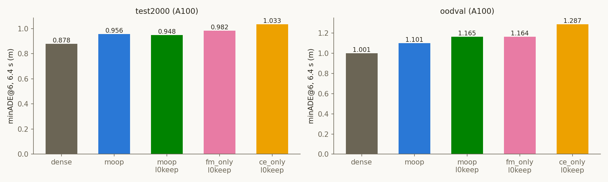

# Experiment: A100에서 FM-only·CE-only (0번 층 Q 보존)

2026-10-30 · 모델 `nvidia/Alpamayo-1.5-10B`(rev `7aba829`) · KISTI NEURON A100-SXM4-80GB
계획 `cvpr27/plans/2026-10-29_a100-fm-ce-only.md` · 코드 `cvpr27/code/`, `experiments/head_analysis/make_slim.py` · 결과 `cvpr27/outputs/a100/`

## Purpose
- MoOP는 층마다 FM 중요도 순위와 CoC 중요도 순위의 최댓값(합집합)으로 남길 유닛을 고른다.
  두 중요도를 하나씩만 쓴 단일 기준 arm(FM-only, CE-only)이 합집합보다 나쁜지를 A100 표 안에서 잰다.
- 0번 층 Q head는 세 arm 모두 보존한다(l0keep, 사용자 결정 2026-10-29).
  0번 층을 자르면 "어떤 head가 잘렸는지"라는 우연이 기준 차이와 섞이기 때문이다. 예전 CE-only의 test500 손해 중 83%가 0번 층 탓이었다.
- FM-only는 마지막 층(35번)만 CoC 중요도로 고른다(사용자 요청). 35번 층은 FM 중요도가 구조적으로 전부 0이라,
  그대로 두면 인덱스 순서대로 남기게 된다.

## Setup
- **arm (모두 u40, 0번 층 Q 32개 보존, 제거 파라미터 2,657,447,936개, expert·KV 그대로):**
  - `moop_l0keep`: `slim_dual_u40_l0keep_v2`, 비교 기준
  - `fm_only_l0keep`: 신규 config `trajlastcoc_u40_l0keep_v2`. 빌드 검증에서 0–34번 층은 `slim_traj_u40_l0keep_v2`와,
    35번 층은 `slim_coc_u40_l0keep_v2`와 유닛 단위로 같았다. 35번 층 선택은 인덱스 순서와 비교해 Q head 13/19,
    MLP 4,435/7,360만 겹친다.
  - `ce_only_l0keep`: `slim_coc_u40_l0keep_v2`
  - 세 arm 모두 `importance_v2`(calib_100)이고, 층별 유닛 수가 같다(1–35번 층 Q 19, MLP 7,359–7,360).
- **세트·프로토콜:** test_2000, OOD-Val262. `run_baseline.py --no-tf`, k=8, 클립별 seed 42, max_gen 256.
  minADE@6은 앞 6샘플의 최솟값이다. 짝지은 Δ에는 부트스트랩 200,000회를 썼다.
- **하드웨어:** NEURON 2장 잡 `953307`(gpu41, 23:54–01:56 KST)과 4장 잡 `953306`(gpu37, 00:51–02:14 KST 작업 완료 후 STOP)이 큐를 나눠 처리했다.
  약 10 A100-시간, 12개 작업 모두 ok.
- **비교 대상:** 10-29에 같은 A100 트랙에서 잰 dense·MoOP·MoOP l0keep 행이다.
  A100끼리는 노드·날짜가 달라도 비트 동일하므로 그대로 짝지을 수 있다.

## Results (Facts)

### 평균 (A100)

| 세트 | arm | minADE@6 1.6 s | 3.2 s | 6.4 s | minFDE@6 1.6 s | 3.2 s | 6.4 s | CoC 퇴화 |
|---|---|---|---|---|---|---|---|---|
| test_2000 | dense | 0.053 | 0.211 | **0.878** | 0.137 | 0.561 | **2.393** | 0.4% |
| test_2000 | moop | 0.061 | 0.238 | **0.956** | 0.155 | 0.623 | **2.559** | 2.2% |
| test_2000 | moop_l0keep | 0.060 | 0.233 | **0.948** | 0.153 | 0.615 | **2.561** | 2.6% |
| test_2000 | fm_only_l0keep | 0.066 | 0.249 | **0.982** | 0.166 | 0.654 | **2.601** | 3.5% |
| test_2000 | ce_only_l0keep | 0.070 | 0.261 | **1.033** | 0.177 | 0.677 | **2.738** | 6.8% |
| OOD-Val262 | dense | 0.065 | 0.259 | **1.001** | 0.175 | 0.685 | **2.497** | 0.4% |
| OOD-Val262 | moop | 0.073 | 0.284 | **1.101** | 0.194 | 0.734 | **2.798** | 4.2% |
| OOD-Val262 | moop_l0keep | 0.077 | 0.304 | **1.165** | 0.206 | 0.795 | **3.017** | 2.3% |
| OOD-Val262 | fm_only_l0keep | 0.081 | 0.316 | **1.164** | 0.220 | 0.817 | **2.958** | 4.6% |
| OOD-Val262 | ce_only_l0keep | 0.095 | 0.361 | **1.287** | 0.254 | 0.932 | **3.107** | 8.8% |

### MoOP l0keep 대비 짝지은 차이 (6.4 s)

| 세트 | arm | Δ minADE@6 [95% CI] | 중앙값 | Δ minFDE@6 [95% CI] | 중앙값 |
|---|---|---|---|---|---|
| test_2000 | fm_only_l0keep | **+0.034 [+0.010, +0.059]** | +0.004 | +0.040 [−0.034, +0.115] | +0.009 |
| test_2000 | ce_only_l0keep | **+0.085 [+0.056, +0.117]** | +0.029 | **+0.176 [+0.088, +0.269]** | +0.051 |
| OOD-Val262 | fm_only_l0keep | −0.001 [−0.167, +0.164] | −0.001 | −0.059 [−0.538, +0.413] | −0.002 |
| OOD-Val262 | ce_only_l0keep | +0.123 [−0.030, +0.261] | +0.054 | +0.090 [−0.378, +0.486] | +0.060 |

### dense 대비 짝지은 차이 (6.4 s, Δ minADE@6)

| 세트 | moop | moop_l0keep | fm_only_l0keep | ce_only_l0keep |
|---|---|---|---|---|
| test_2000 | +0.078 [+0.051, +0.105] | +0.070 [+0.044, +0.095] | +0.104 [+0.072, +0.136] | +0.155 [+0.119, +0.192] |
| OOD-Val262 | +0.101 [+0.011, +0.195] | +0.164 [+0.039, +0.317] | +0.163 [+0.039, +0.309] | +0.287 [+0.158, +0.437] |

### 차이의 구성 (Δ minADE@6, arm − moop_l0keep)

| | test_2000 FM-only | test_2000 CE-only | OOD-Val FM-only | OOD-Val CE-only |
|---|---|---|---|---|
| 상위 10클립을 뺀 평균 | +0.019 | +0.053 | −0.034 | +0.090 |
| 그 arm에서만 CoC가 퇴화한 클립 수 | 51 | 115 | 11 | 22 |
| 그 클립들을 뺀 평균 | +0.014 | +0.039 | −0.076 | +0.063 |
| CoC 문장 일치율(vs moop_l0keep) | 38.2% | 54.6% | 24.8% | 42.0% |
| cruise / accel / decel_stop / turn | +0.021 / +0.048 / +0.091 / +0.019 | +0.080 / +0.069 / +0.041 / +0.156 | −0.050 / +0.417 / −0.398 / +0.329 | +0.107 / +0.148 / +0.165 / +0.091 |

- **test_2000 안의 부분집합:**
  - FM-only는 test500 부분이 −0.024 [−0.060, +0.012], 나머지 1,500클립이 +0.053이다.
  - CE-only는 test500 부분이 +0.111 [+0.052, +0.178], 나머지 1,500클립이 +0.077이다.
- **참고(다른 카드, 짝짓기 아님):** 10-15 Ada test500에서 traj l0keep − dual l0keep은 −0.022(유의하지 않음),
  coc l0keep − dual l0keep은 +0.108이었다. 당시 FM-only는 35번 층을 인덱스 순서로 골랐다.

## Analysis (Opinion)
- **test_2000에서 합집합(MoOP)이 두 단일 기준을 모두 이긴다.**
  - CE-only는 +0.085로 크고 일관되며, 퇴화 클립을 빼도 +0.039가 남는다.
  - FM-only는 +0.034로 작지만 유의하고, 상위 클립이나 퇴화 클립을 빼도 +0.014~+0.019가 남는다.
  - 10-15 메모리에는 "합집합 > FM 단독의 근거는 개루프에 없다"고 적혀 있었다. 이번 결과는 그 근거를 test_2000 규모에서 처음 보여 준다.
- **test500으로는 FM-only 차이가 보이지 않았던 이유:** 이번 test500 부분도 −0.024로 10-15 Ada 결과와 같았다.
  차이는 나머지 1,500클립(+0.053)에서 나왔다. 작은 효과는 2,000클립이 필요하다는 뜻이고,
  앞으로 기준 비교는 test_2000으로 하는 것이 맞다.
- **OOD-Val262는 FM-only를 판단하기에 너무 작다.** 평균은 0이지만 유형별로 ±0.4 m씩 흔들린다.
  CE-only의 +0.123도 CI가 0을 겨우 포함한다.
- **주의:**
  - **중요도 한 벌:** 세 arm 모두 같은 중요도 파일 한 벌로 만들었다. 기준의 차이는 이 한 벌에 대한 관찰이다.
  - **두 요인이 섞임:** FM-only에는 35번 층 처리 변경이 함께 들어 있어, 출하본 FM-only(인덱스 순서)와의 차이는 따로 재지 않았다.
  - **중앙값:** FM-only의 중앙값 차이는 +0.004로 작다. 평균 차이는 넓게 퍼진 소폭 악화와 CoC 퇴화 클립에서 나온다.
- **다음 단계(제안):**
  1. 폐루프(s600)에서 FM-only·CE-only l0keep을 MoOP l0keep과 비교한다.
  2. LingoQA로 언어 능력 쪽 차이를 확인한다(l0keep MoOP는 +8.8 pp였다).
