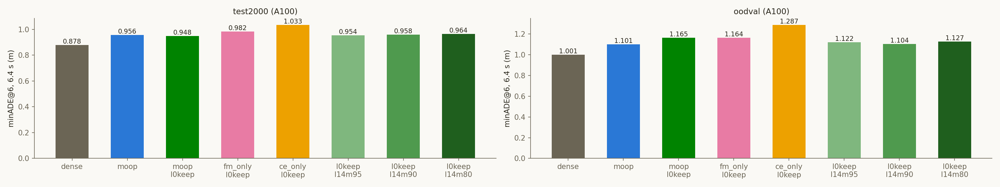

# Experiment: MoOP l0keep + VLM 1–4번 층 MLP 추가 제거 (층별 질량 기준, A100)

2026-10-30 · 모델 `nvidia/Alpamayo-1.5-10B`(rev `7aba829`) · KISTI NEURON A100-SXM4-80GB
계획 `cvpr27/plans/2026-10-30_l0keep-l14-mlp-cut.md` · 코드 `experiments/head_analysis/make_slim.py`(`_l14m<XX>`), `cvpr27/code/` · 결과 `cvpr27/outputs/a100/`

## Purpose
- VLM MLP는 1–4번 층에서만 중요도가 소수 채널에 몰려 있다(`cvpr27/reports/2026-10-29_vlm-mlp-layer-concentration.md`).
  그래서 MoOP l0keep의 균일 절단은 이 층들에서 질량을 0.1–1.9%만 지운다. 6–33번 층에서는 약 28%를 지운다.
- **가설:** 1–4번 층 MLP를 훨씬 더 잘라도 성능이 그대로다. 즉 파라미터를 거의 공짜로 더 줄일 수 있다.
- **사전 등록 판정:** 한 수준을 "공짜"로 부르려면 두 조건을 모두 만족해야 한다.
  - test_2000에서 MoOP l0keep 대비 Δ minADE@6의 95% CI 상한이 +0.02 m 이하
  - LingoQA Δ의 95% CI 하한이 −3 pp 이상

## Setup
- **arm (사용자 결정 2026-10-30: 추가 제거, 층별 질량 기준 95 / 90 / 80% 유지):**
  - MoOP l0keep(`slim_dual_u40_l0keep_v2`)에서 1–4번 층 MLP만 줄인다.
  - 각 층에서는 dual 점수 순서로 채널을 더해 가며, FM·CoC 질량을 **둘 다** XX% 이상 지키는 최소 개수만 남긴다.
  - 그 밖(Q head 전부, 0번·5–35번 층 MLP, expert, KV)은 MoOP l0keep과 유닛 단위로 같다.
  - 남는 채널은 MoOP l0keep 유지 집합의 부분집합이다(빌드 검증 PASS).

  | arm | config | 1–4번 층 유지 채널 | 추가 제거 | 총 압축률 |
  |---|---|---|---|---|
  | MoOP l0keep (기준) | `dual_u40_l0keep_v2` | 7,359 / 7,359 / 7,359 / 7,359 | — | 23.99% |
  | `l0keep_l14m95` | `dual_u40_l0keep_l14m95_v2` | 4,105 / 931 / 1,223 / 2,459 | 254.6M | 26.29% |
  | `l0keep_l14m90` | `dual_u40_l0keep_l14m90_v2` | 1,770 / 419 / 769 / 1,772 | 303.6M | 26.73% |
  | `l0keep_l14m80` | `dual_u40_l0keep_l14m80_v2` | 662 / 181 / 411 / 1,007 | 333.9M | 27.00% |

- **세트·프로토콜:** test_2000, OOD-Val262(`--no-tf`, k=8, 클립별 seed 42, max_gen 256), LingoQA 500문항(Lingo-Judge).
  짝지은 Δ에는 부트스트랩 200,000회를 썼고, LingoQA는 100개 세그먼트를 재표집했다.
- **하드웨어:** NEURON 2장 홀더 잡 4개(`954217` → `954250`, `954216`, `955102`)가 한 큐를 이어서 처리했다.
  14:04–20:39 KST, 약 15 A100-시간, 21개 작업 모두 ok.
  4장 잡 `954216`은 대기 순번을 유지한 채 `scontrol update`로 2장으로 줄였다.
- **비교 대상:** 같은 A100 트랙의 MoOP l0keep·dense 행이다. A100끼리는 노드·날짜가 달라도 비트 동일함을 확인했다.

## Results (Facts)

### 평균 (A100)

| 세트 | arm | minADE@6 1.6 s | 3.2 s | 6.4 s | minFDE@6 1.6 s | 3.2 s | 6.4 s | CoC 퇴화 |
|---|---|---|---|---|---|---|---|---|
| test_2000 | dense | 0.053 | 0.211 | 0.878 | 0.137 | 0.561 | 2.393 | 0.4% |
| test_2000 | MoOP l0keep | 0.060 | 0.233 | **0.948** | 0.153 | 0.615 | 2.561 | 2.6% |
| test_2000 | l14m95 | 0.060 | 0.235 | **0.954** | 0.154 | 0.618 | 2.576 | 2.5% |
| test_2000 | l14m90 | 0.060 | 0.236 | **0.958** | 0.155 | 0.623 | 2.578 | 2.6% |
| test_2000 | l14m80 | 0.060 | 0.237 | **0.964** | 0.155 | 0.624 | 2.592 | 3.0% |
| OOD-Val262 | dense | 0.065 | 0.259 | 1.001 | 0.175 | 0.685 | 2.497 | 0.4% |
| OOD-Val262 | MoOP l0keep | 0.077 | 0.304 | **1.165** | 0.206 | 0.795 | 3.017 | 2.3% |
| OOD-Val262 | l14m95 | 0.075 | 0.296 | **1.122** | 0.201 | 0.765 | 2.920 | 3.4% |
| OOD-Val262 | l14m90 | 0.074 | 0.291 | **1.104** | 0.198 | 0.753 | 2.866 | 4.2% |
| OOD-Val262 | l14m80 | 0.075 | 0.295 | **1.127** | 0.202 | 0.769 | 2.917 | 4.2% |

### MoOP l0keep 대비 짝지은 차이 (Δ minADE@6, 95% CI)

| 세트 | arm | 1.6 s | 3.2 s | 6.4 s | 6.4 s 중앙값 | 상위 5클립을 뺀 6.4 s 평균 | CoC 문장 일치 |
|---|---|---|---|---|---|---|---|
| test_2000 | l14m95 | +0.000 [−0.000, +0.001] | +0.001 [−0.001, +0.004] | **+0.006 [−0.004, +0.017]** | −0.000 | +0.003 | 92.0% |
| test_2000 | l14m90 | +0.000 [−0.000, +0.001] | +0.003 [−0.000, +0.006] | **+0.010 [−0.001, +0.021]** | +0.000 | +0.005 | 90.2% |
| test_2000 | l14m80 | +0.001 [−0.000, +0.002] | +0.003 [−0.000, +0.008] | **+0.016 [−0.001, +0.034]** | +0.000 | +0.005 | 88.6% |
| OOD-Val262 | l14m95 | −0.002 [−0.005, +0.000] | −0.008 [−0.021, +0.002] | −0.042 [−0.089, −0.007] | −0.003 | −0.003 | 90.1% |
| OOD-Val262 | l14m90 | −0.003 [−0.011, +0.002] | −0.013 [−0.043, +0.009] | −0.061 [−0.173, +0.018] | −0.001 | −0.012 | 87.0% |
| OOD-Val262 | l14m80 | −0.002 [−0.009, +0.005] | −0.009 [−0.037, +0.014] | −0.037 [−0.157, +0.051] | +0.002 | +0.017 | 83.2% |

- **OOD-Val의 음수 Δ:** 세 arm 모두, Δ가 가장 큰 5클립 중 4개가 MoOP l0keep이 MoOP보다 나빴던 꼬리 클립(decel_stop)이다.
  그 5클립을 빼면 Δ는 −0.003 / −0.012 / +0.017이다.
- **minFDE@6 6.4 s Δ:** test_2000에서 +0.014 / +0.016 / +0.030, OOD-Val에서 −0.097 / −0.151 / −0.100이다(CI는 `table/metrics.json`).

### LingoQA (500문항)

| arm | 정확도 | dense 대비 | MoOP l0keep 대비 [95% CI] | "현재 행동" 질문 | 나머지 400문항 | 128토큰 잘림 |
|---|---|---|---|---|---|---|
| dense | 72.6% | — | — | — | — | 0.0% |
| MoOP l0keep | 75.4% | +2.8 pp | — | 79/100 | 298/400 | 31.4% |
| l14m95 | 71.8% | −0.8 pp [−5.8, +4.0] | **−3.6 pp [−7.4, +0.2]** | 80/100 | 279/400 | 36.2% |
| l14m90 | 71.4% | −1.2 pp [−5.6, +3.2] | **−4.0 pp [−7.2, −0.8]** | 78/100 | 279/400 | 32.8% |
| l14m80 | 69.4% | −3.2 pp [−8.6, +2.2] | **−6.0 pp [−9.6, −2.4]** | 80/100 | 267/400 | 40.8% |

### 사전 등록 판정

| arm | 주행 (test_2000 CI 상한 ≤ +0.02) | LingoQA (CI 하한 ≥ −3 pp) | 판정 |
|---|---|---|---|
| l14m95 | +0.017 ✓ | −7.4 ✗ | 공짜 아님 |
| l14m90 | +0.021 ✗(근소) | −7.2 ✗ | 공짜 아님 |
| l14m80 | +0.034 ✗ | −9.6 ✗ | 공짜 아님 |

### 참고: 같은 방향의 다른 실험 (다른 카드·세트, 짝짓기 아님)
- `cvpr27/plans/2026-10-29_early-mlp-cut.md`의 A10은 1–4번 층을 층마다 1,229개(10%)씩 남긴다(+2.72%p, l14m90과 비슷한 절감량).
- Ada test500에서 l0keep 대비 −0.006 [−0.029, +0.017]이었다(같은 세션의 손실 검증: FM 공짜, NLL 판단 보류).

## Analysis (Opinion)
- **주행은 거의 공짜에 가깝지만 언어는 아니다.**
  - test_2000에서 절단량에 따라 평균이 조금씩 나빠진다(+0.006 → +0.010 → +0.016). 중앙값과 1.6 s 차이는 사실상 0이다.
  - 95%까지는 사전 등록 주행 기준을 만족한다.
  - 하지만 LingoQA는 세 수준 모두 MoOP l0keep보다 3.6–6.0 pp 낮고, 하한이 −3 pp 기준을 넘는다.
  - 그래서 "1–4번 층 MLP는 공짜"라는 가설은 이번 기준으로는 **기각**이다.
- **언어 손실은 장면 질문에서 나온다.**
  - "현재 행동" 질문(주행과 같은 종류)은 78–80/100으로 그대로다.
  - 손실은 전부 나머지 400문항(물체 수, 장면 묘사 등)에서 나온다(298 → 279 / 279 / 267).
  - 1–4번 층의 하위 채널이 1차 Taylor로 잰 주행·CoC 목적에는 거의 기여하지 않는다.
    그러나 calibration에 없는 일반 시각 질의응답에는 쓰인다고 보는 것이 자연스럽다.
    중요도를 잰 목적과 평가한 능력이 다를 때 질량 기준이 과소평가한다는 사례다.
- **dense 대비로는 언어가 여전히 비슷하다.** MoOP l0keep이 LingoQA에서 dense보다 높았던 것(+2.8 pp)이 원래 이례적이었다.
  1–4번 층 절단 arm들은 dense 수준(−0.8 ~ −3.2 pp, CI가 0 포함)으로 돌아온 것이기도 하다.
  "MoOP l0keep 대비"를 기준으로 삼은 판정이 엄격한 셈이다.
- **OOD-Val의 개선처럼 보이는 결과는 개선이 아니다.** MoOP l0keep의 꼬리 5클립이 작은 변화에도 뒤집히는 불안정한 클립이라는 뜻이다.
- **다음 단계(제안):**
  1. 95% 수준을 dense 대비 기준으로 다시 볼지, 즉 판정 기준 자체를 정한다.
  2. LingoQA 손실을 줄이려면 1–4번 층 중요도에 VQA 목적(이미 있는 `importance_vqa`)을 더하는 방법이 있다.
  3. 폐루프는 언어 손실이 해결되기 전에는 우선순위가 낮다.
