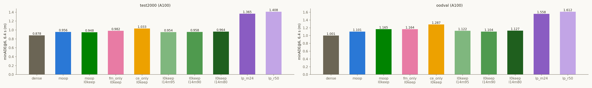

# Experiment: LLM-Pruner를 MoOP와 같은 제거량으로 (A100)

2026-10-31 · 모델 `nvidia/Alpamayo-1.5-10B`(rev `7aba829`) · KISTI NEURON A100-SXM4-80GB
계획 `cvpr27/plans/2026-10-30_llm-pruner-budget-matched.md` · 빌드 `experiments/llm_pruner/lp_prune.py` ·
평가 `cvpr27/code/eval_a100.sbatch`, `analyze_a100.py` · 결과 `outputs/cvpr27/a100/{lp_m24,lp_r50}_*`, `lingo_vqa*_lp_*`

## Purpose
- 논문과 기존 표의 LLM-Pruner 기준선 `lp_r50`은 모델의 24.99%를 지운다. MoOP(`dual_u40_v2`)는 23.99%다.
  1.1억 개를 더 지운 상태로 비교해 왔다.
- 원본 LLM-Pruner의 빌드 절차는 그대로 두고 **제거 파라미터 수만 MoOP와 정확히 같게** 만든 arm(`lp_m24`)을
  A100 표(test_2000, OOD-Val262, LingoQA) 안에서 dense·MoOP·MoOP l0keep과 짝지어 잰다.
- 기존 `lp_r50`도 다시 빌드해 같은 표에서 잰다. 다시 빌드한 것이 기존 모델과 같은지가 빌드 경로의 재현 게이트다.

## Setup
- **빌드 (사용자 결정 2026-10-30):**
  - (A) 이식판의 Q head 단위를 쓴다(q 행 + o 열, k/v 고정). 공식 GQA 경로(`llama3.py`)의 KV 그룹 단위는
    expert가 VLM KV 8개를 모두 읽어서 쓸 수 없다.
  - 중요도는 soowon `lp_importance_v1`의 `coc_param_first`를 그대로 쓴다. 원본 LLM-Pruner의 Taylor `param_first`, 그룹 합이고,
    손실은 모델이 생성한 CoC 구간의 teacher-forced 교차 엔트로피다(궤적 손실 없음). 보정은 `calib_100`이고 MoOP와 같다.
    복사본 `outputs/cvpr27/lp_importance_v1`의 sha256이 원본과 같다.
  - 층 범위는 원본 규칙대로 앞 4개·뒤 2개를 뺀 4–33번(30개 층)이다. 층 안에서만 비교하고 1회에 자른다. LoRA 복원은 없다.
  - **`lp_m24`:** 층마다 Q head 15개, MLP 5,928개를 지우고 4–27번 층에서만 MLP를 하나 더 지운다
    (`--units qhead:15,mlp:5928 --mlp-extra-layers 24`). 제거량 2,657,452,032개는 MoOP와 정확히 같다.
  - **`lp_r50`:** 원래 설정(ratio 0.5: 층마다 Q head 16개, MLP 6,144개, 2,768,240,640개 = 24.99%).
- **빌드 검증 (Ada 5번 카드, 10-31 05:26 KST):**
  - 다시 빌드한 `lp_r50`은 soowon `lp_r50`과 두 타워 모두 유닛 단위로 같다(제거량도 같음).
  - `lp_m24`는 0–3·34–35번 층과 expert를 건드리지 않았다. `lp_r50`이 남기는 유닛을 모두 남긴다.
  - 기록: `outputs/cvpr27/llm_pruner_matched/gate.txt`.
- **층별 구조 비교:**

| arm | 자르는 층 | 층당 Q head 제거 | 층당 MLP 제거 | 제거 파라미터 |
|---|---|---|---|---|
| MoOP | 0–35 (36개) | 13 | 4,898 | 2,657,452,032 |
| MoOP l0keep | 1–35 (0번 층 Q 보존) | 13 | 4,928–4,929 | 2,657,447,936 |
| `lp_m24` | 4–33 (30개) | 15 | 5,928–5,929 | 2,657,452,032 |
| `lp_r50` | 4–33 (30개) | 16 | 6,144 | 2,768,240,640 |

- **세트·프로토콜:** A100 트랙과 같다. `run_baseline.py --no-tf`, k=8, 클립별 seed 42, max_gen 256.
  minADE@6은 앞 6샘플의 최솟값이다. 짝지은 Δ에는 부트스트랩 200,000회를 썼다.
  LingoQA는 500문항, Lingo-Judge이고, CI는 100개 세그먼트를 재표집했다.
- **실행:** 2장 잡 `956270`·`956271`(gpu40, 14:26–17:10 KST)이 큐를 나눠 처리했다. 14개 작업 모두 ok, 약 11 A100-시간.
  dense·MoOP·MoOP l0keep·CE-only 행은 10-29/10-30에 같은 트랙에서 잰 것이다.
  A100끼리는 노드·날짜가 달라도 비트 동일하다.

## Results (Facts)

### 평균 (A100)

| 세트 | arm | minADE@6 1.6 s | 3.2 s | 6.4 s | minFDE@6 1.6 s | 3.2 s | 6.4 s | CoC 퇴화 |
|---|---|---|---|---|---|---|---|---|
| test_2000 | dense | 0.053 | 0.211 | **0.878** | 0.137 | 0.561 | **2.393** | 0.4% |
| test_2000 | MoOP | 0.061 | 0.238 | **0.956** | 0.155 | 0.623 | **2.559** | 2.2% |
| test_2000 | MoOP l0keep | 0.060 | 0.233 | **0.948** | 0.153 | 0.615 | **2.561** | 2.6% |
| test_2000 | CE-only l0keep | 0.070 | 0.261 | **1.033** | 0.177 | 0.677 | **2.738** | 6.8% |
| test_2000 | **lp_m24** | 0.099 | 0.359 | **1.365** | 0.253 | 0.926 | **3.604** | 17.0% |
| test_2000 | lp_r50 | 0.103 | 0.373 | **1.408** | 0.264 | 0.963 | **3.738** | 15.6% |
| OOD-Val | dense | 0.065 | 0.259 | **1.001** | 0.175 | 0.685 | **2.497** | 0.4% |
| OOD-Val | MoOP | 0.073 | 0.284 | **1.101** | 0.194 | 0.734 | **2.798** | 4.2% |
| OOD-Val | MoOP l0keep | 0.077 | 0.304 | **1.165** | 0.206 | 0.795 | **3.017** | 2.3% |
| OOD-Val | CE-only l0keep | 0.095 | 0.361 | **1.287** | 0.254 | 0.932 | **3.107** | 8.8% |
| OOD-Val | **lp_m24** | 0.125 | 0.442 | **1.558** | 0.325 | 1.127 | **3.876** | 15.3% |
| OOD-Val | lp_r50 | 0.132 | 0.470 | **1.612** | 0.344 | 1.203 | **4.010** | 17.2% |

### 짝지은 차이 (6.4 s, 평균 [95% CI], 중앙값)

| 세트 | arm | 기준 | Δ minADE@6 | 중앙값 | Δ minFDE@6 | 중앙값 |
|---|---|---|---|---|---|---|
| test_2000 | lp_m24 | MoOP | +0.409 [+0.347, +0.474] | +0.153 | +1.045 [+0.859, +1.242] | +0.337 |
| test_2000 | lp_m24 | MoOP l0keep | +0.417 [+0.356, +0.482] | +0.157 | +1.043 [+0.858, +1.238] | +0.329 |
| test_2000 | lp_r50 | MoOP | +0.452 [+0.390, +0.518] | +0.159 | +1.179 [+0.993, +1.373] | +0.389 |
| test_2000 | lp_r50 | lp_m24 | +0.043 [−0.002, +0.090] | +0.019 | +0.133 [−0.008, +0.273] | +0.062 |
| OOD-Val | lp_m24 | MoOP | +0.456 [+0.301, +0.628] | +0.202 | +1.078 [+0.691, +1.505] | +0.520 |
| OOD-Val | lp_m24 | MoOP l0keep | +0.393 [+0.213, +0.578] | +0.192 | +0.859 [+0.363, +1.347] | +0.449 |
| OOD-Val | lp_r50 | MoOP | +0.511 [+0.353, +0.686] | +0.216 | +1.212 [+0.787, +1.670] | +0.513 |
| OOD-Val | lp_r50 | lp_m24 | +0.054 [−0.038, +0.148] | +0.031 | +0.134 [−0.131, +0.398] | +0.062 |

dense 대비: `lp_m24` test_2000 +0.487 [+0.422, +0.555], OOD-Val +0.557 [+0.384, +0.747];
`lp_r50` +0.530 [+0.464, +0.600], +0.611 [+0.433, +0.806].

### LingoQA (500문항, Lingo-Judge)

| arm | 정확도 | dense 대비 | MoOP 대비 | MoOP l0keep 대비 |
|---|---|---|---|---|
| dense | 72.6% | — | — | — |
| MoOP | 66.6% | −6.0 pp [−10.8, −1.2] | — | — |
| MoOP l0keep | 75.4% | +2.8 pp [−1.8, +7.4] | — | — |
| CE-only l0keep | 70.4% | −2.2 pp [−6.4, +2.0] | — | −5.0 pp [−10.0, −0.2] |
| **lp_m24** | **53.4%** | −19.2 pp [−24.6, −14.0] | −13.2 pp [−18.8, −7.8] | −22.0 pp [−27.6, −16.4] |
| lp_r50 | 45.4% | −27.2 pp [−32.8, −21.8] | −21.2 pp [−27.0, −15.6] | −30.0 pp [−35.6, −24.6] |

`lp_r50` − `lp_m24`: −8.0 pp [−13.0, −3.0].

## Analysis (Opinion)
- **제거량을 맞춰도 LLM-Pruner는 MoOP에 크게 진다.** 주행(minADE@6 6.4 s)에서 test_2000 +0.41 m, OOD-Val +0.39–0.46 m,
  LingoQA에서 −13–22 pp다. 모든 CI가 0과 멀리 떨어져 있다. 기존 표의 격차는 1%p 더 지운 탓이 아니었다.
- **1%p(1.1억 개)를 더 지운 값은 주행에서는 작고 언어에서는 크다.** `lp_r50` − `lp_m24`는 주행 +0.04–0.05 m(경계,
  CI가 0을 겨우 포함)인데 LingoQA는 −8.0 pp다. 그래서 논문의 기존 `lp_r50` 행은 LingoQA 격차를 약 8 pp 부풀려 왔다.
  공정 비교에는 `lp_m24`를 써야 한다.
- **차이가 어디서 오는가 (미분리).** `lp_m24`와 MoOP는 두 축에서 다르다.
  1. **기준:** CoC 교차 엔트로피만 쓰는가, CoC와 FM 순위의 합집합인가.
  2. **층 배치:** 같은 예산을 30개 층(4–33)에 몰아 층마다 더 깊게 자르는가(Q 15, MLP 5,929),
     36개 층에 나눠 얕게 자르는가(Q 13, MLP 4,898). 둘 다 층 안에서는 같은 수를 자르는 균등 배분이다.
  - 같은 표의 CE-only l0keep은 기준이 `lp_m24`와 같은 축(CoC만)인데 1.033으로 `lp_m24`보다 0.33 m 좋다.
    다만 CE-only는 층 배치(36층, 얕게)와 추정 방식(우리 `prune_lib`)이 둘 다 다르므로 이것만으로 층 배치 탓이라고 할 수 없다.
- **추론 퇴화가 함께 온다.** CoC 퇴화율이 15–17%로 MoOP(2–4%)의 4–8배다. 개루프 손해와 LingoQA 손해가 같은 방향이다.
- **다음 단계 제안:**
  1. 같은 LLM-Pruner 구조에 `dual_param_first`(층마다 `max(rank(traj), rank(coc))`, MoOP와 같은 결합)를 넣은 arm.
     중요도는 이미 계산돼 있다. `lp_m24`와 비교하면 기준의 효과, MoOP와 비교하면 층 배치·추정 방식의 효과가 나온다.
  2. 논문 표의 LLM-Pruner 행을 `lp_m24`로 바꾸고, `lp_r50`은 "원래 설정(24.99%)"으로 부록에 둔다.
