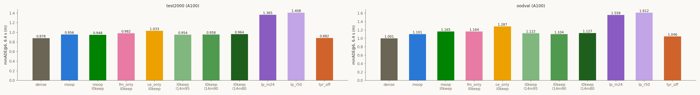
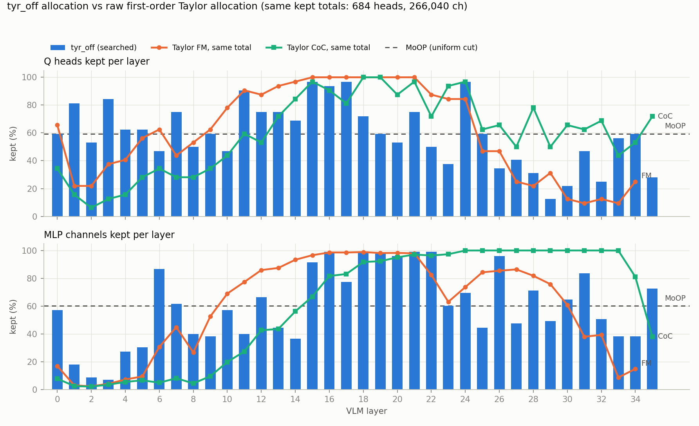
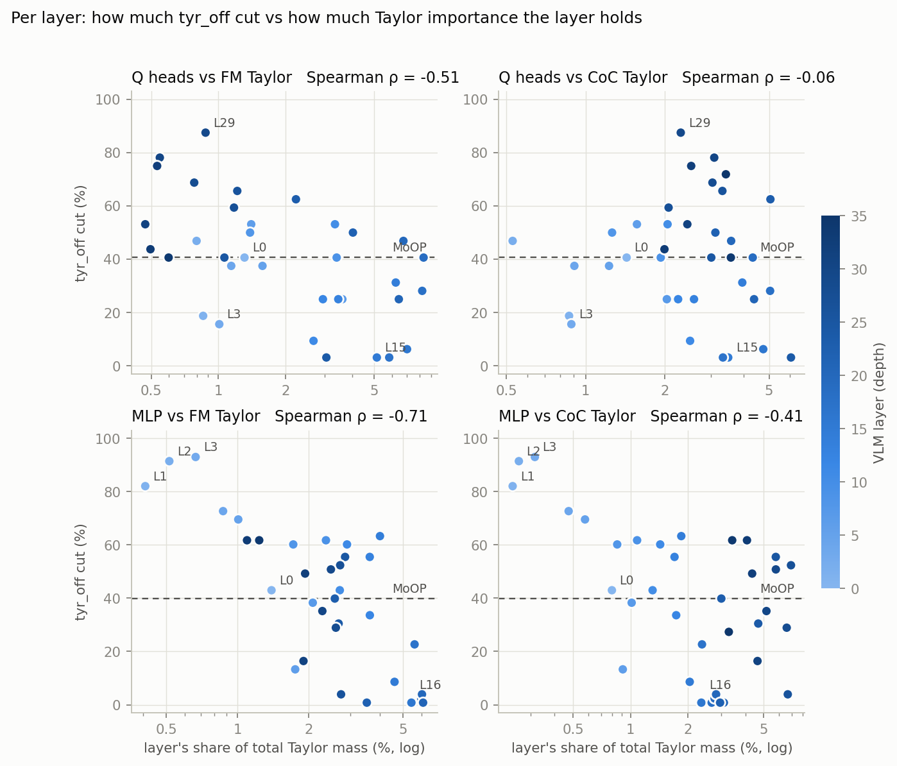

# Experiment: Tyr-the-Pruner를 공식 절차대로 다시 빌드해 A100에서 평가 (`tyr_off`)

2026-11-01 · 모델 `nvidia/Alpamayo-1.5-10B`(rev `7aba829`) · 빌드 cvlab21 RTX PRO 5000 Blackwell ×4, 평가 KISTI NEURON A100-SXM4-80GB
계획 `cvpr27/plans/2026-10-31_tyr-a100.md` · 코드 `cvpr27/code/tyr_off/` · 결과 `outputs/cvpr27/tyr_off/`, `outputs/cvpr27/slim_tyr_off`,
`outputs/cvpr27/a100/{tyr_off_*,lingo_vqa*_tyr_off}`

## Purpose
- 논문 Tyr 행(`tyr_u40_r`)은 이 레포의 간이 포트였다(반복 1회, 작은 탐색, CoC 위치 KL + expert MSE 적합도, 중앙 수준 오차 누적).
  공식 레포 절차를 따른 Tyr를 MoOP와 같은 제거량에서 빌드해 A100 표(test_2000, OOD-Val262, LingoQA)로 잰다.
- 사용자 결정(2026-10-31): 보정·적합도 데이터는 calib_100(MoOP·LLM-Pruner와 같음), 오차 누적은 논문 식 5, supernet·탐색 4회.

## Setup
- **공식과 같은 것:**
  - 절단 단위: o_proj 입력 열(Q head), down_proj 입력 열(MLP 채널). k/v는 안 건드림.
  - 수준별 OSSCAR 풀이: 포트가 공식 `LocalPruner`와 **비트 단위로 같음**(G0, `check_osscar_vs_official.py`).
  - 수준 격자: 9수준, 간격 = 모듈의 12.5%에서 반복마다 절반(head 4→2→1→1, MLP 1,536→768→384→192).
  - 탐색: (1+λ) 진화, 세대 50 × 자손 128 × 4회, 변이 min(U[1,4], U[1,4]), 같은 유형끼리만 이동, 생존 16/4/2, 마지막 단계에 부모 포함.
  - 적합도: dense 대비 top-8,192 sparse KL, 위치 가중 평균.
- **공식과 다른 것:**
  - 보정 데이터: FineWeb-Edu 대신 calib_100 fused prompt(클립당 3,102토큰, 93% 비전).
  - KL 위치: 텍스트 위치. 클립당 173개 = 프롬프트 텍스트 157 + dense 자신의 CoC 16.
  - 선택 단계: 2,048/16,384/131,072 토큰을 1/5/42 클립으로 환산.
  - 오차 누적: 논문 식 5(모든 수준의 (1 − Sₑ) 가중 평균). 공식 코드에서 켜져 있는 쪽은 버그로 꺼진 것과 같다.
- **예산:** 시작 s = 0.39856 → 층당 Q head 13개·MLP 4,898개 절단 = MoOP와 같은 2,657,452,032. 4회 모두 유지 총량 불변
  (Q head 684/1,152, MLP 266,040/442,368).
- **빌드:** cvlab21 Blackwell 0–3, 2026-10-31 20:19 → 11-01 02:34 KST.
  - supernet: R=1은 34분. R=2–4는 26분(보정 블록 직후 forward를 멈춤, 매 실행 0번 블록에서 전체 forward와 헤시안 비트 일치 확인).
  - 탐색: 라운드당 약 63분.
  - NEURON 빌드 잡은 대기열에서 시작되지 않아 사용자 결정으로 취소했다.
- **평가:** A100 트랙 프로토콜 그대로. `run_baseline.py --no-tf`, k=8, 클립별 seed 42, max_gen 256. 짝지은 Δ는 부트스트랩 200,000회.
  LingoQA 500문항(Lingo-Judge, 세그먼트 재표집 CI). 2장 잡 `957099`·`957100`(03:14–04:27 KST), 작업 7개 모두 ok.
  dense·MoOP·LLM-Pruner 행은 같은 A100 트랙의 앞선 측정이다.

## Results (Facts)

### 빌드 경과

| 라운드 | 간격 (head / 채널) | 기준점 KL (100클립) | 탐색 후 적합도 (42클립) | 기준점 최대 가중치 크기 (dense 대비) |
|---|---|---|---|---|
| R=1 | 4 / 1,536 | 2.108 | 0.218 | 159× (3번 층 o_proj) |
| R=2 | 2 / 768 | 2.045 | 0.197 | — |
| R=3 | 1 / 384 | 0.223 | 0.234 | — |
| R=4 | 1 / 192 | 0.209 | 0.190 | 2.61× (2번 층 o_proj) |

- 최종 구성에서 가장 큰 가중치 크기는 35번 층 o_proj의 3.45×다. R=4 supernet 전체에서는 613개 (모듈, 수준) 중 25개가 2× 초과다.
- 최종 층별 유지 수:
  - Q head는 4–31개다(29번 층 4개, 0번 층 19개 = MoOP와 같음, 15·17·24번 층 31개).
  - MLP는 1–3번 층이 862–2,206개만 남고, 16·18·21·22번 층은 12,190개가 남는다.

### 개루프 평균 (A100)

| 세트 | arm | minADE@6 1.6 s | 3.2 s | 6.4 s | minFDE@6 1.6 s | 3.2 s | 6.4 s | CoC 퇴화 |
|---|---|---|---|---|---|---|---|---|
| test_2000 | dense | 0.053 | 0.211 | **0.878** | 0.137 | 0.561 | **2.393** | 0.4% |
| test_2000 | MoOP | 0.061 | 0.238 | **0.956** | 0.155 | 0.623 | **2.559** | 2.2% |
| test_2000 | MoOP l0keep | 0.060 | 0.233 | **0.948** | 0.153 | 0.615 | **2.561** | 2.6% |
| test_2000 | LLM-Pruner `lp_m24` | 0.099 | 0.359 | **1.365** | 0.253 | 0.926 | **3.604** | 17.0% |
| test_2000 | **tyr_off** | 0.059 | 0.221 | **0.882** | 0.149 | 0.569 | **2.394** | 1.1% |
| OOD-Val | dense | 0.065 | 0.259 | **1.001** | 0.175 | 0.685 | **2.497** | 0.4% |
| OOD-Val | MoOP | 0.073 | 0.284 | **1.101** | 0.194 | 0.734 | **2.798** | 4.2% |
| OOD-Val | MoOP l0keep | 0.077 | 0.304 | **1.165** | 0.206 | 0.795 | **3.017** | 2.3% |
| OOD-Val | LLM-Pruner `lp_m24` | 0.125 | 0.442 | **1.558** | 0.325 | 1.127 | **3.876** | 15.3% |
| OOD-Val | **tyr_off** | 0.074 | 0.287 | **1.046** | 0.197 | 0.751 | **2.569** | 2.7% |

### 짝지은 차이 (6.4 s, 평균 [95% CI], 중앙값)

| 세트 | tyr_off − | Δ minADE@6 | 중앙값 | Δ minFDE@6 | 중앙값 |
|---|---|---|---|---|---|
| test_2000 | dense | +0.004 [−0.021, +0.028] | +0.006 | +0.001 [−0.077, +0.079] | +0.009 |
| test_2000 | MoOP | **−0.075 [−0.101, −0.048]** | −0.041 | **−0.165 [−0.254, −0.076]** | −0.081 |
| test_2000 | MoOP l0keep | **−0.066 [−0.091, −0.042]** | −0.040 | **−0.167 [−0.250, −0.084]** | −0.072 |
| OOD-Val | dense | +0.046 [−0.021, +0.112] | +0.025 | +0.072 [−0.133, +0.269] | +0.077 |
| OOD-Val | MoOP | −0.055 [−0.154, +0.038] | −0.039 | −0.228 [−0.518, +0.029] | −0.030 |
| OOD-Val | MoOP l0keep | **−0.118 [−0.257, −0.002]** | −0.043 | **−0.448 [−0.871, −0.103]** | −0.147 |

### LingoQA (500문항, Lingo-Judge)

| arm | 정확도 | dense 대비 | MoOP 대비 | MoOP l0keep 대비 | 답변 중앙 길이 |
|---|---|---|---|---|---|
| dense | 72.6% | — | — | — | 22 단어 |
| MoOP | 66.6% | −6.0 pp [−10.8, −1.2] | — | — | 35 단어 |
| MoOP l0keep | 75.4% | +2.8 pp [−1.8, +7.4] | — | — | — |
| LLM-Pruner `lp_m24` | 53.4% | −19.2 pp | −13.2 pp | −22.0 pp | — |
| **tyr_off** | **38.0%** | −34.6 pp [−39.4, −29.6] | −28.6 pp [−34.0, −23.2] | −37.4 pp [−42.4, −32.6] | 12 단어 |

- tyr_off의 가장 흔한 답변: "Low" 68회, "I" 43회, "2," 24회, "2" 17회. 한 단어로 끊기거나 숫자만 나온다.
- 참고(Ada, 다른 하드웨어): 기존 포트 `tyr_u40_r`의 LingoQA는 34.2%였고, 항상 "No"라고 답하면 37.0%다.

## Analysis (Opinion)
- **주행에서는 공식 절차의 Tyr가 MoOP를 이긴다.**
  - 24% 제거에도 test_2000이 dense와 구별되지 않는다(+0.004, CI가 0 포함). MoOP보다 0.075 m(MoOP l0keep보다 0.066 m) 좋고, 유의하다.
  - OOD-Val에서도 dense에 가깝고(+0.046 n.s.), MoOP l0keep보다 유의하게 좋다.
  - 기존 간이 포트(Ada test500에서 MoOP와 동률)보다 분명히 좋아졌다. 다만 하드웨어와 세트가 달라 직접 비교는 아니다.
- **대신 언어 능력은 무너진다.** LingoQA 38.0%는 "항상 No" 수준이다. 답변이 한 단어로 끊긴다.
  - 주행 프롬프트에서는 CoC 퇴화가 1–3%로 낮다. 그래서 생성 능력 전체가 아니라 보정 데이터(주행 fused prompt)와 다른 입력에서만 무너진 것이다.
  - 재구성(o_proj·down_proj를 calib_100 헤시안에 맞춰 다시 씀)이 주행 분포에 과적합한 것으로 본다.
  - "능력 보존 = 그 능력의 데이터를 fit에" 관찰(dualr_wl: LingoQA train을 Hessian에 넣자 41.8→72.6%)과 같은 방향이다.
- **MoOP와의 대비가 논문 서술을 바꾼다.** 이전 표의 "Tyr ≈ MoOP(주행)"는 간이 포트의 결과였다.
  공식 절차의 Tyr는 주행 개루프에서 MoOP보다 낫고 언어에서 훨씬 나쁘다. MoOP는 선택만 하고 가중치를 다시 쓰지 않는 방법이므로,
  "재구성 없이 두 능력을 함께 지킨다"가 비교의 축이 된다.
- **수치 폭주는 공식 감쇠값(1e-2)의 결과다.** 비전 위주 헤시안이 거의 특이해서 생긴다.
  - 탐색이 폭주한 수준을 피해 최종 구성은 최대 3.45×다.
  - 다만 R=1·R=2 탐색은 폭주 회피에 상당 부분을 썼을 수 있다.
- **다음 단계 제안:**
  1. 폐루프(s600)에서 tyr_off를 측정한다. 개루프 이점이 폐루프로 이어지는지, CoC 침묵이 운전에 영향을 주는지 본다.
     로컬 Ada/Blackwell 또는 KISTI 폐루프(스모크 통과)로 할 수 있다.
  2. LingoQA를 보존하려면 보정 데이터에 LingoQA를 섞은 Tyr 변형(calib_100 + LingoQA train)을 빌드한다.
     dualr_wl과 같은 처방이고, 공식 절차와는 데이터만 다르다.
  3. 논문 Tyr 행을 tyr_off로 교체할지, 두 행(간이 포트·공식 절차)을 함께 둘지 결정한다.

## 추가 분석: tyr_off 층별 배분과 Taylor 중요도 (2026-11-01)

`cvpr27/code/analyze_tyr_allocation.py` → `outputs/cvpr27/tyr_off_allocation/`. Taylor는 `importance_v2`(calib_100, 1차, 원값)이고,
traj = FM, coc = CoC CE다. Tyr는 Taylor를 쓰지 않는다(선택은 OSSCAR 헤시안, 배분은 텍스트 KL 탐색).
traj 통계에서 35번 층은 제외했다(점수가 구조적으로 0).

그림은 `cvpr27/code/plot_tyr_allocation.py`로 그렸다(`outputs/cvpr27/tyr_off_allocation/`).

### Facts

| 비교 | traj Q | CoC Q | traj MLP | CoC MLP |
|---|---|---|---|---|
| 층 간: 절단 비율 vs 층 Taylor 질량 (Spearman ρ) | −0.51 | −0.06 | **−0.71** | −0.41 |
| 층 간: 절단 비율 vs 층 Gini | −0.08 | +0.19 | +0.23 | +0.36 |
| 배분: 같은 총량의 전역 Taylor 상위 배분과 층별 유지 수 (ρ) | +0.51 | +0.12 | **+0.70** | +0.46 |
| 층 안: Taylor 상위 k와 겹치는 비율 (우연 기대값) | 0.79 (0.60) | 0.69 (0.59) | 0.75 (0.60) | 0.75 (0.60) |
| 남긴 Taylor 질량: tyr_off | 0.836 | **0.695** | 0.797 | 0.712 |
| 남긴 Taylor 질량: MoOP | 0.827 | **0.794** | 0.761 | 0.723 |
| 남긴 Taylor 질량: 층별 top-k 상한(tyr 유지 수) | 0.879 | 0.797 | 0.836 | 0.779 |

- Tyr가 남긴 유닛 중 MoOP도 남긴 비율은 Q 76.2%, MLP 74.8%다(우연 59–60%).
- 주요 층의 유지 수 (tyr / 전역 traj Taylor / 전역 CoC Taylor):

| 층 | Q head | MLP 채널 |
|---|---|---|
| 0 | 19 / 21 / 11 | 7,006 / 2,078 / 961 |
| 1–3 | 26·17·27 / 7·7·12 / 5·2·4 | 2,206·1,054·862 / 371·288·506 / 305·260·430 |
| 16·18·21 | 30·23·24 / 32·32·32 / 29·32·31 | 12,190 / 12,115–12,150 / 10,031–11,931 |
| 29·30·32 | 4·7·8 / 10·4·4 / 16·21·22 | 6,046·7,966·6,238 / 9,313·7,483·4,825 / 12,288 |

### Analysis (Opinion)
- **배분의 모양은 FM(traj) Taylor와 상당히 닮았다.** 층 간 상관은 traj와 MLP ρ 0.70, head ρ 0.51이고, CoC와는 약하다(0.46, 0.12).
  - 앞쪽 MLP는 많이 자르고, 중간층(15–22)은 거의 보존하고, 뒤쪽 head는 많이 자른다. 세 가지 모두 traj Taylor 전역 배분과 같은 방향이다.
  - 탐색은 텍스트 KL만 봤는데도 이렇게 나왔다. OSSCAR 재구성이 같은 calib_100 활성값에 맞춰졌기 때문일 수 있다(추정).
- **정도는 Taylor보다 훨씬 완만하다.** 예: 1번 층 MLP를 Tyr는 2,206개 남기고, 전역 traj Taylor는 371개만 남긴다.
  - 원값 Taylor 전역 배분은 앞쪽 층을 극단적으로 비운다.
  - Tyr의 단계 제한(라운드당 ±4수준)과 재구성이 그 극단을 막은 것으로 보인다.
- **CoC 쪽 질량을 덜 지킨다.** 뒤쪽 head(26–32층)를 CoC Taylor는 16–22개 남기라고 하지만, Tyr는 4–11개만 남긴다.
  - 그래서 Tyr가 남긴 CoC head 질량은 0.695로 MoOP 0.794보다 낮다.
  - LingoQA 붕괴(38.0%)와 같은 방향이다. 다만 주행 프롬프트에서는 CoC 퇴화가 1–3%여서, 언어 손상이 VQA 형식에서 크게 드러난 것으로 본다.
- **층 안 선택도 Taylor와 부분적으로 겹친다.** 우연보다 15–19%p 높고, MoOP와는 75–76%를 공유한다.
