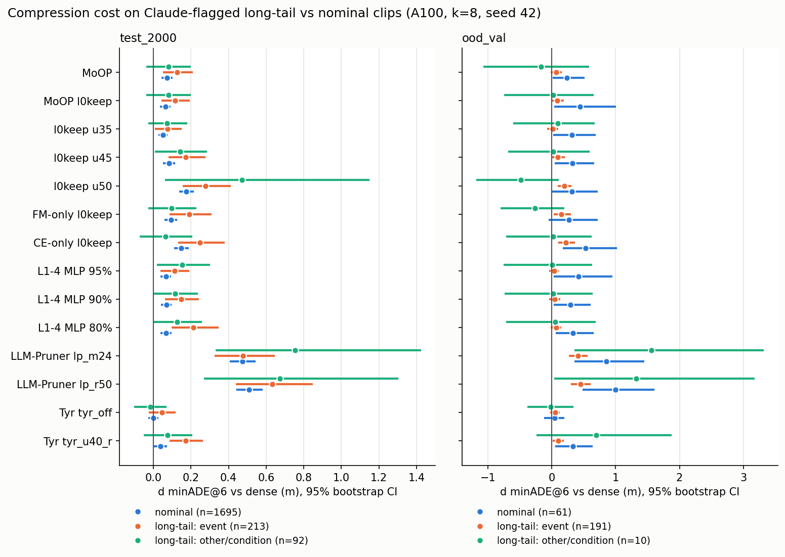

# Experiment: Claude로 찾은 long-tail 씬에서의 개루프 압축 비용

계획 [`long-tail-detection/plan.md`](../long-tail-detection/plan.md) · 코드 `long-tail-detection/label_longtail.py`,
`long-tail-detection/analyze_longtail_openloop.py` · 산출물 `outputs/cvpr27/long_tail_detection/{pilot50,label_v1,openloop_v1}/`

## Purpose

- 가설: 압축 비용(Δ minADE@6 vs dense)은 평균 세트보다 long-tail 씬에 몰려 있고, long-tail에서 방법 간 순위가 달라질 수 있다.
- NVIDIA의 큐레이션 long-tail(OOD, 9개 `event_cluster`)은 train/val 분할에만 있다. 그래서 held-out **test 분할(test_2000)**에서
  Claude로 long-tail 씬을 찾아 같은 질문을 검증한다.
- 출발점: A100 minADE@8 기준으로 MoOP l0keep의 비용은 OOD-val +0.151 m, test_2000 +0.055 m였다.

## Setup

- **라벨러:** `claude-opus-5-5`, adaptive thinking, effort `medium`, structured output, `fallbacks: "default"`.
  - 입력은 카메라 4대(front-wide·front-tele·cross-L·cross-R)의 t0 프레임(긴 변 1280 px)과 ego 과거 1.5 s 요약이다.
    GT 미래, OOD의 참조 CoC와 범주는 보내지 않는다.
  - 출력은 NVIDIA 9개 범주 + `NOMINAL`, 난이도 1–5, hazards, 근거다.
  - 데이터셋 프레임을 Anthropic API로 보내는 것은 사용자가 2026-11-02에 허용했다. 프롬프트는 개인 속성 기술과 번호판 언급을 금지한다(라이선스 §4.4/4.5).
- **라벨링 대상:** OOD-val 262 전부 + test_2000 전부, 클립당 1회(`label_v1`). 파일럿(`pilot50`)은 OOD-val 25 + test 25, 각 2회.
- **개루프:** 저장된 A100 클립별 결과(`outputs/cvpr27/a100/<arm>_{test2000,oodval}`)를 그대로 썼다.
  `run_baseline.py --no-tf`, k=8, 클립별 seed 42, minADE@6은 앞 6샘플의 최솟값, 6.4 s. 새로 GPU를 쓰지 않았다.
- **통계:**
  - Δ는 클립별로 짝지은 값이고, 부트스트랩 200,000회 95% CI를 붙였다.
  - DiD = Δ(long-tail) − Δ(NOMINAL)이다.
  - "기동 맞춤" DiD는 GT 기동 버킷(cruise/accel/turn/decel_stop) 안에서 비교한 뒤, long-tail 쪽 버킷 비율로 가중했다.
- **묶음:**
  - long-tail = `NOMINAL`이 아닌 전부.
  - 사건형 = NVIDIA의 이름 붙은 8개 범주.
  - 조건형 = `OTHER_LONGTAIL`. test에서 Claude는 이 범주를 주로 날씨·시야(눈 84, 야간 60, 시정 59, 눈부심 41, 비 28, 안개 22건 언급)로 채웠다.

## Results (Facts)

### 1. 라벨러

| 항목 | 값 |
|---|---|
| 요청 / 성공 / 응답 모델 | 2,262 / 2,262 `ok` / 전부 `claude-opus-5-5`(fallback 0) |
| 토큰(요청당 평균) | 입력 4,962 + 캐시 읽기 2,044, 출력 172 |
| 비용 | $53.59(요청당 $0.024, 표준가); 파일럿 $2.39 |
| 반복 판정 일치(파일럿 50클립 × 2) | 범주 OOD 96% / test 100%, 난이도 평균 차 0.16 / 0.00 |
| OOD-val long-tail 판정 | 201 / 262 (77%) |
| OOD-val NVIDIA 범주 재현 | 주 범주 61%, 주 또는 보조 76% |
| OOD-val 범주별 long-tail 판정률 | 공사 구간 90% (n=118), 자전거 등 78% (9), 보행자 69% (52), 특수 차량 68% (50), 잔해 60% (5), 교차로 50% (14), 기타 45% (11) |
| test_2000 long-tail 판정 | 305 / 2,000 (15.3%) — 사건형 213, 조건형 92 |
| test_2000 범주 | 기타(조건형) 92, 공사 구간 86, 보행자 43, 교차로 39, 자전거 등 23, 특수 차량 14, 응급 4, 잔해 3, 동물 1 |
| test_2000 야간 비율 | 사건형 34.7%, 조건형 52.2%, NOMINAL 39.7% |
| test_2000 GT 기동 비율(cruise) | long-tail 52.8%, NOMINAL 55.8% (사건형 44.1%, 조건형 72.8%) |

### 2. test_2000: long-tail(305) vs NOMINAL(1,695)

dense의 minADE@6은 long-tail **0.862**, NOMINAL **0.881**이다.

| arm | minADE@6 long-tail | minADE@6 NOMINAL | Δ long-tail [95% CI] | Δ NOMINAL [95% CI] | DiD, 기동 맞춤 [95% CI] |
|---|---|---|---|---|---|
| MoOP | 0.976 | 0.953 | +0.113 [+0.049, +0.181] | +0.072 [+0.042, +0.102] | +0.039 [−0.031, +0.113] |
| MoOP l0keep | 0.967 | 0.945 | +0.105 [+0.043, +0.169] | +0.064 [+0.036, +0.091] | +0.039 [−0.029, +0.108] |
| l0keep u35 | 0.938 | 0.932 | +0.076 [+0.018, +0.137] | +0.051 [+0.026, +0.076] | +0.022 [−0.041, +0.088] |
| l0keep u45 | 1.026 | 0.965 | +0.164 [+0.086, +0.248] | +0.084 [+0.052, +0.117] | +0.076 [−0.007, +0.164] |
| l0keep u50 | 1.198 | 1.057 | +0.336 [+0.173, +0.563] | +0.176 [+0.139, +0.214] | +0.153 [−0.011, +0.375] |
| FM-only l0keep | 1.024 | 0.975 | +0.162 [+0.079, +0.254] | +0.094 [+0.060, +0.127] | +0.065 [−0.024, +0.163] |
| CE-only l0keep | 1.055 | 1.030 | +0.193 [+0.101, +0.294] | +0.149 [+0.110, +0.189] | +0.041 [−0.058, +0.148] |
| L1-4 MLP 95% | 0.988 | 0.948 | +0.126 [+0.059, +0.196] | +0.067 [+0.039, +0.095] | +0.056 [−0.016, +0.131] |
| L1-4 MLP 90% | 1.001 | 0.950 | +0.139 [+0.068, +0.214] | +0.069 [+0.041, +0.097] | +0.067 [−0.009, +0.147] |
| L1-4 MLP 80% | 1.049 | 0.948 | +0.187 [+0.097, +0.288] | +0.067 [+0.037, +0.098] | **+0.117 [+0.023, +0.221]** |
| LLM-Pruner `lp_m24` | 1.423 | 1.354 | +0.561 [+0.384, +0.792] | +0.473 [+0.406, +0.544] | +0.075 [−0.115, +0.308] |
| LLM-Pruner `lp_r50` | 1.508 | 1.391 | +0.646 [+0.451, +0.883] | +0.510 [+0.441, +0.581] | +0.122 [−0.077, +0.353] |
| Tyr `tyr_off` | 0.889 | 0.880 | +0.027 [−0.029, +0.085] | −0.001 [−0.028, +0.026] | +0.026 [−0.036, +0.089] |
| Tyr `tyr_u40_r` | 1.004 | 0.920 | +0.142 [+0.071, +0.218] | +0.039 [+0.004, +0.073] | **+0.102 [+0.023, +0.182]** |

- DiD는 14개 arm 모두 양수다. 기동 맞춤 CI가 0을 벗어난 것은 L1-4 MLP 80%와 `tyr_u40_r` 둘뿐이다.
- 기동을 맞추기 전과 맞춘 뒤의 DiD 차이는 모든 arm에서 0.014 m 이하다.
- CoC 퇴화율(long-tail / NOMINAL): MoOP l0keep 3.0% / 2.6%, `lp_m24` 19.7% / 16.5%, dense 0.7% / 0.4%.

### 3. 사건형(213) / 조건형(92)

| arm | minADE@6 사건형 | minADE@6 조건형 | Δ 사건형 [95% CI] | Δ 조건형 [95% CI] | DiD 사건형, 기동 맞춤 | DiD 조건형, 기동 맞춤 |
|---|---|---|---|---|---|---|
| dense | 0.854 | 0.881 | — | — | — | — |
| MoOP | 0.981 | 0.962 | +0.128 [+0.050, +0.210] | +0.081 [−0.037, +0.198] | +0.047 [−0.035, +0.135] | +0.021 [−0.100, +0.140] |
| MoOP l0keep | 0.969 | 0.961 | +0.116 [+0.043, +0.193] | +0.080 [−0.037, +0.200] | +0.043 [−0.035, +0.124] | +0.030 [−0.090, +0.149] |
| FM-only l0keep | 1.044 | 0.979 | +0.190 [+0.086, +0.310] | +0.098 [−0.027, +0.228] | +0.082 [−0.027, +0.207] | +0.025 [−0.104, +0.159] |
| CE-only l0keep | 1.102 | 0.946 | +0.248 [+0.133, +0.379] | +0.065 [−0.074, +0.207] | +0.090 [−0.032, +0.225] | −0.071 [−0.213, +0.075] |
| L1-4 MLP 80% | 1.067 | 1.009 | +0.213 [+0.097, +0.347] | +0.127 [+0.002, +0.259] | **+0.136 [+0.016, +0.271]** | +0.075 [−0.052, +0.203] |
| LLM-Pruner `lp_m24` | 1.331 | 1.636 | +0.478 [+0.327, +0.646] | +0.754 [+0.331, +1.424] | −0.039 [−0.205, +0.140] | +0.340 [−0.085, +0.967] |
| Tyr `tyr_off` | 0.899 | 0.866 | +0.045 [−0.024, +0.119] | −0.015 [−0.104, +0.071] | +0.038 [−0.036, +0.116] | −0.003 [−0.095, +0.087] |
| Tyr `tyr_u40_r` | 1.025 | 0.956 | +0.172 [+0.085, +0.264] | +0.075 [−0.050, +0.206] | **+0.121 [+0.029, +0.218]** | +0.056 [−0.072, +0.188] |

나머지 arm의 행은 `outputs/cvpr27/long_tail_detection/openloop_v1/summary.txt`에 있다.

### 4. 방법 간 순위 (test_2000)

- **순위 상관:** 14개 arm의 Δ 순위는 long-tail과 NOMINAL 사이에서 Spearman ρ = 0.859, 사건형과 NOMINAL 사이에서 0.873이다.
- **최상위:** 비용이 가장 작은 arm은 두 집합 모두 `tyr_off`다.
- **최하위:** 가장 큰 두 arm도 두 집합 모두 LLM-Pruner(`lp_m24`, `lp_r50`)다.
- **짝지은 비교:** 클립별로 두 arm의 minADE@6 차이를 내고 부트스트랩 200,000회를 했다.

| 비교 | long-tail | NOMINAL | 두 집합 간 차이 |
|---|---|---|---|
| MoOP − `tyr_u40_r` | −0.029 [−0.104, +0.045] | +0.033 [+0.002, +0.064] | −0.062 [−0.143, +0.018] |
| MoOP l0keep − `tyr_u40_r` | −0.037 [−0.109, +0.032] | +0.025 [−0.004, +0.055] | −0.063 [−0.139, +0.013] |
| MoOP l0keep − `tyr_off` | +0.078 [+0.018, +0.140] | +0.064 [+0.037, +0.092] | +0.014 [−0.052, +0.081] |

### 5. OOD-val: long-tail(201) vs NOMINAL(61)

dense의 minADE@6은 long-tail **0.970**, NOMINAL **1.100**이다. OOD-val의 NOMINAL은 decel_stop 비율이 31.1%로, long-tail의 15.9%보다 높다.

| arm | minADE@6 long-tail | minADE@6 NOMINAL | Δ long-tail | Δ NOMINAL | DiD, 기동 맞춤 [95% CI] |
|---|---|---|---|---|---|
| MoOP | 1.029 | 1.339 | +0.059 | +0.239 | −0.133 [−0.337, +0.059] |
| MoOP l0keep | 1.051 | 1.538 | +0.081 | +0.439 | −0.216 [−0.537, +0.052] |
| LLM-Pruner `lp_m24` | 1.438 | 1.952 | +0.467 | +0.852 | −0.337 [−0.812, +0.096] |
| Tyr `tyr_off` | 1.018 | 1.142 | +0.047 | +0.042 | +0.012 [−0.137, +0.161] |
| Tyr `tyr_u40_r` | 1.099 | 1.430 | +0.128 | +0.331 | −0.098 [−0.345, +0.155] |

- DiD는 14개 중 13개 arm에서 음수다(예외는 `tyr_off`).
- 기동 맞춤 CI가 0을 벗어난 것은 L1-4 MLP 95%(−0.253 [−0.554, −0.001]) 하나다.
- 조건형은 OOD-val에 10클립뿐이라 CI 폭이 1 m를 넘는다.

## Analysis (Opinion)

- **Claude가 고른 long-tail에 압축 비용이 몰리는 경향은 약하고, 일관되지 않다.**
  - test_2000에서는 14개 arm 모두 같은 방향이다(MoOP류 +0.04 m 수준). 그러나 개별 CI는 대부분 0을 포함한다.
  - 14개 arm은 클립과 dense 기준을 공유하므로, 같은 방향이라는 사실을 독립 근거 14개로 볼 수 없다.
  - OOD-val에서는 방향이 반대다. 큐레이션된 long-tail 안에서는 Claude가 "평범하다"고 본 클립에서 비용이 더 컸다.
  - 기동을 맞춰도 숫자가 거의 그대로이므로, 이 결과를 정지·회전 비율 차이로 설명할 수는 없다.
- **"정적으로 보이는 희귀성"과 "모델에게 어려운 것"은 다른 축으로 보인다.**
  - dense 모델은 Claude의 long-tail에서 오히려 약간 더 잘한다(0.862 vs 0.881).
  - OOD-val에서 Claude가 `NOMINAL`로 본 61클립은 dense 오차(1.100)와 압축 비용(MoOP l0keep +0.439)이 모두 크다.
    파일럿에서 직접 본 놓친 사례 16건은 두 종류였다. 하나는 끼어들기·합류·양보 같은 동적 상호작용이고, 다른 하나는 시각적으로 평범한
    NVIDIA 라벨("급커브 앞 감속" 등)이다. 61클립 전체의 구성은 아직 세지 않았다.
  - 압축 비용은 공사 구간·눈 같은 정적 맥락보다, 한 장면으로는 안 보이는 상호작용 쪽에 있을 가능성이 크다.
  - 이 해석은 OOD-val NOMINAL 61클립(꼬리가 큰 분포)에 기대고 있어서 아직 가설이다.
- **방법 순위는 long-tail에서도 대체로 유지된다**(ρ ≈ 0.86).
  - `tyr_off`가 가장 싸고 LLM-Pruner가 가장 비싸다는 결론은 long-tail로 잘라도 같다.
  - 논문의 Tyr 행(`tyr_u40_r`)은 long-tail에서 비용이 특히 커서(DiD +0.102*), MoOP와의 우열이 뒤집힌다. 다만 뒤집힘 자체는 n.s.(−0.062 [−0.143, +0.018])라 주장할 수 없다.
- **조건형(눈·야간 비 등)은 압축 비용과 거의 무관하다**(MoOP l0keep 조건형 DiD +0.030 [−0.090, +0.149]). CE-only는 조건형에서 점추정상 비용이 오히려 작다(−0.071, CI 0 포함).
- **라벨러로서 Claude는 안정적이고 정적 맥락에는 정확하다.** 반복 일치 96–100%, 공사 구간 재현 90%다. 동적 사건 재현은 낮다(교차로 50%, 기타 45%). 카메라 프레임이 0.3 s 구간뿐이라 생기는 구조적 한계다.

## Next steps (제안)

1. **동적 상호작용으로 고르기:** 장애물 라벨(`labels/obstacle_perclip`)이나 GT 미래의 감속·횡이동으로 상호작용 씬을 골라 같은 분할을 반복한다. Claude에 몇 초 길이의 프레임 열을 주는 것도 방법이다. 단 이 경우 캐시를 새로 만들어야 한다.
2. **NOMINAL 61클립 들여다보기:** OOD-val의 Claude-NOMINAL 61클립에서 비용이 큰 클립을 사례로 확인한다. NVIDIA CoC가 동적 사건인지 직접 본다.
3. **표본 늘리기:** test_2000의 사건형 long-tail은 213클립이라 DiD CI 폭이 ±0.08 m다. MoOP류의 +0.04 m를 가리려면 n을 4배쯤 늘려야 한다(Hub 스트리밍으로 test 분할 확장, 계획 S4).
