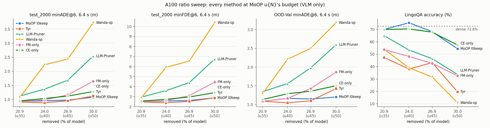

# A100 개루프 결과 정리 (2026-10-29 – 11-05)

모델 `nvidia/Alpamayo-1.5-10B`(rev `7aba829`) · KISTI NEURON A100-SXM4-80GB.
이 문서는 `2026-11-02_a100-results-summary.md`를 대체한다.

## 공통 설정
- **개루프:** `run_baseline.py --no-tf`, k=8, 클립별 seed 42, max_gen 256. 지표는 **minADE@6·minFDE@6을 1.6 / 3.2 / 6.4 s**에서 잰다(앞 6샘플의 최솟값).
- **세트:** test_2000(2,000클립, in-distribution), OOD-Val262, OOD-train1271(long-tail; calib_100과 겹침 0).
- **LingoQA:** 500문항, Lingo-Judge.
- **짝지은 Δ:** 부트스트랩 200,000회, LingoQA는 100개 세그먼트를 재표집한다. 표의 *는 95% CI가 0을 벗어난다는 뜻이다.
- **하드웨어:** A100 행끼리는 노드·날짜가 달라도 비트 동일하다. Ada 표와는 섞지 않는다.
- **압축 범위:** 별도 표기가 없으면 VLM 텍스트 타워만 자른다. expert와 k/v는 그대로다.
- **u40 예산:** 제거 2,657,452,032(모델의 23.99%). l0keep 계열은 4,096 적다.
- **개별 리포트(`cvpr27/reports/`):**

  | 날짜 | 리포트 |
  |---|---|
  | 2026-10-29 | `kisti-a100-openloop` |
  | 2026-10-30 | `a100-fm-ce-only`, `l0keep-l14-mlp-cut` |
  | 2026-10-31 | `llm-pruner-budget-matched` |
  | 2026-11-01 | `tyr-official-a100` |
  | 2026-11-02 | `wandasp-a100-openloop`, `tyr-vt-equal-hessian` |
  | 2026-11-03 | `oodtrain-coc-quality` |
  | 2026-11-05 | `combination-rule-ablation`, `moop-l0keep-expert-mlp`, `baselines-ratio-sweep` |

- **분석 스크립트:** `cvpr27/code/analyze_u40_summary.py`(u40 표), `analyze_ratio_sweep.py`(비율 표), `analyze_coc_quality.py`.

## 1. u40 예산의 모든 arm (MoOP l0keep 대비)

### test_2000 (2,000클립) — 절댓값

| 묶음 | arm | minADE@6 1.6 s | 3.2 s | 6.4 s | minFDE@6 1.6 s | 3.2 s | 6.4 s | CoC 퇴화 |
|---|---|---|---|---|---|---|---|---|
| 기준 | dense (무압축) | 0.053 | 0.211 | 0.878 | 0.137 | 0.561 | 2.393 | 0.4% |
| 기준 | MoOP (출하본, 0번 층 절단) | 0.061 | 0.238 | 0.956 | 0.155 | 0.623 | 2.559 | 2.2% |
| 기준 | MoOP l0keep | 0.060 | 0.233 | 0.948 | 0.153 | 0.615 | 2.561 | 2.6% |
| 외부 기준선 | LLM-Pruner (예산 일치 `lp_m24`) | 0.099 | 0.359 | 1.365 | 0.253 | 0.926 | 3.604 | 17.0% |
| 외부 기준선 | LLM-Pruner r=0.5 (`lp_r50`, 24.99%) | 0.103 | 0.373 | 1.408 | 0.264 | 0.963 | 3.738 | 15.6% |
| 외부 기준선 | Tyr 공식 (`tyr_off`) | 0.059 | 0.221 | 0.882 | 0.149 | 0.569 | 2.394 | 1.1% |
| 외부 기준선 | Tyr 간이 포트 (`tyr_u40_r`) | 0.065 | 0.237 | 0.933 | 0.162 | 0.607 | 2.499 | 0.4% |
| 외부 기준선 | Tyr 공식 + 헤시안 V:T 1:1 (`tyr_vt`) | 0.060 | 0.229 | 0.931 | 0.153 | 0.603 | 2.525 | 1.2% |
| 외부 기준선 | Wanda-sp | 0.170 | 0.601 | 2.232 | 0.437 | 1.581 | 5.931 | 75.0% |
| 기준 ablation | FM-only | 0.066 | 0.249 | 0.982 | 0.166 | 0.654 | 2.601 | 3.5% |
| 기준 ablation | CE-only | 0.070 | 0.261 | 1.033 | 0.177 | 0.677 | 2.738 | 6.8% |
| 기준 ablation | rank-mean | 0.060 | 0.235 | 0.953 | 0.154 | 0.621 | 2.559 | 3.3% |
| 기준 ablation | raw mean | 0.065 | 0.253 | 1.004 | 0.166 | 0.661 | 2.673 | 5.2% |
| 기준 ablation | raw max | 0.066 | 0.253 | 1.000 | 0.169 | 0.661 | 2.671 | 4.6% |
| MoOP l0keep 추가 절단 | + VLM 1–4층 MLP 질량 95% | 0.060 | 0.235 | 0.954 | 0.154 | 0.618 | 2.576 | 2.5% |
| MoOP l0keep 추가 절단 | + VLM 1–4층 MLP 질량 90% | 0.060 | 0.236 | 0.958 | 0.155 | 0.623 | 2.578 | 2.6% |
| MoOP l0keep 추가 절단 | + VLM 1–4층 MLP 질량 80% | 0.060 | 0.237 | 0.964 | 0.155 | 0.624 | 2.592 | 3.0% |
| MoOP l0keep 추가 절단 | + expert MLP 75% | 0.060 | 0.233 | 0.948 | 0.153 | 0.615 | 2.562 | 2.6% |
| MoOP l0keep 추가 절단 | + expert MLP 87.5% | 0.060 | 0.233 | 0.948 | 0.153 | 0.615 | 2.562 | 2.6% |
| MoOP l0keep 추가 절단 | + expert MLP 93.75% | 0.060 | 0.234 | 0.949 | 0.153 | 0.616 | 2.563 | 2.6% |

#### test_2000 — MoOP l0keep 대비 짝지은 Δ

| arm | Δ minADE@6 1.6 s | 3.2 s | 6.4 s | Δ minFDE@6 1.6 s | 3.2 s | 6.4 s |
|---|---|---|---|---|---|---|
| dense (무압축) | -0.006 [-0.008, -0.005]* | -0.023 [-0.029, -0.016]* | -0.070 [-0.095, -0.044]* | -0.016 [-0.021, -0.011]* | -0.054 [-0.074, -0.034]* | -0.168 [-0.255, -0.081]* |
| MoOP (출하본, 0번 층 절단) | +0.001 [+0.000, +0.002]* | +0.004 [+0.001, +0.007]* | +0.008 [-0.004, +0.020] | +0.002 [-0.001, +0.004] | +0.009 [-0.000, +0.018] | -0.002 [-0.042, +0.036] |
| LLM-Pruner (예산 일치 `lp_m24`) | +0.039 [+0.034, +0.044]* | +0.126 [+0.109, +0.143]* | +0.417 [+0.356, +0.482]* | +0.100 [+0.087, +0.113]* | +0.311 [+0.264, +0.362]* | +1.043 [+0.858, +1.238]* |
| LLM-Pruner r=0.5 (`lp_r50`, 24.99%) | +0.044 [+0.039, +0.049]* | +0.139 [+0.122, +0.157]* | +0.460 [+0.398, +0.525]* | +0.111 [+0.098, +0.125]* | +0.348 [+0.298, +0.400]* | +1.176 [+0.992, +1.369]* |
| Tyr 공식 (`tyr_off`) | -0.001 [-0.003, +0.001] | -0.013 [-0.020, -0.006]* | -0.066 [-0.091, -0.042]* | -0.005 [-0.010, +0.001] | -0.046 [-0.066, -0.025]* | -0.167 [-0.250, -0.084]* |
| Tyr 간이 포트 (`tyr_u40_r`) | +0.005 [+0.003, +0.007]* | +0.004 [-0.004, +0.012] | -0.016 [-0.043, +0.012] | +0.009 [+0.003, +0.016]* | -0.008 [-0.031, +0.016] | -0.062 [-0.151, +0.026] |
| Tyr 공식 + 헤시안 V:T 1:1 (`tyr_vt`) | +0.001 [-0.001, +0.003] | -0.004 [-0.011, +0.003] | -0.018 [-0.042, +0.007] | +0.000 [-0.005, +0.006] | -0.012 [-0.032, +0.009] | -0.037 [-0.116, +0.043] |
| Wanda-sp | +0.110 [+0.102, +0.118]* | +0.368 [+0.340, +0.397]* | +1.284 [+1.184, +1.387]* | +0.284 [+0.262, +0.306]* | +0.966 [+0.886, +1.049]* | +3.370 [+3.072, +3.676]* |
| FM-only | +0.006 [+0.004, +0.008]* | +0.016 [+0.008, +0.024]* | +0.034 [+0.010, +0.059]* | +0.013 [+0.007, +0.019]* | +0.039 [+0.018, +0.061]* | +0.040 [-0.034, +0.115] |
| CE-only | +0.010 [+0.008, +0.013]* | +0.028 [+0.019, +0.036]* | +0.085 [+0.056, +0.117]* | +0.024 [+0.017, +0.031]* | +0.062 [+0.039, +0.087]* | +0.176 [+0.088, +0.269]* |
| rank-mean | +0.000 [-0.001, +0.002] | +0.002 [-0.004, +0.008] | +0.005 [-0.016, +0.027] | +0.001 [-0.003, +0.006] | +0.006 [-0.011, +0.023] | -0.002 [-0.071, +0.068] |
| raw mean | +0.005 [+0.003, +0.007]* | +0.020 [+0.013, +0.027]* | +0.056 [+0.031, +0.083]* | +0.013 [+0.008, +0.019]* | +0.046 [+0.024, +0.068]* | +0.112 [+0.034, +0.192]* |
| raw max | +0.007 [+0.004, +0.009]* | +0.020 [+0.011, +0.029]* | +0.052 [+0.021, +0.086]* | +0.016 [+0.009, +0.023]* | +0.046 [+0.020, +0.074]* | +0.110 [+0.018, +0.209]* |
| + VLM 1–4층 MLP 질량 95% | +0.000 [-0.000, +0.001] | +0.001 [-0.001, +0.004] | +0.006 [-0.004, +0.017] | +0.001 [-0.001, +0.003] | +0.003 [-0.005, +0.012] | +0.014 [-0.015, +0.045] |
| + VLM 1–4층 MLP 질량 90% | +0.000 [-0.000, +0.001] | +0.003 [-0.000, +0.006] | +0.010 [-0.001, +0.021] | +0.001 [-0.000, +0.004] | +0.008 [-0.001, +0.018] | +0.016 [-0.016, +0.050] |
| + VLM 1–4층 MLP 질량 80% | +0.001 [-0.000, +0.002] | +0.003 [-0.000, +0.008] | +0.016 [-0.001, +0.034] | +0.002 [-0.001, +0.005] | +0.009 [-0.003, +0.021] | +0.030 [-0.021, +0.089] |
| + expert MLP 75% | -0.000 [-0.000, -0.000]* | -0.000 [-0.000, +0.000] | +0.000 [-0.001, +0.001] | -0.000 [-0.000, -0.000]* | -0.000 [-0.001, +0.000] | +0.000 [-0.002, +0.003] |
| + expert MLP 87.5% | -0.000 [-0.000, -0.000]* | -0.000 [-0.000, +0.000] | +0.000 [-0.001, +0.001] | -0.000 [-0.001, -0.000]* | -0.000 [-0.001, +0.001] | +0.001 [-0.003, +0.004] |
| + expert MLP 93.75% | -0.000 [-0.000, +0.000] | +0.000 [-0.000, +0.001] | +0.001 [-0.001, +0.003] | -0.000 [-0.001, +0.000] | +0.001 [-0.001, +0.002] | +0.002 [-0.004, +0.007] |

### OOD-Val262 — 절댓값

| 묶음 | arm | minADE@6 1.6 s | 3.2 s | 6.4 s | minFDE@6 1.6 s | 3.2 s | 6.4 s | CoC 퇴화 |
|---|---|---|---|---|---|---|---|---|
| 기준 | dense (무압축) | 0.065 | 0.259 | 1.001 | 0.175 | 0.685 | 2.497 | 0.4% |
| 기준 | MoOP (출하본, 0번 층 절단) | 0.073 | 0.284 | 1.101 | 0.194 | 0.734 | 2.798 | 4.2% |
| 기준 | MoOP l0keep | 0.077 | 0.304 | 1.165 | 0.206 | 0.795 | 3.017 | 2.3% |
| 외부 기준선 | LLM-Pruner (예산 일치 `lp_m24`) | 0.125 | 0.442 | 1.558 | 0.325 | 1.127 | 3.876 | 15.3% |
| 외부 기준선 | LLM-Pruner r=0.5 (`lp_r50`, 24.99%) | 0.132 | 0.470 | 1.612 | 0.344 | 1.203 | 4.010 | 17.2% |
| 외부 기준선 | Tyr 공식 (`tyr_off`) | 0.074 | 0.287 | 1.046 | 0.197 | 0.751 | 2.569 | 2.7% |
| 외부 기준선 | Tyr 간이 포트 (`tyr_u40_r`) | 0.090 | 0.332 | 1.176 | 0.237 | 0.838 | 2.989 | 1.1% |
| 외부 기준선 | Tyr 공식 + 헤시안 V:T 1:1 (`tyr_vt`) | 0.080 | 0.302 | 1.113 | 0.212 | 0.791 | 2.748 | 1.5% |
| 외부 기준선 | Wanda-sp | 0.187 | 0.661 | 2.208 | 0.487 | 1.706 | 5.354 | 74.8% |
| 기준 ablation | FM-only | 0.081 | 0.316 | 1.164 | 0.220 | 0.817 | 2.958 | 4.6% |
| 기준 ablation | CE-only | 0.095 | 0.361 | 1.287 | 0.254 | 0.932 | 3.107 | 8.8% |
| 기준 ablation | rank-mean | 0.077 | 0.307 | 1.178 | 0.208 | 0.808 | 3.030 | 5.7% |
| 기준 ablation | raw mean | 0.076 | 0.312 | 1.225 | 0.206 | 0.828 | 3.173 | 7.3% |
| 기준 ablation | raw max | 0.078 | 0.310 | 1.179 | 0.208 | 0.828 | 2.944 | 6.5% |
| MoOP l0keep 추가 절단 | + VLM 1–4층 MLP 질량 95% | 0.075 | 0.296 | 1.122 | 0.201 | 0.765 | 2.920 | 3.4% |
| MoOP l0keep 추가 절단 | + VLM 1–4층 MLP 질량 90% | 0.074 | 0.291 | 1.104 | 0.198 | 0.753 | 2.866 | 4.2% |
| MoOP l0keep 추가 절단 | + VLM 1–4층 MLP 질량 80% | 0.075 | 0.295 | 1.127 | 0.202 | 0.769 | 2.917 | 4.2% |
| MoOP l0keep 추가 절단 | + expert MLP 75% | 0.077 | 0.304 | 1.164 | 0.206 | 0.795 | 3.015 | 2.3% |
| MoOP l0keep 추가 절단 | + expert MLP 87.5% | 0.077 | 0.304 | 1.164 | 0.207 | 0.795 | 3.014 | 2.3% |
| MoOP l0keep 추가 절단 | + expert MLP 93.75% | 0.077 | 0.304 | 1.163 | 0.207 | 0.795 | 3.014 | 2.3% |

#### OOD-Val262 — MoOP l0keep 대비 짝지은 Δ

| arm | Δ minADE@6 1.6 s | 3.2 s | 6.4 s | Δ minFDE@6 1.6 s | 3.2 s | 6.4 s |
|---|---|---|---|---|---|---|
| dense (무압축) | -0.012 [-0.021, -0.004]* | -0.045 [-0.081, -0.015]* | -0.164 [-0.317, -0.039]* | -0.031 [-0.056, -0.009]* | -0.110 [-0.220, -0.017]* | -0.520 [-0.992, -0.133]* |
| MoOP (출하본, 0번 층 절단) | -0.004 [-0.012, +0.001] | -0.020 [-0.053, +0.004] | -0.063 [-0.192, +0.026] | -0.012 [-0.035, +0.004] | -0.061 [-0.160, +0.009] | -0.219 [-0.582, +0.020] |
| LLM-Pruner (예산 일치 `lp_m24`) | +0.048 [+0.032, +0.066]* | +0.138 [+0.084, +0.197]* | +0.393 [+0.213, +0.578]* | +0.119 [+0.076, +0.166]* | +0.332 [+0.182, +0.491]* | +0.859 [+0.363, +1.347]* |
| LLM-Pruner r=0.5 (`lp_r50`, 24.99%) | +0.055 [+0.039, +0.073]* | +0.167 [+0.114, +0.224]* | +0.448 [+0.281, +0.625]* | +0.137 [+0.094, +0.184]* | +0.408 [+0.264, +0.564]* | +0.993 [+0.529, +1.472]* |
| Tyr 공식 (`tyr_off`) | -0.003 [-0.012, +0.006] | -0.017 [-0.052, +0.014] | -0.118 [-0.257, -0.002]* | -0.009 [-0.035, +0.015] | -0.044 [-0.147, +0.046] | -0.448 [-0.871, -0.103]* |
| Tyr 간이 포트 (`tyr_u40_r`) | +0.013 [+0.002, +0.026]* | +0.028 [-0.009, +0.065] | +0.011 [-0.110, +0.120] | +0.031 [-0.000, +0.062] | +0.043 [-0.058, +0.140] | -0.028 [-0.372, +0.261] |
| Tyr 공식 + 헤시안 V:T 1:1 (`tyr_vt`) | +0.003 [-0.004, +0.011] | -0.001 [-0.023, +0.021] | -0.052 [-0.143, +0.032] | +0.006 [-0.013, +0.027] | -0.004 [-0.069, +0.060] | -0.269 [-0.565, -0.012]* |
| Wanda-sp | +0.110 [+0.088, +0.134]* | +0.358 [+0.284, +0.438]* | +1.043 [+0.812, +1.293]* | +0.281 [+0.220, +0.346]* | +0.911 [+0.707, +1.132]* | +2.337 [+1.687, +3.032]* |
| FM-only | +0.004 [-0.007, +0.015] | +0.013 [-0.029, +0.052] | -0.001 [-0.167, +0.164] | +0.013 [-0.017, +0.042] | +0.022 [-0.104, +0.144] | -0.059 [-0.538, +0.413] |
| CE-only | +0.018 [+0.007, +0.030]* | +0.058 [+0.017, +0.102]* | +0.123 [-0.030, +0.261] | +0.048 [+0.018, +0.082]* | +0.137 [+0.019, +0.258]* | +0.090 [-0.378, +0.486] |
| rank-mean | +0.000 [-0.006, +0.007] | +0.004 [-0.020, +0.027] | +0.014 [-0.080, +0.100] | +0.002 [-0.016, +0.021] | +0.012 [-0.054, +0.074] | +0.013 [-0.274, +0.279] |
| raw mean | -0.001 [-0.007, +0.006] | +0.008 [-0.021, +0.037] | +0.060 [-0.068, +0.186] | -0.001 [-0.020, +0.019] | +0.033 [-0.056, +0.121] | +0.156 [-0.233, +0.547] |
| raw max | +0.001 [-0.007, +0.008] | +0.007 [-0.028, +0.036] | +0.014 [-0.124, +0.123] | +0.002 [-0.022, +0.023] | +0.033 [-0.072, +0.120] | -0.073 [-0.480, +0.238] |
| + VLM 1–4층 MLP 질량 95% | -0.002 [-0.005, +0.000] | -0.008 [-0.021, +0.002] | -0.042 [-0.089, -0.007]* | -0.005 [-0.013, +0.001] | -0.030 [-0.069, -0.002]* | -0.097 [-0.214, -0.010]* |
| + VLM 1–4층 MLP 질량 90% | -0.003 [-0.011, +0.002] | -0.013 [-0.043, +0.009] | -0.061 [-0.173, +0.018] | -0.008 [-0.030, +0.007] | -0.042 [-0.129, +0.021] | -0.151 [-0.459, +0.060] |
| + VLM 1–4층 MLP 질량 80% | -0.002 [-0.009, +0.005] | -0.009 [-0.037, +0.014] | -0.037 [-0.157, +0.051] | -0.005 [-0.024, +0.012] | -0.026 [-0.111, +0.039] | -0.100 [-0.457, +0.161] |
| + expert MLP 75% | +0.000 [-0.000, +0.000] | +0.000 [-0.001, +0.001] | -0.001 [-0.003, +0.001] | +0.000 [-0.000, +0.001] | -0.000 [-0.002, +0.001] | -0.002 [-0.010, +0.005] |
| + expert MLP 87.5% | +0.000 [-0.000, +0.000] | +0.000 [-0.001, +0.001] | -0.001 [-0.004, +0.002] | +0.000 [-0.000, +0.001] | -0.000 [-0.003, +0.003] | -0.003 [-0.015, +0.008] |
| + expert MLP 93.75% | +0.000 [-0.000, +0.000] | +0.000 [-0.001, +0.002] | -0.001 [-0.006, +0.003] | +0.001 [-0.001, +0.002] | -0.000 [-0.005, +0.004] | -0.003 [-0.021, +0.015] |

### OOD-train1271 — 절댓값 (이 세트로 잰 arm만)

| 묶음 | arm | minADE@6 1.6 s | 3.2 s | 6.4 s | minFDE@6 1.6 s | 3.2 s | 6.4 s | CoC 퇴화 |
|---|---|---|---|---|---|---|---|---|
| 기준 | dense (무압축) | 0.063 | 0.245 | 0.922 | 0.166 | 0.630 | 2.334 | 0.7% |
| 기준 | MoOP (출하본, 0번 층 절단) | 0.073 | 0.280 | 1.017 | 0.191 | 0.715 | 2.486 | 2.4% |
| 기준 | MoOP l0keep | 0.075 | 0.284 | 1.023 | 0.195 | 0.727 | 2.496 | 2.8% |
| 외부 기준선 | LLM-Pruner (예산 일치 `lp_m24`) | 0.135 | 0.471 | 1.526 | 0.347 | 1.180 | 3.583 | 16.9% |
| 외부 기준선 | Tyr 공식 (`tyr_off`) | 0.081 | 0.298 | 1.035 | 0.212 | 0.757 | 2.490 | 1.4% |
| 외부 기준선 | Tyr 공식 + 헤시안 V:T 1:1 (`tyr_vt`) | 0.080 | 0.298 | 1.046 | 0.209 | 0.764 | 2.520 | 1.6% |
| 외부 기준선 | Wanda-sp | 0.220 | 0.749 | 2.390 | 0.566 | 1.902 | 5.650 | 76.0% |
| MoOP l0keep 추가 절단 | + expert MLP 75% | 0.075 | 0.284 | 1.021 | 0.195 | 0.726 | 2.492 | 2.8% |
| MoOP l0keep 추가 절단 | + expert MLP 87.5% | 0.075 | 0.284 | 1.021 | 0.195 | 0.725 | 2.489 | 2.8% |
| MoOP l0keep 추가 절단 | + expert MLP 93.75% | 0.075 | 0.284 | 1.020 | 0.194 | 0.723 | 2.488 | 2.8% |

#### OOD-train1271 — MoOP l0keep 대비 짝지은 Δ

| arm | Δ minADE@6 1.6 s | 3.2 s | 6.4 s | Δ minFDE@6 1.6 s | 3.2 s | 6.4 s |
|---|---|---|---|---|---|---|
| dense (무압축) | -0.012 [-0.016, -0.009]* | -0.040 [-0.053, -0.027]* | -0.101 [-0.153, -0.051]* | -0.029 [-0.039, -0.020]* | -0.097 [-0.138, -0.059]* | -0.163 [-0.325, -0.008]* |
| MoOP (출하본, 0번 층 절단) | -0.001 [-0.003, -0.000]* | -0.004 [-0.009, +0.000] | -0.006 [-0.026, +0.014] | -0.004 [-0.008, -0.001]* | -0.012 [-0.028, +0.002] | -0.010 [-0.071, +0.048] |
| LLM-Pruner (예산 일치 `lp_m24`) | +0.061 [+0.053, +0.069]* | +0.186 [+0.162, +0.212]* | +0.504 [+0.430, +0.582]* | +0.152 [+0.132, +0.174]* | +0.453 [+0.387, +0.523]* | +1.087 [+0.887, +1.292]* |
| Tyr 공식 (`tyr_off`) | +0.006 [+0.002, +0.010]* | +0.014 [+0.000, +0.028]* | +0.012 [-0.038, +0.060] | +0.017 [+0.006, +0.028]* | +0.030 [-0.012, +0.070] | -0.006 [-0.149, +0.127] |
| Tyr 공식 + 헤시안 V:T 1:1 (`tyr_vt`) | +0.006 [+0.001, +0.010]* | +0.014 [-0.002, +0.030] | +0.023 [-0.030, +0.076] | +0.014 [+0.002, +0.026]* | +0.037 [-0.008, +0.082] | +0.024 [-0.127, +0.170] |
| Wanda-sp | +0.145 [+0.133, +0.158]* | +0.465 [+0.424, +0.507]* | +1.368 [+1.238, +1.502]* | +0.371 [+0.339, +0.405]* | +1.175 [+1.062, +1.292]* | +3.154 [+2.803, +3.514]* |
| + expert MLP 75% | -0.000 [-0.000, +0.000] | -0.000 [-0.001, -0.000]* | -0.001 [-0.003, +0.000] | -0.000 [-0.001, +0.000] | -0.001 [-0.003, -0.000]* | -0.004 [-0.010, +0.001] |
| + expert MLP 87.5% | -0.000 [-0.000, +0.000] | -0.000 [-0.001, +0.000] | -0.002 [-0.004, +0.000] | -0.000 [-0.001, +0.000] | -0.002 [-0.004, -0.001]* | -0.007 [-0.017, +0.001] |
| + expert MLP 93.75% | -0.000 [-0.000, +0.000] | -0.001 [-0.001, +0.000] | -0.003 [-0.007, +0.001] | -0.001 [-0.001, +0.000] | -0.004 [-0.007, -0.001]* | -0.008 [-0.021, +0.003] |

### LingoQA (500문항)

| arm | 정확도 | MoOP l0keep 대비 |
|---|---|---|
| dense (무압축) | 72.6% | -2.8 pp [-7.4, +1.8] |
| MoOP (출하본, 0번 층 절단) | 66.6% | -8.8 pp [-12.8, -4.8]* |
| MoOP l0keep | 75.4% | -- |
| LLM-Pruner (예산 일치 `lp_m24`) | 53.4% | -22.0 pp [-27.6, -16.4]* |
| LLM-Pruner r=0.5 (`lp_r50`, 24.99%) | 45.4% | -30.0 pp [-35.6, -24.6]* |
| Tyr 공식 (`tyr_off`) | 38.0% | -37.4 pp [-42.4, -32.6]* |
| Tyr 간이 포트 (`tyr_u40_r`) | 34.0% | -41.4 pp [-47.0, -35.6]* |
| Tyr 공식 + 헤시안 V:T 1:1 (`tyr_vt`) | 62.8% | -12.6 pp [-17.6, -7.6]* |
| Wanda-sp | 39.0% | -36.4 pp [-42.2, -30.6]* |
| FM-only | 48.2% | -27.2 pp [-32.2, -22.4]* |
| CE-only | 70.4% | -5.0 pp [-10.0, -0.2]* |
| rank-mean | 71.0% | -4.4 pp [-9.0, +0.2] |
| raw mean | 64.4% | -11.0 pp [-15.8, -6.2]* |
| raw max | 65.4% | -10.0 pp [-15.0, -5.2]* |
| + VLM 1–4층 MLP 질량 95% | 71.8% | -3.6 pp [-7.4, +0.2] |
| + VLM 1–4층 MLP 질량 90% | 71.4% | -4.0 pp [-7.2, -0.8]* |
| + VLM 1–4층 MLP 질량 80% | 69.4% | -6.0 pp [-9.6, -2.4]* |
| + expert MLP 75% | = MoOP l0keep (VLM 동일) | -- |
| + expert MLP 87.5% | = MoOP l0keep (VLM 동일) | -- |
| + expert MLP 93.75% | = MoOP l0keep (VLM 동일) | -- |

## 2. 비율 곡선 (u35–u50, `2026-11-05_baselines-ratio-sweep.md`)

그림: `figures/2026-11-05_ratio-sweep.png`. 같은 비율 MoOP l0keep 대비 6개 지표 짝지은 CI는 개별 리포트에 있다. 각 방법의 u40 행은 1절의 행과 같다.

### test_2000 — 절댓값

| 비율 (제거) | 방법 | minADE@6 1.6 s | 3.2 s | 6.4 s | minFDE@6 1.6 s | 3.2 s | 6.4 s | CoC 퇴화 |
|---|---|---|---|---|---|---|---|---|
| u35 (20.92%) | MoOP l0keep | 0.060 | 0.231 | 0.933 | 0.152 | 0.607 | 2.496 | 1.9% |
| u35 (20.92%) | FM-only | 0.060 | 0.230 | 0.927 | 0.152 | 0.602 | 2.480 | 2.6% |
| u35 (20.92%) | CE-only | 0.060 | 0.233 | 0.945 | 0.153 | 0.612 | 2.557 | 1.9% |
| u35 (20.92%) | Tyr | 0.059 | 0.221 | 0.906 | 0.149 | 0.578 | 2.473 | 1.3% |
| u35 (20.92%) | LLM-Pruner | 0.079 | 0.289 | 1.118 | 0.199 | 0.748 | 2.952 | 4.2% |
| u35 (20.92%) | Wanda-sp | 0.070 | 0.263 | 1.068 | 0.177 | 0.686 | 2.867 | 6.1% |
| u40 (23.99%) | MoOP l0keep | 0.060 | 0.233 | 0.948 | 0.153 | 0.615 | 2.561 | 2.6% |
| u40 (23.99%) | FM-only | 0.066 | 0.249 | 0.982 | 0.166 | 0.654 | 2.601 | 3.5% |
| u40 (23.99%) | CE-only | 0.070 | 0.261 | 1.033 | 0.177 | 0.677 | 2.738 | 6.8% |
| u40 (23.99%) | Tyr | 0.059 | 0.221 | 0.882 | 0.149 | 0.569 | 2.394 | 1.1% |
| u40 (23.99%) | LLM-Pruner | 0.099 | 0.359 | 1.365 | 0.253 | 0.926 | 3.604 | 17.0% |
| u40 (23.99%) | Wanda-sp | 0.170 | 0.601 | 2.232 | 0.437 | 1.581 | 5.931 | 75.0% |
| u45 (26.85%) | MoOP l0keep | 0.062 | 0.242 | 0.975 | 0.157 | 0.634 | 2.622 | 2.5% |
| u45 (26.85%) | FM-only | 0.077 | 0.294 | 1.159 | 0.197 | 0.770 | 3.093 | 8.6% |
| u45 (26.85%) | CE-only | 0.075 | 0.281 | 1.118 | 0.189 | 0.736 | 2.969 | 9.8% |
| u45 (26.85%) | Tyr | 0.066 | 0.239 | 0.949 | 0.165 | 0.620 | 2.527 | 0.4% |
| u45 (26.85%) | LLM-Pruner | 0.131 | 0.465 | 1.683 | 0.336 | 1.197 | 4.396 | 31.0% |
| u45 (26.85%) | Wanda-sp | 0.181 | 0.649 | 2.434 | 0.470 | 1.732 | 6.552 | 76.8% |
| u50 (29.98%) | MoOP l0keep | 0.068 | 0.267 | 1.079 | 0.173 | 0.705 | 2.881 | 3.2% |
| u50 (29.98%) | FM-only | 0.104 | 0.409 | 1.645 | 0.274 | 1.117 | 4.456 | 24.2% |
| u50 (29.98%) | CE-only | 0.091 | 0.332 | 1.280 | 0.230 | 0.862 | 3.397 | 16.2% |
| u50 (29.98%) | Tyr | 0.092 | 0.311 | 1.123 | 0.229 | 0.781 | 2.881 | 3.0% |
| u50 (29.98%) | LLM-Pruner | 0.191 | 0.692 | 2.539 | 0.499 | 1.848 | 6.744 | 74.5% |
| u50 (29.98%) | Wanda-sp | 0.247 | 0.953 | 3.726 | 0.669 | 2.656 | 10.379 | 99.8% |

### OOD-Val262 — 절댓값

| 비율 (제거) | 방법 | minADE@6 1.6 s | 3.2 s | 6.4 s | minFDE@6 1.6 s | 3.2 s | 6.4 s | CoC 퇴화 |
|---|---|---|---|---|---|---|---|---|
| u35 (20.92%) | MoOP l0keep | 0.076 | 0.290 | 1.084 | 0.201 | 0.743 | 2.781 | 3.8% |
| u35 (20.92%) | FM-only | 0.074 | 0.283 | 1.085 | 0.197 | 0.725 | 2.769 | 4.2% |
| u35 (20.92%) | CE-only | 0.074 | 0.295 | 1.132 | 0.197 | 0.782 | 2.877 | 2.3% |
| u35 (20.92%) | Tyr | 0.081 | 0.303 | 1.085 | 0.215 | 0.774 | 2.696 | 1.9% |
| u35 (20.92%) | LLM-Pruner | 0.106 | 0.391 | 1.342 | 0.280 | 0.998 | 3.365 | 6.9% |
| u35 (20.92%) | Wanda-sp | 0.086 | 0.341 | 1.286 | 0.235 | 0.916 | 3.316 | 4.6% |
| u40 (23.99%) | MoOP l0keep | 0.077 | 0.304 | 1.165 | 0.206 | 0.795 | 3.017 | 2.3% |
| u40 (23.99%) | FM-only | 0.081 | 0.316 | 1.164 | 0.220 | 0.817 | 2.958 | 4.6% |
| u40 (23.99%) | CE-only | 0.095 | 0.361 | 1.287 | 0.254 | 0.932 | 3.107 | 8.8% |
| u40 (23.99%) | Tyr | 0.074 | 0.287 | 1.046 | 0.197 | 0.751 | 2.569 | 2.7% |
| u40 (23.99%) | LLM-Pruner | 0.125 | 0.442 | 1.558 | 0.325 | 1.127 | 3.876 | 15.3% |
| u40 (23.99%) | Wanda-sp | 0.187 | 0.661 | 2.208 | 0.487 | 1.706 | 5.354 | 74.8% |
| u45 (26.85%) | MoOP l0keep | 0.076 | 0.297 | 1.146 | 0.204 | 0.782 | 2.920 | 5.3% |
| u45 (26.85%) | FM-only | 0.100 | 0.385 | 1.425 | 0.266 | 1.008 | 3.686 | 11.8% |
| u45 (26.85%) | CE-only | 0.101 | 0.383 | 1.355 | 0.268 | 0.987 | 3.346 | 7.6% |
| u45 (26.85%) | Tyr | 0.085 | 0.313 | 1.097 | 0.224 | 0.811 | 2.715 | 0.4% |
| u45 (26.85%) | LLM-Pruner | 0.162 | 0.592 | 1.977 | 0.425 | 1.543 | 4.900 | 36.6% |
| u45 (26.85%) | Wanda-sp | 0.204 | 0.736 | 2.501 | 0.541 | 1.917 | 6.249 | 82.1% |
| u50 (29.98%) | MoOP l0keep | 0.083 | 0.326 | 1.200 | 0.219 | 0.844 | 3.062 | 3.1% |
| u50 (29.98%) | FM-only | 0.121 | 0.483 | 1.864 | 0.324 | 1.318 | 5.021 | 31.7% |
| u50 (29.98%) | CE-only | 0.119 | 0.426 | 1.500 | 0.310 | 1.081 | 3.732 | 19.8% |
| u50 (29.98%) | Tyr | 0.122 | 0.428 | 1.424 | 0.315 | 1.082 | 3.446 | 3.8% |
| u50 (29.98%) | LLM-Pruner | 0.201 | 0.733 | 2.597 | 0.528 | 1.967 | 6.616 | 77.9% |
| u50 (29.98%) | Wanda-sp | 0.225 | 0.863 | 3.184 | 0.605 | 2.382 | 8.371 | 100.0% |

### LingoQA (괄호는 같은 비율 MoOP l0keep 대비 pp)

| 비율 | MoOP l0keep | FM-only | CE-only | Tyr | LLM-Pruner | Wanda-sp |
|---|---|---|---|---|---|---|
| u35 | 70.0% | 53.8% (-16.2*) | 70.0% (+0.0) | 47.4% (-22.6*) | 65.0% (-5.0*) | 54.0% (-16.0*) |
| u40 | 75.4% | 48.2% (-27.2*) | 70.4% (-5.0*) | 38.0% (-37.4*) | 53.4% (-22.0*) | 39.0% (-36.4*) |
| u45 | 68.2% | 42.6% (-25.6*) | 67.8% (-0.4) | 43.2% (-25.0*) | 46.4% (-21.8*) | 31.6% (-36.6*) |
| u50 | 54.4% | 32.6% (-21.8*) | 57.4% (+3.0) | 19.6% (-34.8*) | 33.6% (-20.8*) | 10.8% (-43.6*) |

## 3. OOD CoC 품질 (u40, `2026-11-03_oodtrain-coc-quality.md`)

Claude 채점: 정답 CoC 대비 1–5점, 블라인드, 반복 일치 92.6%. 우연 바닥(다른 클립 정답과 짝지음)은 OOD-Val 1.80이다.

| arm | OOD-Val | OOD-train | OOD-train MoOP 대비 |
|---|---|---|---|
| dense | 3.02 | 3.05 | +0.142* |
| MoOP | 2.81 | 2.91 | — |
| MoOP l0keep | 2.79 | 2.94 | +0.027 |
| Tyr V:T 1:1 | 2.86 | 2.91 | +0.004 |
| Tyr official | 2.71 | 2.75 | −0.159* |
| LLM-Pruner | 2.65 | 2.64 | −0.266* |
| Wanda-sp | 1.47 | 1.34 | −1.573* |

## 4. 핵심 결론 (의견)
- **MoOP l0keep이 주행과 언어를 함께 지키는 유일한 방법이다.**
  - u40에서 test_2000 0.948 / 2.561(6.4 s minADE@6 / minFDE@6), LingoQA 75.4%(dense 72.6%)다.
  - 비율을 올려도 u45까지 완만하다(0.975, LingoQA 68.2%). CoC 퇴화도 3% 이하로 유지된다.
- **0번 층 Q head 보존(l0keep)은 주행을 바꾸지 않고 언어를 지킨다.**
  - MoOP 출하본 대비 test_2000 6.4 s minADE@6 −0.008(n.s.)이다.
  - LingoQA는 출하본(0번 층 절단)이 l0keep보다 −8.8 pp*다.
- **Tyr는 주행에서 가장 강하지만 언어가 무너지고, 이점은 in-distribution에 한정된다.**
  - 공식 재빌드는 test_2000에서 MoOP l0keep보다 −0.066*, OOD-Val에서 −0.118*다.
  - OOD-train에서는 같고(+0.012), LingoQA 38.0%, CoC 채점 −0.159*다.
  - 헤시안 V:T 1:1(`tyr_vt`)은 언어를 62.8%로 되살리지만 주행 이점이 사라진다.
  - u50에서는 주행도 MoOP l0keep보다 나쁘다.
- **LLM-Pruner·Wanda-sp는 모든 세트·구간에서 크게 나쁘다.** CoC 퇴화가 함께 늘고, u45부터 붕괴한다.
- **두 기준의 합집합(순위 max)이 핵심이다.**
  - 한쪽 기준만 쓰면 주행(CE-only)이나 언어(FM-only)를 잃는다. 그 격차는 비율과 함께 커진다(FM-only u35 −0.006 → u50 +0.566*).
  - 순위 정규화 없이 원래 크기로 합치면 주행 +0.05*, 언어 −10 pp*다.
  - 순위 공간에서 max와 평균은 주행이 같고, 언어 차이는 경계선이다(−4.4 pp).
- **추가 압축 여지:**
  - expert MLP는 93.75%까지 공짜다. 세 세트 모두 |Δ| ≤ 0.008 m이고, 모델의 39.4% 제거, bf16 −3.42 GB다.
  - VLM 1–4번 층 MLP 추가 절단은 주행은 공짜(n.s.)지만 LingoQA를 −3.6~−6.0 pp 잃는다.
- **구간별로 보면:**
  - MoOP 계열·Tyr·기준 ablation 사이의 1.6 s 차이는 0.01 m 안팎이고, 차이는 3.2 s·6.4 s에서 벌어진다.
  - LLM-Pruner·Wanda-sp는 1.6 s에서도 이미 0.04–0.15 m 나쁘다.
  - 짧은 구간만으로는 비슷한 방법끼리 구분하기 어렵다.
