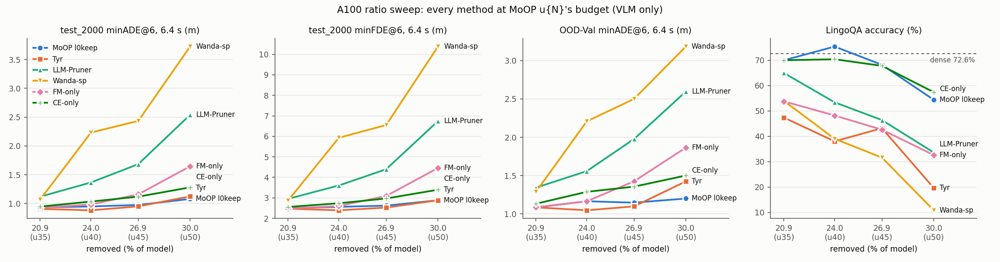

# Experiment: 외부 기준선·단일 기준 비율 실험 (u35/u40/u45/u50, A100)

계획 `cvpr27/plans/2026-11-03_baselines-ratio-sweep.md` · 모델 `nvidia/Alpamayo-1.5-10B`(rev `7aba829`)
· KISTI NEURON A100-SXM4-80GB · 분석 `cvpr27/code/analyze_ratio_sweep.py`(`outputs/cvpr27/ratio_sweep/`),
그림 `cvpr27/code/plot_ratio_sweep.py`.

## Purpose
- 외부 기준선(LLM-Pruner, Tyr, Wanda-sp)과 단일 기준 대조(FM-only, CE-only)를 MoOP u{N}과 같은 예산으로 만든다.
  비율 곡선 위에서 MoOP l0keep과 비교한다.
- 질문:
  - 순위가 비율에 따라 바뀌는가
  - 어느 방법이 먼저 무너지는가
  - 두 기준을 합친 이점(합집합)이 비율에 따라 커지는가

## Setup
- **공통:** VLM 텍스트 타워만 자른다. expert와 k/v는 그대로다.
- **예산:** MoOP `dual_u{N}_v2`의 제거량에 맞춘다.

  | 비율 | 제거 파라미터 | 모델 대비 |
  |---|---|---|
  | u35 | 2,317,860,864 | 20.92% |
  | u40 | 2,657,452,032 | 23.99% |
  | u45 | 2,974,777,344 | 26.85% |
  | u50 | 3,321,888,768 | 29.98% |

  l0keep 계열(MoOP l0keep, FM-only, CE-only)은 0번 층 Q head를 보존하고 MLP로 갚는다. 그래서 예산보다 4,096–8,192 파라미터 적다.
- **방법별 레시피 (u40 점은 기존 A100 arm):**

  | 방법 | 레시피 | u40 arm |
  |---|---|---|
  | MoOP l0keep | `dual_u{N}_l0keep_v2` | `moop_l0keep` |
  | FM-only | `trajlastcoc_u{N}_l0keep_v2` | `fm_only_l0keep` |
  | CE-only | `coc_u{N}_l0keep_v2` | `ce_only_l0keep` |

  - **Tyr:** 공식 절차(supernet·탐색 4회, 식 5, KL 적합도, calib_100). R=1 출발점을 head·MLP 유형별로 둬서 출발점이 MoOP u{N}의 층당 절단 수와 같다. u40 arm은 `tyr_off`다.
    - u45는 29번 층, u50은 30번 층의 Q head를 모두 지웠다. 이 층에는 출력이 정확히 0인 자리 지킴 head를 남겼다(1,048,576 파라미터, 같은 함수).
  - **LLM-Pruner:** Q head 단위, 4–33번 층, `coc_param_first` 중요도 재사용. 원본 반올림 규칙의 head 수에 MLP 수로 예산을 정확히 맞췄다. u40 arm은 `lp_m24`다.

    | 비율 | 층당 head | 층당 MLP | +1 하는 앞쪽 층 수 |
    |---|---|---|---|
    | u35 | 13 | 5,178 | 8 |
    | u45 | 17 | 6,618 | 28 |
    | u50 | 19 | 7,389 | 26 |

  - **Wanda-sp:** FLAP 공식(층별 순차, 0번 층 포함 균일). 비율마다 통계를 다시 모았다. u40 arm은 `wandasp`다.
- **빌드 게이트(모두 통과):**
  - u40 재현: lp_m24, FM-only, CE-only, MoOP l0keep
  - LLM-Pruner 비율 간 포함 관계
  - Wanda-sp 빌드 유닛 = 수집 유닛
  - 예산 일치
- **평가:** `run_baseline.py --no-tf`, k=8, 클립별 seed 42.
  - 세트: test_2000(4샤드), OOD-Val262(2샤드), OOD-train1271(4샤드, 11-06 추가), LingoQA 500문항(Lingo-Judge)
  - 실행: 105작업, 실패 0. 홀더 961968, 962366, 963341, 963342, 965927, 965928. 11-03 19:30 – 11-04 21:48 KST.
  - OOD-train(계획 §8): 20개 arm × 4샤드 = 80작업, 실패 0. 홀더 967843, 967844, 968914. 11-06 03:44 – 14:07 KST.
    u40 점은 FM-only·CE-only만 이 큐에서 새로 쟀다. MoOP l0keep·Tyr·LLM-Pruner·Wanda-sp의 u40은 11-03 OOD-train 행
    (`2026-11-03_oodtrain-coc-quality.md`)이다.
  - 짝지은 Δ: 같은 비율의 MoOP l0keep 대비, 부트스트랩 200,000회. LingoQA는 100개 세그먼트를 재표집했다.

## Results (Facts)

그림은 6.4 s minADE@6·minFDE@6과 LingoQA만 보여 준다. 여섯 지표 전체는 아래 표에 있다.

### test_2000 (2,000클립) — 절댓값

| 비율 (제거) | 방법 | minADE@6 1.6 s | 3.2 s | 6.4 s | minFDE@6 1.6 s | 3.2 s | 6.4 s | CoC 퇴화 |
|---|---|---|---|---|---|---|---|---|
| u35 (20.92%) | MoOP l0keep | 0.060 | 0.231 | 0.933 | 0.152 | 0.607 | 2.496 | 1.9% |
| u35 (20.92%) | FM-only | 0.060 | 0.230 | 0.927 | 0.152 | 0.602 | 2.480 | 2.6% |
| u35 (20.92%) | CE-only | 0.060 | 0.233 | 0.945 | 0.153 | 0.612 | 2.557 | 1.9% |
| u35 (20.92%) | Tyr | 0.059 | 0.221 | 0.906 | 0.149 | 0.578 | 2.473 | 1.3% |
| u35 (20.92%) | LLM-Pruner | 0.079 | 0.289 | 1.118 | 0.199 | 0.748 | 2.952 | 4.2% |
| u35 (20.92%) | Wanda-sp | 0.070 | 0.263 | 1.068 | 0.177 | 0.686 | 2.867 | 6.1% |
| u40 (23.99%) | MoOP l0keep | 0.060 | 0.233 | 0.948 | 0.153 | 0.615 | 2.561 | 2.6% |
| u40 (23.99%) | FM-only | 0.066 | 0.249 | 0.982 | 0.166 | 0.654 | 2.601 | 3.5% |
| u40 (23.99%) | CE-only | 0.070 | 0.261 | 1.033 | 0.177 | 0.677 | 2.738 | 6.8% |
| u40 (23.99%) | Tyr | 0.059 | 0.221 | 0.882 | 0.149 | 0.569 | 2.394 | 1.1% |
| u40 (23.99%) | LLM-Pruner | 0.099 | 0.359 | 1.365 | 0.253 | 0.926 | 3.604 | 17.0% |
| u40 (23.99%) | Wanda-sp | 0.170 | 0.601 | 2.232 | 0.437 | 1.581 | 5.931 | 75.0% |
| u45 (26.85%) | MoOP l0keep | 0.062 | 0.242 | 0.975 | 0.157 | 0.634 | 2.622 | 2.5% |
| u45 (26.85%) | FM-only | 0.077 | 0.294 | 1.159 | 0.197 | 0.770 | 3.093 | 8.6% |
| u45 (26.85%) | CE-only | 0.075 | 0.281 | 1.118 | 0.189 | 0.736 | 2.969 | 9.8% |
| u45 (26.85%) | Tyr | 0.066 | 0.239 | 0.949 | 0.165 | 0.620 | 2.527 | 0.4% |
| u45 (26.85%) | LLM-Pruner | 0.131 | 0.465 | 1.683 | 0.336 | 1.197 | 4.396 | 31.0% |
| u45 (26.85%) | Wanda-sp | 0.181 | 0.649 | 2.434 | 0.470 | 1.732 | 6.552 | 76.8% |
| u50 (29.98%) | MoOP l0keep | 0.068 | 0.267 | 1.079 | 0.173 | 0.705 | 2.881 | 3.2% |
| u50 (29.98%) | FM-only | 0.104 | 0.409 | 1.645 | 0.274 | 1.117 | 4.456 | 24.2% |
| u50 (29.98%) | CE-only | 0.091 | 0.332 | 1.280 | 0.230 | 0.862 | 3.397 | 16.2% |
| u50 (29.98%) | Tyr | 0.092 | 0.311 | 1.123 | 0.229 | 0.781 | 2.881 | 3.0% |
| u50 (29.98%) | LLM-Pruner | 0.191 | 0.692 | 2.539 | 0.499 | 1.848 | 6.744 | 74.5% |
| u50 (29.98%) | Wanda-sp | 0.247 | 0.953 | 3.726 | 0.669 | 2.656 | 10.379 | 99.8% |

### test_2000 — 같은 비율 MoOP l0keep 대비 짝지은 Δ (평균 [95% CI]; *는 CI가 0 배제)

| 비율 | 방법 | d minADE@6 1.6 s | 3.2 s | 6.4 s | d minFDE@6 1.6 s | 3.2 s | 6.4 s |
|---|---|---|---|---|---|---|---|
| u35 | FM-only | +0.000 [-0.002, +0.002] | -0.002 [-0.007, +0.004] | -0.006 [-0.026, +0.014] | -0.000 [-0.005, +0.005] | -0.005 [-0.022, +0.011] | -0.017 [-0.083, +0.049] |
| u35 | CE-only | +0.000 [-0.001, +0.002] | +0.002 [-0.004, +0.007] | +0.013 [-0.006, +0.032] | +0.001 [-0.004, +0.005] | +0.006 [-0.011, +0.022] | +0.061 [-0.003, +0.124] |
| u35 | Tyr | -0.001 [-0.003, +0.001] | -0.010 [-0.018, -0.003]* | -0.026 [-0.052, +0.000] | -0.004 [-0.010, +0.003] | -0.029 [-0.050, -0.007]* | -0.024 [-0.109, +0.064] |
| u35 | LLM-Pruner | +0.019 [+0.016, +0.022]* | +0.058 [+0.047, +0.069]* | +0.186 [+0.149, +0.224]* | +0.047 [+0.039, +0.056]* | +0.142 [+0.111, +0.174]* | +0.456 [+0.348, +0.567]* |
| u35 | Wanda-sp | +0.010 [+0.007, +0.013]* | +0.031 [+0.022, +0.041]* | +0.136 [+0.098, +0.174]* | +0.025 [+0.018, +0.033]* | +0.080 [+0.051, +0.110]* | +0.371 [+0.254, +0.491]* |
| u40 | FM-only | +0.006 [+0.004, +0.008]* | +0.016 [+0.008, +0.024]* | +0.034 [+0.010, +0.059]* | +0.013 [+0.007, +0.019]* | +0.039 [+0.018, +0.061]* | +0.040 [-0.034, +0.115] |
| u40 | CE-only | +0.010 [+0.008, +0.013]* | +0.028 [+0.019, +0.036]* | +0.085 [+0.056, +0.117]* | +0.024 [+0.017, +0.031]* | +0.062 [+0.039, +0.087]* | +0.176 [+0.088, +0.269]* |
| u40 | Tyr | -0.001 [-0.003, +0.001] | -0.013 [-0.020, -0.006]* | -0.066 [-0.091, -0.042]* | -0.005 [-0.010, +0.001] | -0.046 [-0.066, -0.025]* | -0.167 [-0.250, -0.084]* |
| u40 | LLM-Pruner | +0.039 [+0.034, +0.044]* | +0.126 [+0.109, +0.143]* | +0.417 [+0.356, +0.482]* | +0.100 [+0.087, +0.113]* | +0.311 [+0.264, +0.362]* | +1.043 [+0.858, +1.238]* |
| u40 | Wanda-sp | +0.110 [+0.102, +0.118]* | +0.368 [+0.340, +0.397]* | +1.284 [+1.184, +1.387]* | +0.284 [+0.262, +0.306]* | +0.966 [+0.886, +1.049]* | +3.370 [+3.072, +3.676]* |
| u45 | FM-only | +0.016 [+0.012, +0.020]* | +0.052 [+0.038, +0.067]* | +0.185 [+0.133, +0.240]* | +0.040 [+0.030, +0.051]* | +0.136 [+0.095, +0.180]* | +0.471 [+0.323, +0.628]* |
| u45 | CE-only | +0.014 [+0.011, +0.016]* | +0.038 [+0.028, +0.049]* | +0.144 [+0.105, +0.185]* | +0.032 [+0.024, +0.040]* | +0.102 [+0.072, +0.133]* | +0.347 [+0.226, +0.476]* |
| u45 | Tyr | +0.005 [+0.002, +0.007]* | -0.003 [-0.012, +0.006] | -0.025 [-0.056, +0.006] | +0.008 [+0.001, +0.015]* | -0.013 [-0.040, +0.013] | -0.095 [-0.193, +0.003] |
| u45 | LLM-Pruner | +0.070 [+0.063, +0.076]* | +0.223 [+0.199, +0.246]* | +0.709 [+0.629, +0.791]* | +0.179 [+0.161, +0.197]* | +0.563 [+0.499, +0.630]* | +1.774 [+1.541, +2.015]* |
| u45 | Wanda-sp | +0.120 [+0.112, +0.128]* | +0.406 [+0.377, +0.437]* | +1.459 [+1.351, +1.571]* | +0.313 [+0.290, +0.336]* | +1.098 [+1.013, +1.185]* | +3.930 [+3.602, +4.267]* |
| u50 | FM-only | +0.036 [+0.030, +0.042]* | +0.143 [+0.120, +0.166]* | +0.566 [+0.482, +0.653]* | +0.100 [+0.084, +0.118]* | +0.412 [+0.346, +0.481]* | +1.575 [+1.330, +1.828]* |
| u50 | CE-only | +0.024 [+0.020, +0.028]* | +0.065 [+0.051, +0.079]* | +0.201 [+0.153, +0.252]* | +0.057 [+0.046, +0.068]* | +0.157 [+0.119, +0.197]* | +0.516 [+0.368, +0.671]* |
| u50 | Tyr | +0.024 [+0.019, +0.029]* | +0.045 [+0.030, +0.059]* | +0.044 [+0.001, +0.088]* | +0.056 [+0.044, +0.068]* | +0.076 [+0.038, +0.115]* | +0.000 [-0.135, +0.137] |
| u50 | LLM-Pruner | +0.123 [+0.114, +0.132]* | +0.425 [+0.394, +0.457]* | +1.461 [+1.353, +1.570]* | +0.326 [+0.302, +0.350]* | +1.143 [+1.055, +1.233]* | +3.863 [+3.554, +4.177]* |
| u50 | Wanda-sp | +0.179 [+0.169, +0.189]* | +0.686 [+0.649, +0.724]* | +2.647 [+2.511, +2.785]* | +0.495 [+0.467, +0.524]* | +1.952 [+1.843, +2.062]* | +7.498 [+7.101, +7.899]* |

### OOD-Val262 — 절댓값

| 비율 (제거) | 방법 | minADE@6 1.6 s | 3.2 s | 6.4 s | minFDE@6 1.6 s | 3.2 s | 6.4 s | CoC 퇴화 |
|---|---|---|---|---|---|---|---|---|
| u35 (20.92%) | MoOP l0keep | 0.076 | 0.290 | 1.084 | 0.201 | 0.743 | 2.781 | 3.8% |
| u35 (20.92%) | FM-only | 0.074 | 0.283 | 1.085 | 0.197 | 0.725 | 2.769 | 4.2% |
| u35 (20.92%) | CE-only | 0.074 | 0.295 | 1.132 | 0.197 | 0.782 | 2.877 | 2.3% |
| u35 (20.92%) | Tyr | 0.081 | 0.303 | 1.085 | 0.215 | 0.774 | 2.696 | 1.9% |
| u35 (20.92%) | LLM-Pruner | 0.106 | 0.391 | 1.342 | 0.280 | 0.998 | 3.365 | 6.9% |
| u35 (20.92%) | Wanda-sp | 0.086 | 0.341 | 1.286 | 0.235 | 0.916 | 3.316 | 4.6% |
| u40 (23.99%) | MoOP l0keep | 0.077 | 0.304 | 1.165 | 0.206 | 0.795 | 3.017 | 2.3% |
| u40 (23.99%) | FM-only | 0.081 | 0.316 | 1.164 | 0.220 | 0.817 | 2.958 | 4.6% |
| u40 (23.99%) | CE-only | 0.095 | 0.361 | 1.287 | 0.254 | 0.932 | 3.107 | 8.8% |
| u40 (23.99%) | Tyr | 0.074 | 0.287 | 1.046 | 0.197 | 0.751 | 2.569 | 2.7% |
| u40 (23.99%) | LLM-Pruner | 0.125 | 0.442 | 1.558 | 0.325 | 1.127 | 3.876 | 15.3% |
| u40 (23.99%) | Wanda-sp | 0.187 | 0.661 | 2.208 | 0.487 | 1.706 | 5.354 | 74.8% |
| u45 (26.85%) | MoOP l0keep | 0.076 | 0.297 | 1.146 | 0.204 | 0.782 | 2.920 | 5.3% |
| u45 (26.85%) | FM-only | 0.100 | 0.385 | 1.425 | 0.266 | 1.008 | 3.686 | 11.8% |
| u45 (26.85%) | CE-only | 0.101 | 0.383 | 1.355 | 0.268 | 0.987 | 3.346 | 7.6% |
| u45 (26.85%) | Tyr | 0.085 | 0.313 | 1.097 | 0.224 | 0.811 | 2.715 | 0.4% |
| u45 (26.85%) | LLM-Pruner | 0.162 | 0.592 | 1.977 | 0.425 | 1.543 | 4.900 | 36.6% |
| u45 (26.85%) | Wanda-sp | 0.204 | 0.736 | 2.501 | 0.541 | 1.917 | 6.249 | 82.1% |
| u50 (29.98%) | MoOP l0keep | 0.083 | 0.326 | 1.200 | 0.219 | 0.844 | 3.062 | 3.1% |
| u50 (29.98%) | FM-only | 0.121 | 0.483 | 1.864 | 0.324 | 1.318 | 5.021 | 31.7% |
| u50 (29.98%) | CE-only | 0.119 | 0.426 | 1.500 | 0.310 | 1.081 | 3.732 | 19.8% |
| u50 (29.98%) | Tyr | 0.122 | 0.428 | 1.424 | 0.315 | 1.082 | 3.446 | 3.8% |
| u50 (29.98%) | LLM-Pruner | 0.201 | 0.733 | 2.597 | 0.528 | 1.967 | 6.616 | 77.9% |
| u50 (29.98%) | Wanda-sp | 0.225 | 0.863 | 3.184 | 0.605 | 2.382 | 8.371 | 100.0% |

### OOD-Val262 — 같은 비율 MoOP l0keep 대비 짝지은 Δ (평균 [95% CI]; *는 CI가 0 배제)

| 비율 | 방법 | d minADE@6 1.6 s | 3.2 s | 6.4 s | d minFDE@6 1.6 s | 3.2 s | 6.4 s |
|---|---|---|---|---|---|---|---|
| u35 | FM-only | -0.002 [-0.010, +0.006] | -0.007 [-0.036, +0.020] | +0.002 [-0.104, +0.102] | -0.004 [-0.027, +0.018] | -0.018 [-0.100, +0.063] | -0.012 [-0.326, +0.291] |
| u35 | CE-only | -0.002 [-0.011, +0.006] | +0.004 [-0.026, +0.031] | +0.048 [-0.047, +0.138] | -0.004 [-0.028, +0.017] | +0.039 [-0.042, +0.115] | +0.096 [-0.159, +0.350] |
| u35 | Tyr | +0.005 [-0.007, +0.017] | +0.012 [-0.027, +0.052] | +0.001 [-0.130, +0.129] | +0.014 [-0.018, +0.048] | +0.031 [-0.077, +0.138] | -0.084 [-0.430, +0.247] |
| u35 | LLM-Pruner | +0.031 [+0.016, +0.045]* | +0.101 [+0.053, +0.151]* | +0.258 [+0.128, +0.390]* | +0.079 [+0.041, +0.118]* | +0.255 [+0.127, +0.387]* | +0.584 [+0.270, +0.896]* |
| u35 | Wanda-sp | +0.010 [-0.001, +0.021] | +0.051 [+0.010, +0.092]* | +0.203 [+0.069, +0.346]* | +0.034 [+0.003, +0.063]* | +0.173 [+0.056, +0.291]* | +0.535 [+0.182, +0.912]* |
| u40 | FM-only | +0.004 [-0.007, +0.015] | +0.013 [-0.029, +0.052] | -0.001 [-0.167, +0.164] | +0.013 [-0.017, +0.042] | +0.022 [-0.104, +0.144] | -0.059 [-0.538, +0.413] |
| u40 | CE-only | +0.018 [+0.007, +0.030]* | +0.058 [+0.017, +0.102]* | +0.123 [-0.030, +0.261] | +0.048 [+0.018, +0.082]* | +0.137 [+0.019, +0.258]* | +0.090 [-0.378, +0.486] |
| u40 | Tyr | -0.003 [-0.012, +0.006] | -0.017 [-0.052, +0.014] | -0.118 [-0.257, -0.002]* | -0.009 [-0.035, +0.015] | -0.044 [-0.147, +0.046] | -0.448 [-0.871, -0.103]* |
| u40 | LLM-Pruner | +0.048 [+0.032, +0.066]* | +0.138 [+0.084, +0.197]* | +0.393 [+0.213, +0.578]* | +0.119 [+0.076, +0.166]* | +0.332 [+0.182, +0.491]* | +0.859 [+0.363, +1.347]* |
| u40 | Wanda-sp | +0.110 [+0.088, +0.134]* | +0.358 [+0.284, +0.438]* | +1.043 [+0.812, +1.293]* | +0.281 [+0.220, +0.346]* | +0.911 [+0.707, +1.132]* | +2.337 [+1.687, +3.032]* |
| u45 | FM-only | +0.024 [+0.013, +0.035]* | +0.087 [+0.052, +0.126]* | +0.279 [+0.147, +0.420]* | +0.062 [+0.034, +0.093]* | +0.225 [+0.127, +0.331]* | +0.766 [+0.349, +1.213]* |
| u45 | CE-only | +0.025 [+0.013, +0.038]* | +0.086 [+0.047, +0.128]* | +0.209 [+0.093, +0.333]* | +0.063 [+0.033, +0.098]* | +0.204 [+0.101, +0.317]* | +0.426 [+0.102, +0.758]* |
| u45 | Tyr | +0.009 [+0.002, +0.017]* | +0.016 [-0.010, +0.043] | -0.049 [-0.128, +0.030] | +0.020 [-0.001, +0.041] | +0.029 [-0.046, +0.105] | -0.205 [-0.442, +0.023] |
| u45 | LLM-Pruner | +0.086 [+0.065, +0.109]* | +0.294 [+0.223, +0.372]* | +0.831 [+0.618, +1.064]* | +0.221 [+0.164, +0.282]* | +0.761 [+0.567, +0.974]* | +1.980 [+1.415, +2.590]* |
| u45 | Wanda-sp | +0.128 [+0.103, +0.154]* | +0.439 [+0.353, +0.531]* | +1.355 [+1.074, +1.658]* | +0.337 [+0.270, +0.409]* | +1.135 [+0.895, +1.396]* | +3.329 [+2.548, +4.168]* |
| u50 | FM-only | +0.038 [+0.024, +0.053]* | +0.157 [+0.102, +0.217]* | +0.665 [+0.455, +0.890]* | +0.106 [+0.066, +0.148]* | +0.474 [+0.310, +0.649]* | +1.959 [+1.340, +2.615]* |
| u50 | CE-only | +0.036 [+0.023, +0.050]* | +0.100 [+0.057, +0.148]* | +0.301 [+0.160, +0.455]* | +0.092 [+0.057, +0.130]* | +0.237 [+0.115, +0.370]* | +0.670 [+0.277, +1.095]* |
| u50 | Tyr | +0.039 [+0.025, +0.054]* | +0.102 [+0.058, +0.152]* | +0.224 [+0.102, +0.356]* | +0.097 [+0.060, +0.138]* | +0.238 [+0.117, +0.371]* | +0.384 [+0.092, +0.687]* |
| u50 | LLM-Pruner | +0.118 [+0.094, +0.144]* | +0.407 [+0.319, +0.502]* | +1.397 [+1.108, +1.709]* | +0.310 [+0.243, +0.382]* | +1.123 [+0.876, +1.389]* | +3.554 [+2.743, +4.421]* |
| u50 | Wanda-sp | +0.142 [+0.116, +0.169]* | +0.537 [+0.441, +0.637]* | +1.984 [+1.656, +2.323]* | +0.387 [+0.314, +0.463]* | +1.538 [+1.264, +1.823]* | +5.309 [+4.374, +6.266]* |

### OOD-train1271 — 절댓값

| 비율 (제거) | 방법 | minADE@6 1.6 s | 3.2 s | 6.4 s | minFDE@6 1.6 s | 3.2 s | 6.4 s | CoC 퇴화 |
|---|---|---|---|---|---|---|---|---|
| u35 (20.92%) | MoOP l0keep | 0.074 | 0.281 | 1.013 | 0.194 | 0.723 | 2.472 | 2.4% |
| u35 (20.92%) | FM-only | 0.075 | 0.289 | 1.038 | 0.198 | 0.728 | 2.557 | 2.7% |
| u35 (20.92%) | CE-only | 0.074 | 0.285 | 1.039 | 0.194 | 0.737 | 2.562 | 2.0% |
| u35 (20.92%) | Tyr | 0.078 | 0.294 | 1.013 | 0.205 | 0.741 | 2.441 | 1.6% |
| u35 (20.92%) | LLM-Pruner | 0.111 | 0.388 | 1.273 | 0.283 | 0.968 | 2.993 | 7.5% |
| u35 (20.92%) | Wanda-sp | 0.095 | 0.352 | 1.222 | 0.250 | 0.897 | 2.978 | 3.8% |
| u40 (23.99%) | MoOP l0keep | 0.075 | 0.284 | 1.023 | 0.195 | 0.727 | 2.496 | 2.8% |
| u40 (23.99%) | FM-only | 0.085 | 0.321 | 1.132 | 0.225 | 0.810 | 2.765 | 4.6% |
| u40 (23.99%) | CE-only | 0.091 | 0.334 | 1.157 | 0.234 | 0.848 | 2.836 | 6.8% |
| u40 (23.99%) | Tyr | 0.081 | 0.298 | 1.035 | 0.212 | 0.757 | 2.490 | 1.4% |
| u40 (23.99%) | LLM-Pruner | 0.135 | 0.471 | 1.526 | 0.347 | 1.180 | 3.583 | 16.9% |
| u40 (23.99%) | Wanda-sp | 0.220 | 0.749 | 2.390 | 0.566 | 1.902 | 5.650 | 76.0% |
| u45 (26.85%) | MoOP l0keep | 0.078 | 0.300 | 1.073 | 0.204 | 0.768 | 2.628 | 3.9% |
| u45 (26.85%) | FM-only | 0.104 | 0.387 | 1.382 | 0.272 | 0.996 | 3.456 | 13.8% |
| u45 (26.85%) | CE-only | 0.100 | 0.360 | 1.219 | 0.256 | 0.899 | 2.922 | 9.8% |
| u45 (26.85%) | Tyr | 0.094 | 0.333 | 1.102 | 0.242 | 0.834 | 2.598 | 0.4% |
| u45 (26.85%) | LLM-Pruner | 0.170 | 0.569 | 1.803 | 0.433 | 1.417 | 4.234 | 33.6% |
| u45 (26.85%) | Wanda-sp | 0.233 | 0.803 | 2.557 | 0.608 | 2.056 | 6.081 | 77.7% |
| u50 (29.98%) | MoOP l0keep | 0.088 | 0.329 | 1.169 | 0.227 | 0.833 | 2.849 | 3.0% |
| u50 (29.98%) | FM-only | 0.125 | 0.477 | 1.766 | 0.329 | 1.260 | 4.521 | 30.3% |
| u50 (29.98%) | CE-only | 0.124 | 0.425 | 1.384 | 0.316 | 1.049 | 3.295 | 15.6% |
| u50 (29.98%) | Tyr | 0.141 | 0.475 | 1.466 | 0.363 | 1.173 | 3.353 | 2.6% |
| u50 (29.98%) | LLM-Pruner | 0.225 | 0.775 | 2.517 | 0.587 | 2.001 | 6.025 | 74.8% |
| u50 (29.98%) | Wanda-sp | 0.250 | 0.920 | 3.259 | 0.668 | 2.476 | 8.369 | 99.8% |

### OOD-train1271 — 같은 비율 MoOP l0keep 대비 짝지은 Δ (평균 [95% CI]; *는 CI가 0 배제)

| 비율 | 방법 | d minADE@6 1.6 s | 3.2 s | 6.4 s | d minFDE@6 1.6 s | 3.2 s | 6.4 s |
|---|---|---|---|---|---|---|---|
| u35 | FM-only | +0.001 [-0.003, +0.004] | +0.008 [-0.004, +0.020] | +0.025 [-0.011, +0.064] | +0.004 [-0.005, +0.014] | +0.005 [-0.026, +0.039] | +0.085 [-0.016, +0.190] |
| u35 | CE-only | +0.000 [-0.003, +0.003] | +0.003 [-0.007, +0.013] | +0.026 [-0.013, +0.066] | +0.000 [-0.008, +0.008] | +0.014 [-0.016, +0.045] | +0.090 [-0.024, +0.209] |
| u35 | Tyr | +0.004 [+0.000, +0.007]* | +0.013 [+0.001, +0.025]* | -0.000 [-0.043, +0.041] | +0.012 [+0.002, +0.021]* | +0.018 [-0.017, +0.053] | -0.031 [-0.149, +0.083] |
| u35 | LLM-Pruner | +0.037 [+0.031, +0.043]* | +0.107 [+0.088, +0.128]* | +0.260 [+0.199, +0.326]* | +0.089 [+0.074, +0.106]* | +0.246 [+0.193, +0.304]* | +0.521 [+0.358, +0.695]* |
| u35 | Wanda-sp | +0.021 [+0.016, +0.026]* | +0.070 [+0.053, +0.089]* | +0.209 [+0.148, +0.273]* | +0.056 [+0.043, +0.070]* | +0.175 [+0.125, +0.227]* | +0.506 [+0.342, +0.678]* |
| u40 | FM-only | +0.010 [+0.006, +0.015]* | +0.036 [+0.021, +0.052]* | +0.109 [+0.063, +0.159]* | +0.030 [+0.017, +0.043]* | +0.083 [+0.042, +0.126]* | +0.268 [+0.141, +0.403]* |
| u40 | CE-only | +0.016 [+0.012, +0.021]* | +0.049 [+0.036, +0.064]* | +0.134 [+0.093, +0.179]* | +0.039 [+0.027, +0.051]* | +0.121 [+0.084, +0.160]* | +0.340 [+0.224, +0.465]* |
| u40 | Tyr | +0.006 [+0.002, +0.010]* | +0.014 [+0.000, +0.028]* | +0.012 [-0.038, +0.060] | +0.017 [+0.006, +0.028]* | +0.030 [-0.012, +0.070] | -0.006 [-0.149, +0.127] |
| u40 | LLM-Pruner | +0.061 [+0.053, +0.069]* | +0.186 [+0.162, +0.212]* | +0.504 [+0.430, +0.582]* | +0.152 [+0.132, +0.174]* | +0.453 [+0.387, +0.523]* | +1.087 [+0.887, +1.292]* |
| u40 | Wanda-sp | +0.145 [+0.133, +0.158]* | +0.465 [+0.424, +0.507]* | +1.368 [+1.238, +1.502]* | +0.371 [+0.339, +0.405]* | +1.175 [+1.062, +1.292]* | +3.154 [+2.803, +3.514]* |
| u45 | FM-only | +0.026 [+0.020, +0.032]* | +0.087 [+0.067, +0.108]* | +0.309 [+0.241, +0.381]* | +0.068 [+0.052, +0.086]* | +0.229 [+0.174, +0.288]* | +0.828 [+0.627, +1.039]* |
| u45 | CE-only | +0.022 [+0.018, +0.027]* | +0.060 [+0.045, +0.076]* | +0.147 [+0.098, +0.199]* | +0.053 [+0.041, +0.065]* | +0.131 [+0.089, +0.175]* | +0.294 [+0.154, +0.442]* |
| u45 | Tyr | +0.016 [+0.011, +0.021]* | +0.034 [+0.018, +0.049]* | +0.030 [-0.018, +0.077] | +0.039 [+0.026, +0.052]* | +0.066 [+0.024, +0.109]* | -0.030 [-0.165, +0.103] |
| u45 | LLM-Pruner | +0.092 [+0.082, +0.102]* | +0.269 [+0.238, +0.301]* | +0.730 [+0.634, +0.829]* | +0.230 [+0.204, +0.256]* | +0.649 [+0.565, +0.737]* | +1.606 [+1.350, +1.868]* |
| u45 | Wanda-sp | +0.156 [+0.143, +0.169]* | +0.503 [+0.459, +0.547]* | +1.484 [+1.343, +1.630]* | +0.404 [+0.370, +0.439]* | +1.288 [+1.168, +1.412]* | +3.453 [+3.073, +3.844]* |
| u50 | FM-only | +0.037 [+0.030, +0.045]* | +0.149 [+0.120, +0.178]* | +0.597 [+0.494, +0.704]* | +0.102 [+0.081, +0.124]* | +0.427 [+0.344, +0.513]* | +1.672 [+1.371, +1.982]* |
| u50 | CE-only | +0.037 [+0.031, +0.043]* | +0.096 [+0.077, +0.116]* | +0.215 [+0.155, +0.277]* | +0.089 [+0.073, +0.105]* | +0.216 [+0.165, +0.270]* | +0.446 [+0.281, +0.617]* |
| u50 | Tyr | +0.053 [+0.045, +0.061]* | +0.146 [+0.122, +0.172]* | +0.297 [+0.225, +0.372]* | +0.136 [+0.115, +0.157]* | +0.340 [+0.272, +0.410]* | +0.504 [+0.319, +0.695]* |
| u50 | LLM-Pruner | +0.137 [+0.125, +0.149]* | +0.446 [+0.405, +0.489]* | +1.348 [+1.216, +1.482]* | +0.360 [+0.328, +0.393]* | +1.168 [+1.054, +1.285]* | +3.176 [+2.824, +3.535]* |
| u50 | Wanda-sp | +0.163 [+0.150, +0.176]* | +0.591 [+0.544, +0.640]* | +2.090 [+1.928, +2.255]* | +0.441 [+0.405, +0.478]* | +1.643 [+1.509, +1.781]* | +5.520 [+5.063, +5.983]* |

### LingoQA (500문항, dense 72.6%; 괄호는 같은 비율 MoOP l0keep 대비 pp)

| 비율 | MoOP l0keep | FM-only | CE-only | Tyr | LLM-Pruner | Wanda-sp |
|---|---|---|---|---|---|---|
| u35 | 70.0% | 53.8% (-16.2*) | 70.0% (+0.0) | 47.4% (-22.6*) | 65.0% (-5.0*) | 54.0% (-16.0*) |
| u40 | 75.4% | 48.2% (-27.2*) | 70.4% (-5.0*) | 38.0% (-37.4*) | 53.4% (-22.0*) | 39.0% (-36.4*) |
| u45 | 68.2% | 42.6% (-25.6*) | 67.8% (-0.4) | 43.2% (-25.0*) | 46.4% (-21.8*) | 31.6% (-36.6*) |
| u50 | 54.4% | 32.6% (-21.8*) | 57.4% (+3.0) | 19.6% (-34.8*) | 33.6% (-20.8*) | 10.8% (-43.6*) |

## Analysis (Opinion)
- **MoOP l0keep만 비율이 커져도 주행과 언어를 함께 지킨다.**
  - test2000 6.4 s minADE@6이 0.933 → 0.948 → 0.975 → 1.079로 완만하게 오른다. CoC 퇴화는 3% 이하로 유지된다.
  - LingoQA는 u45까지 68% 이상이고, u50에서 54.4%로 떨어진다.
- **Tyr는 u45까지 주행이 가장 좋지만 언어를 잃는다.**
  - test2000에서 u35 −0.026, u40 −0.066*, u45 −0.025(n.s.)다. 이득은 3.2 s·6.4 s 구간에서 보인다.
  - LingoQA는 38–47%다.
  - u50에서는 주행도 뒤집힌다(+0.044*, OOD-Val +0.224*). LingoQA는 19.6%다.
  - OOD-Val에서는 u35·u45에서 MoOP l0keep과 구별되지 않고, u40에서만 유리하다.
- **단일 기준의 약점은 비율이 클수록 커진다. 합집합의 이점은 압축이 셀수록 커진다.**

  | 비율 | FM-only test2000 Δ | CE-only test2000 Δ |
  |---|---|---|
  | u35 | −0.006 (n.s.) | +0.013 (n.s.) |
  | u40 | +0.034* | +0.085* |
  | u45 | +0.185* | +0.144* |
  | u50 | +0.566* | +0.201* |

  - FM-only는 모든 비율에서 언어를 16–27 pp 잃는다.
  - CE-only의 언어는 u40에서만 −5.0 pp*로 낮고, 나머지 비율에서는 MoOP l0keep과 같거나 조금 높다(u50 +3.0 pp, n.s.).
    대신 u40부터 주행을 잃는다.
- **LLM-Pruner·Wanda-sp는 test_2000의 모든 비율·모든 구간에서 유의하게 나쁘다.**
  - OOD-Val에서 n.s.인 칸은 Wanda-sp u35의 1.6 s minADE@6 하나뿐이다.
  - u45부터 CoC 퇴화(31–77%)와 함께 주행이 무너진다.
  - Wanda-sp는 u35(1.068)와 u40(2.232) 사이에 절벽이 있다.
- **짧은 구간(1.6 s)의 차이는 작다.** 1.6 s Δ는 대부분 0.04 m 이하이고, 차이는 3.2·6.4 s에서 벌어진다.
  예외는 LLM-Pruner·Wanda-sp의 높은 비율과 FM-only u50이다.
- **OOD-train(1,271클립, 11-06 추가)도 같은 순위를 보인다.**
  - MoOP l0keep 6.4 s minADE@6이 1.013 → 1.023 → 1.073 → 1.169로 완만하게 오르고, CoC 퇴화는 4% 이하다.
  - **Tyr의 test_2000 이점은 OOD-train으로 옮겨 가지 않는다.** 6.4 s Δ는 u35 −0.000, u40 +0.012, u45 +0.030으로
    모두 n.s.이고, 1.6·3.2 s minADE@6은 u35부터 유의하게 나쁘다(+0.004*–+0.034*). u50에서는 +0.297*로 무너진다.
    OOD-Val에서 본 것(u40에서만 유리)과 같은 방향이다.
  - 단일 기준의 격차는 비율과 함께 커지고, test_2000과 같거나 크다(u40에서 특히 크다: FM-only +0.109* 대 +0.034*,
    CE-only +0.134* 대 +0.085*).

    | 비율 | FM-only OOD-train Δ | CE-only OOD-train Δ |
    |---|---|---|
    | u35 | +0.025 (n.s.) | +0.026 (n.s.) |
    | u40 | +0.109* | +0.134* |
    | u45 | +0.309* | +0.147* |
    | u50 | +0.597* | +0.215* |

  - LLM-Pruner·Wanda-sp는 모든 비율·모든 구간에서 유의하게 나쁘다. u35에서도 +0.26*·+0.21*이고, CoC 퇴화는
    u50에서 75%·99.8%다.
- **다음:**
  - 폐루프(s600)에서 같은 비율 곡선을 볼지 결정한다. Tyr·MoOP l0keep의 u45가 후보다.
  - 리포트의 u40 점들은 각 기준선의 기존 A100 행이다.
