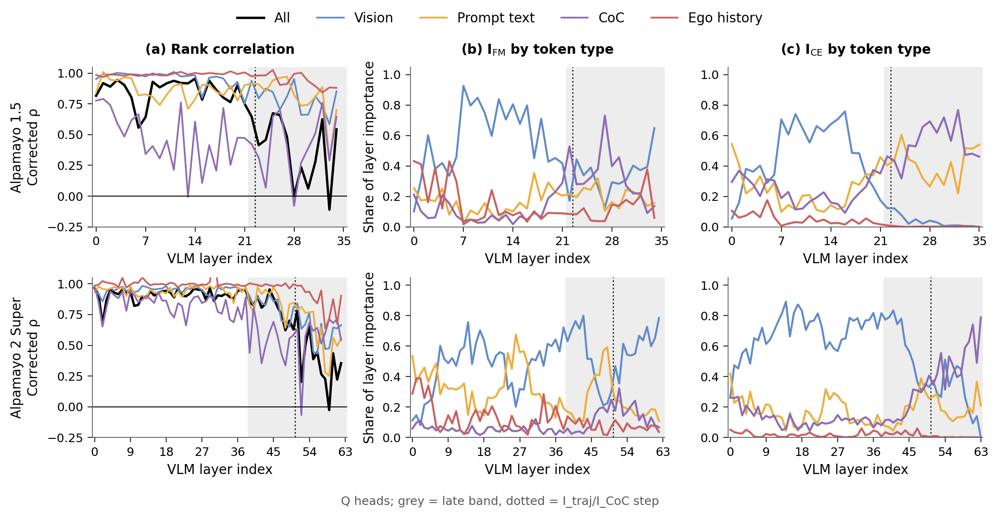
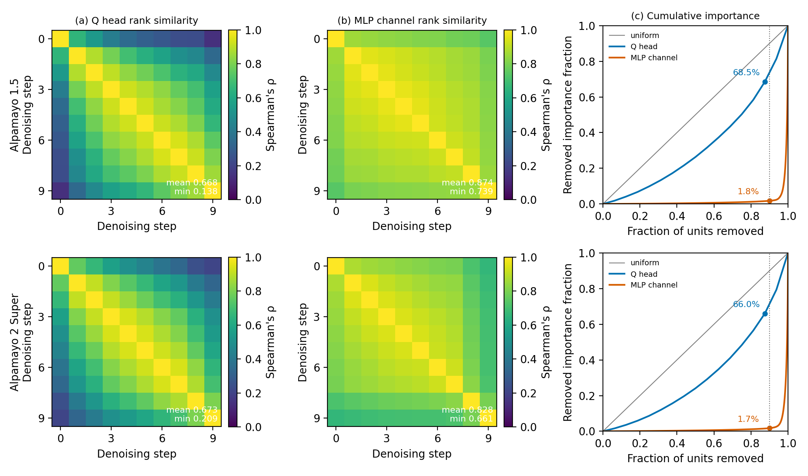
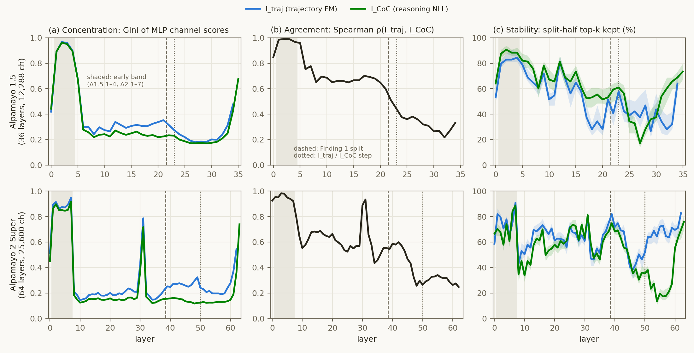

# Experiment: Alpamayo 2 Super에서 논문 분석 재현 — Fig. 3(토큰 타입), Fig. 5(expert), VLM MLP 깊이 구조

2026-11-08 · 모델 `nvidia/Alpamayo2-Super`(34B) vs `nvidia/Alpamayo-1.5-10B` · GPU 미사용(저장된 중요도·gradient 재분석)
코드 `iclr27-rebuttal/code/{a2_fig3_token_type,a2_fig5_expert,a2_depth_structure}.py` ·
결과 `iclr27-rebuttal/outputs/{a2_fig3_token_type,a2_fig5_expert,a2_depth_structure}/` ·
계획 `iclr27-rebuttal/plans/2026-11-07_a2-analysis-replication.md`

**요약**
- 일반화되는 것
  - Fig. 5(expert MLP의 스텝 안정성과 질량 집중)는 거의 그대로 재현된다.
  - Fig. 3(a)는 정성적 순서가 같다: late 불일치, 토큰 타입으로 제한하면 회복, CoC 위치에서 가장 낮음.
  - VLM 초기층 MLP 편중이 같은 상대 깊이(≤ 0.11)에 있다.
- 일반화되지 않는 것
  - Fig. 3(c)의 "late CE = text"는 약하고 늦게 나타난다(Q text 몫 0.65 vs 0.98, MLP 0.24 vs 0.98).
  - step 위치가 다르다(상대 깊이 0.80 vs 0.66).
- 사전 등록 게이트(G1–G8)는 모두 통과했다.

## Purpose

- 논문 분석 섹션의 두 발견과 cvpr27의 VLM MLP 깊이 구조가 Alpamayo 1.5(A1.5)만의 성질인지 확인한다.
  비교 대상은 규모 3.4배, 깊이 1.8배인 Alpamayo 2 Super(A2)다.
  - Finding 1: 두 목적의 층 내 순위가 깊이에 따라 갈라진다.
  - Finding 2: expert MLP 중요도는 디노이징 스텝 사이에서 안정하고 소수 채널에 몰려 있다.
  - 논문 Fig. 3(토큰 타입별 분해)과 Fig. 5(expert)는 사용자가 2026-11-08에 직접 요청했다.
  - cvpr27: VLM MLP는 1–4층만 편중되어 있고, 그 층들에서는 두 목적이 일치하며 순위가 안정하다.
- 리뷰 대응 질문: "Alpamayo 1.5 하나에서만 나온 현상인가?"

## Setup

- **이미 있던 것 (재실행하지 않음)**
  - A2 중요도 run `alpamayo2-distill/outputs/a2_importance_v1`(2026-09-27).
    - A1.5 `run_importance.py`와 같은 추정기를 썼다.
    - **같은 calib_100 클립 100개**를 썼다.
    - 무결성 게이트 G0a–e를 통과했다.
  - Finding 1은 사전 등록 판정 R1–R9로 이미 재현을 시도했다(`alpamayo2-distill/reports/2026-09-27_a2-dual-importance.md`).
  - 논문 본문 그림 7개를 두 모델 나란히 렌더링한 결과가 있다(`alpamayo2-distill/figures/a2_vs_a15/`).
    이 폴더 사본은 `reports/figures/a2_vs_a15/`.
  - GPU로 다시 재면 같은 파일이 나오므로 재측정하지 않았다.
- **이번에 새로 한 것 (세 스크립트, 두 모델에 같은 코드)**
  - `a2_fig3_token_type.py`: 논문 Fig. 3.
    - 입력: 토큰 타입별 per-clip gate gradient(`anatomy_perclip_{q,mlp}.npz`). 타입은 vision, ego-history, prompt text, 생성 CoC, sink(0번 위치) 다섯 가지다.
    - (a)는 논문과 같은 천장 보정판으로 그렸다.
  - `a2_fig5_expert.py`: 논문 Fig. 5.
    - 입력: per-step FM 중요도(`step_importance.npz`), 정의는 Eq. 4–5.
  - `a2_depth_structure.py`: cvpr27 깊이 구조. 아래 표와 설명은 이 분석에 해당한다.

  | 항목 | A1.5 | A2 |
  |---|---|---|
  | VLM | 36층, Q 32, MLP 12,288 | 64층(Qwen3-VL-32B 형태), Q 64, MLP 25,600 |
  | 중요도 | `outputs/importance_v2` | `a2_importance_v1` |
  | traj∩CoC 겹침 k (상위 0.26%) | 32 | 67 |
  | 안정성 k (상위 0.52%) | 64 | 133 |
  | 구간 (상대 깊이로 매핑) | 0 / 1–4 / 5 / 6–21 / 22–34 | 0 / 1–7 / 8–9 / 10–38 / 39–62 |

  - 지표 정의(Gini, n50, cut = 하위 39.86% 질량)는 `cvpr27/code/analyze_layer_concentration.py`의 `layer_stats`를 import해서 같다.
  - **안정성 정의를 바꿨다.** cvpr27판은 독립 calibration 추출 5개끼리 비교했지만, A2는 추출이 하나뿐이다.
    그래서 두 모델 모두 split-half로 쟀다: 100클립을 50/50으로 나눠 반쪽끼리 상위 k를 비교하고, 무작위 분할 20회(seed 0)의 중앙값을 쓴다.
  - 마지막 층은 `I_traj`가 구조적으로 0이라 traj 지표와 ρ에서 뺐다.
- **무결성 게이트 (A2를 읽기 전에 확인)**

  | 게이트 | 결과 |
  |---|---|
  | G1: cvpr27의 A1.5 수치 재현 (1–4층 Gini, 층별 n50, cut, top-32 겹침 28/26/26/23) | PASS |
  | G2: 9/27 리포트의 구간 평균 ρ 재현 (A1.5 Q 0.782/0.335, MLP 0.753/0.339; A2 Q 0.873/0.537, MLP 0.687/0.378) | PASS (4/4, 오차 ≤ 0.0003) |
  | G3: `importance.npz` = per-clip 평균 | 최대 상대오차 ≤ 2.3e-7 (두 모델) |
  | G4/G5: Fig. 3(a) late 보정 ρ — A1.5 논문 본문 / A2 9/27 리포트와 ±0.03 | PASS (10/10) |
  | G6: Fig. 3(a) late raw ρ — 9월 출력과 ±0.006 | PASS (10/10) |
  | G7: Fig. 3(b, c) A1.5 토큰 몫 — 논문 본문 11개 수치와 ±0.006 | PASS (11/11) |
  | G8: Fig. 5 A1.5 — 논문 0.668 / 0.874 / 68.5% / 1.8%와 ±0.0006 | PASS (4/4) |

  - G1은 첫 실행에서 n50만 실패했다. 계획서에 옮긴 "40–151"이 traj 열만 적은 값이었기 때문이다(CoC 4층 = 195).
    층별 값은 원본 summary와 모두 일치했고, G1을 층별 n50 대조로 바꿨다(계획서 amendment).

## Results (Facts)

### 1. Finding 1 — 깊이에 따른 순위 불일치 (9/27 리포트, 그림 README)

| 항목 | A1.5 Q | A2 Q | A1.5 MLP | A2 MLP |
|---|---:|---:|---:|---:|
| 층 내 순위 일치 ρ, trunk (A1.5 0–21 / A2 0–38) | 0.782 | 0.873 | 0.753 | 0.687 |
| 층 내 순위 일치 ρ, late (A1.5 22–34 / A2 39–62) | 0.335 | 0.537 | 0.339 | 0.378 |
| 천장 보정 late ρ | 0.375 | 0.584 | 0.539 | 0.544 |
| log(ΣI_traj/ΣI_CoC) step 위치 (상대 깊이) | 23 (0.66) | 51 (0.81) | 23 (0.66) | 50 (0.79) |
| step 크기 | 4.64× | 3.06× | 4.56× | 3.29× |
| `I_CoC`의 vision 위치 몫, late | 0.04 | 0.45 | 0.04 | 0.77 |
| `I_traj`의 vision 위치 몫, late | 0.34 | 0.55 | 0.28 | 0.52 |

### 1b. 논문 Fig. 3 — 토큰 타입별 중요도 분해 (`code/a2_fig3_token_type.py`, 새로 계산)

- **(a) 같은 위치로 제한한 층 내 순위 일치, 논문과 같은 천장 보정판**
  - 9월 렌더링은 raw ρ였지만, 논문 PDF의 Fig. 3(a)는 "Corrected ρ"다.
  - 보정 ρ = cross / √(self_FM · self_CE). 50/50 split-half로 Q는 50회, MLP는 10회 분할했다.
  - 보정 함수는 `paper_same_position.py`의 것과 같다.
- **(b, c) 층 점수의 토큰 타입별 가법 몫**
- **게이트 (모두 PASS)**
  - G4: A1.5 late 보정 평균이 논문 본문 값과 ±0.03 안에서 같다.
  - G5: A2 late 보정 평균이 9/27 리포트와 ±0.03 안에서 같다.
  - G6: raw 평균이 9월 출력값과 ±0.006 안에서 같다.
  - G7: A1.5 토큰 몫 11개 수치가 논문 본문과 ±0.006 안에서 같다(예: MLP 6–17층 I_traj vision 0.90, 27–34층 I_CoC text 0.98).

(a) 구간 평균 보정 ρ (괄호 안은 raw). trunk = A1.5 0–21 / A2 0–38, late = A1.5 22–34 / A2 39–62.

| 축 | 모델 | 구간 | All | Vision | Prompt text | CoC | Ego history |
|---|---|---|---:|---:|---:|---:|---:|
| Q | A1.5 | trunk | 0.85 | 0.96 | 0.87 | 0.47 | 0.99 |
| Q | A1.5 | late | 0.38 (0.33) | 0.79 (0.72) | 0.81 (0.75) | 0.41 (0.36) | 0.94 (0.86) |
| Q | A2 | trunk | 0.91 | 0.95 | 0.94 | 0.84 | 1.00 |
| Q | A2 | late | 0.58 (0.54) | 0.71 (0.66) | 0.73 (0.69) | 0.56 (0.50) | 0.92 (0.83) |
| MLP | A1.5 | trunk | 0.92 | 0.98 | 0.83 | 0.77 | 0.99 |
| MLP | A1.5 | late | 0.54 (0.34) | 0.71 (0.47) | 0.74 (0.49) | 0.38 (0.24) | 0.83 (0.52) |
| MLP | A2 | trunk | 0.91 | 0.91 | 0.92 | 0.90 | 1.02 |
| MLP | A2 | late | 0.54 (0.38) | 0.50 (0.37) | 0.73 (0.52) | 0.56 (0.36) | 0.91 (0.48) |

보정 ρ는 cross가 자기 일치보다 큰 층에서 1을 넘을 수 있다(A2 MLP ego trunk 1.02). A1.5에서도 같은 일이 있다.

(b, c) 토큰 타입별 몫, 구간 평균. lo = A1.5 6–17 / A2 11–30, hi = A1.5 27–34 / A2 48–60 (9/27 리포트의 상대 깊이 매핑).

| 축 | 점수 | 모델 | lo: vision / prompt / CoC / ego | hi: vision / prompt / CoC / ego |
|---|---|---|---|---|
| Q | I_FM | A1.5 | 0.72 / 0.13 / 0.05 / 0.10 | 0.35 / 0.17 / 0.32 / 0.16 |
| Q | I_FM | A2 | 0.50 / 0.35 / 0.05 / 0.10 | 0.50 / 0.26 / 0.18 / 0.06 |
| Q | I_CE | A1.5 | 0.63 / 0.16 / 0.18 / 0.03 | **0.02** / 0.36 / 0.62 / 0.00 |
| Q | I_CE | A2 | 0.73 / 0.16 / 0.10 / 0.01 | **0.35** / 0.21 / 0.44 / 0.00 |
| MLP | I_FM | A1.5 | 0.90 / 0.04 / 0.03 / 0.03 | 0.26 / 0.37 / 0.29 / 0.08 |
| MLP | I_FM | A2 | 0.68 / 0.22 / 0.02 / 0.07 | 0.48 / 0.31 / 0.16 / 0.06 |
| MLP | I_CE | A1.5 | 0.75 / 0.09 / 0.14 / 0.01 | **0.02** / 0.70 / 0.28 / 0.00 |
| MLP | I_CE | A2 | 0.92 / 0.04 / 0.03 / 0.00 | **0.75** / 0.15 / 0.09 / 0.00 |

그림 파일은 `outputs/a2_fig3_token_type/figs/`에 있다.
- 논문 스타일 쌍(A1.5 왼쪽, A2 오른쪽): `fig3a_same_position_corrected_{q_head,mlp}`, `fig3b_token_share_traj_*`, `fig3c_token_share_coc_*`
- 2×3 개요: `fig3_overview_{q_head,mlp}`

사전 등록 판정(A2):
- 통과: R1(trunk 일치·late 불일치), R2(단일 step), R4(잡음 천장 아님, 경계), R5(expert MLP 집중), R6(스텝 U자).
- 불통과: R3(step 상대 깊이), R7(`I_traj` peak이 앞), R9(late 불일치가 토큰 구성 차이).
- R8은 잘못 등록되어 판정에서 뺐다(A1.5 자신도 불통과).

### 2. 논문 Fig. 5 / Finding 2 — expert의 스텝 안정성과 질량 집중 (`code/a2_fig5_expert.py`)

- 논문 Eq. 4–5 정의대로 per-step FM 중요도에서 다시 계산했다. 9월 렌더링(`paper_figs_a2.py`)과는 독립된 코드다.
  - (a, b) 스텝 쌍의 Spearman을 층별로 구한 뒤 층 평균을 냈다.
  - (c) C(r)은 스텝 평균 중요도의 하위 ⌊rU⌋ unit 몫을 층 평균한 값이다.
- **G8: A1.5가 논문 값과 일치한다** (0.6682 / 0.8737, C(0.9) 68.53% / 1.77%; 기준 0.668 / 0.874 / 68.5% / 1.8%).

| 항목 | A1.5 | A2 |
|---|---:|---:|
| 스텝 간 ρ, Q head: 평균 (최소) | 0.668 (0.138) | 0.673 (0.209) |
| 스텝 간 ρ, MLP: 평균 (최소) | 0.874 (0.739) | 0.828 (0.661) |
| C(0.9), Q head (14/16 제거): 층 평균 [층 범위] | 68.5% [42.4–79.9%] | 66.0% [21.7–80.5%] |
| C(0.9), MLP: 층 평균 [층 범위] | 1.8% [0.0–6.5%] | 1.7% [0.0–6.8%] |
| 하위 50% unit이 가진 1차 질량: Q / MLP (9/27 리포트) | 24.96% / 0.44% | 22.61% / 0.39% |

스텝 거리 |s − s′| = 1…9에서 쌍들의 평균 ρ:

| | 1 | 2 | 3 | 4 | 5 | 6 | 7 | 8 | 9 |
|---|---:|---:|---:|---:|---:|---:|---:|---:|---:|
| A1.5 Q | 0.88 | 0.81 | 0.73 | 0.65 | 0.57 | 0.49 | 0.39 | 0.29 | 0.14 |
| A2 Q | 0.89 | 0.81 | 0.73 | 0.65 | 0.57 | 0.49 | 0.39 | 0.29 | 0.21 |
| A1.5 MLP | 0.92 | 0.90 | 0.88 | 0.87 | 0.85 | 0.84 | 0.81 | 0.79 | 0.74 |
| A2 MLP | 0.90 | 0.87 | 0.84 | 0.82 | 0.80 | 0.77 | 0.74 | 0.70 | 0.66 |

- 두 모델 모두 expert Q는 16개다. 그래서 r = 0.9는 두 모델에서 같은 14/16 head를 뜻한다.
- A2 MLP 행렬에서는 마지막 스텝(9) 행이 가장 낮다(약 0.66). 9/27 리포트에서 A2 MLP의 스텝 질량이 마지막 스텝에 몰렸던 것(0.359)과 같은 현상이다.
- 9월 렌더링 그림(Fig. 5 = `fig2_*`)은 `figures/a2_vs_a15/`에 있다.

### 3. VLM MLP 깊이 구조 (이번 분석)

구간 중앙값. n50은 질량 50%를 가진 최소 채널 수, cut은 균일 40% 절단이 지우는 질량, 겹침은 traj∩CoC 상위 k의 비율, 안정성은 split-half 상위 k 유지율이다.

| 모델 | 구간 | Gini traj / CoC | n50 traj / CoC | cut traj / CoC | 겹침 | ρ | 안정성 traj / CoC |
|---|---|---|---|---|---:|---:|---|
| A1.5 | 0 | 0.42 / 0.44 | 2552 / 2304 | 16.6% / 16.1% | 0.31 | 0.85 | 53% / 64% |
| A1.5 | **1–4** | **0.93 / 0.92** | **67 / 86** | **0.6% / 0.6%** | **0.81** | **0.99** | **83% / 89%** |
| A1.5 | 5 | 0.67 / 0.67 | 995 / 1038 | 3.1% / 3.1% | 0.62 | 0.96 | 79% / 82% |
| A1.5 | 6–21 | 0.31 / 0.24 | 3494 / 4080 | 22.2% / 25.9% | 0.58 | 0.67 | 58% / 66% |
| A1.5 | 22–34 | 0.22 / 0.19 | 4255 / 4531 | 27.0% / 28.3% | 0.16 | 0.33 | 41% / 52% |
| A2 | 0 | 0.51 / 0.45 | 4231 / 5186 | 10.9% / 13.9% | 0.58 | 0.92 | 59% / 67% |
| A2 | **1–7** | **0.89 / 0.85** | **341 / 530** | **1.2% / 1.4%** | **0.70** | **0.95** | **77% / 71%** |
| A2 | 8–9 | 0.20 / 0.17 | 9230 / 9806 | 27.5% / 29.3% | 0.38 | 0.72 | 47% / 41% |
| A2 | 10–38 | 0.19 / 0.15 | 9436 / 10131 | 28.6% / 30.6% | 0.66 | 0.58 | 65% / 59% |
| A2 | 39–62 | 0.25 / 0.13 | 8304 / 10456 | 25.6% / 31.4% | 0.22 | 0.33 | 66% / 37% |

사전 등록한 재현 기준(계획서; A2 층별 수치를 보기 전에 고정):

| 기준 | A1.5 | A2 |
|---|---|---|
| C1 편중: 앞 15% 깊이 안에 Gini ≥ 0.85(두 목적)인 연속 층이 2개 이상, 중간 구간 중앙값 ≤ 0.5 | PASS (1–4) | **PASS** (1–4 연속; 6–7도 해당, 5는 CoC 0.85 경계) |
| C2 일치: 그 층들의 traj∩CoC 겹침 ≥ 0.6이고 중간 구간보다 큼 | PASS (0.81) | **PASS** (0.68 > 0.66, 차이 작음) |
| C3 안정성: 그 층들의 split-half 유지율이 중간 구간보다 큼 (두 목적) | PASS (83/89% vs 58/66%) | **PASS** (79/69% vs 65/59%) |

추가로 관찰한 것(사전 등록 아님):
- **A2 편중 구간의 범위.** 1–7층은 모두 Gini 0.85–0.95이고, 8층에서 0.21로 급락한다.
  - 끝나는 상대 깊이가 A1.5와 같다: A1.5 4/35 = 0.11, A2 7/63 = 0.11.
  - 가장 극단적인 층은 A2 7층이다. 25,600채널 중 17개(traj) / 38개(CoC)가 질량의 절반을 가진다.
- **A2에만 있는 중간 편중 층.** 31층은 Gini 0.79 / 0.72, n50 1,655 / 2,200, ρ 0.93이고, 30층은 Gini 0.43이다. 상대 깊이는 0.49다.
  A1.5에는 이런 중간 층이 없다.
- **마지막 층 직전의 재편중.** 두 모델 모두 있다: A1.5 34–35층, A2 61–63층.
- **A2 late 구간의 CoC 순위가 불안정하다.** 52–59층 CoC split-half 유지율은 14–27%로, 같은 층 traj(64–73%)보다 훨씬 낮다.
  A1.5 late 구간은 traj 41%, CoC 52%다.
- **Q head는 두 모델 모두 고르게 퍼져 있다.** 층별 Gini 중앙값이 A1.5 0.40 / 0.38, A2 0.45 / 0.43이다. 편중은 MLP에만 있다.
- **전 층을 한 풀로 묶은 Gini.** A1.5 0.46 / 0.48, A2 0.55 / 0.53으로, 층별 편중(0.85–0.95)이 묶은 통계에서는 가려진다.

## Analysis (Opinion)

**A2로 일반화되는 것 — 세 발견의 골격**
- **Fig. 5 / Finding 2는 거의 그대로다.** 독립 코드로 다시 계산해도 같다.
  - 스텝 간 ρ는 Q 0.67 vs MLP 0.83–0.87, C(0.9)는 Q 66–69% vs MLP 1.7–1.8%다.
  - Q의 스텝 거리별 감쇠 곡선은 두 모델이 소수 둘째 자리까지 거의 같다(거리 1: 0.88–0.89, 거리 8: 0.29).
  - "expert MLP는 소수 채널로 고정하고 attention은 그대로 둔다"는 설계 근거가 규모 3.4배 모델에서도 성립한다.
  - 차이는 하나다. A2 MLP는 마지막 스텝의 순위가 다른 스텝과 조금 더 다르다(최소 0.66 vs 0.74).
- **Fig. 3(a)의 정성적 순서가 유지된다.** late 구간에서 한 토큰 타입으로 제한하면 Q head의 순위 일치가 올라간다.
  - 순서: ego-history > prompt ≈ vision > CoC ≈ All. A2는 0.92 > 0.73 ≈ 0.71 > 0.56 ≈ 0.58, A1.5는 0.94 > 0.81 ≈ 0.79 > 0.41 ≈ 0.38.
  - 생성 CoC 위치에서 불일치가 가장 오래 남는 것도 같다.
  - 다만 A2는 pooled late 불일치가 약해서(0.58 vs 0.38) 회복 폭이 작다(+0.13–0.15 vs +0.41–0.43).
- **Finding 1의 골격도 유지된다.** trunk에서는 같은 unit을 고르고, late에서는 갈라진다(MLP late 구간 중앙값 ρ는 두 모델 모두 0.33). 그 사이에 단일 step이 있다.
- **VLM 초기층 MLP 편중이 같은 상대 깊이(≤ 0.11)에서 재현된다.** 그 층들에서 두 목적이 일치하고(ρ 0.95) 순위도 상대적으로 안정하다.
  - 서로 다른 크기와 깊이의 두 모델에서 같은 상대 위치에 나타나므로, 특정 체크포인트의 우연이라기보다 구조나 사전학습 쪽 성질로 보인다.
  - 다만 두 모델은 같은 Qwen3-VL 계열이고, 같은 회사가 같은 데이터 계열로 학습했다. 그래서 "계열 내 일반화"로 쓰는 것이 정확하다.

**일반화되지 않는 것 — 위치에 관한 서사**
- step 위치: 상대 깊이 0.80 vs 0.66.
- **Fig. 3(b, c)의 토큰 서사는 절반만 옮겨 간다.**
  - A2 Q head에도 I_CE가 vision에서 text로 넘어가는 전환이 있다. 다만 늦게(약 46–50층, 상대 깊이 0.75) 불완전하게 일어난다.
    late vision 몫이 0.35로 남는다(A1.5는 0.02).
  - A2 MLP의 I_CE는 late에서도 vision 몫이 0.75다(A1.5는 0.02).
  - 그래서 "late 층의 CE 중요도는 거의 전부 text 위치에서 나온다"(논문 본문: 98%)와 "late band는 언어 채널"이라는 해석은 A2로 일반화되지 않는다.
  - A2 MLP는 late에서 vision 위치로 제한해도 일치가 오르지 않는다(0.50 vs pooled 0.54).
- **trunk의 CoC 위치 일치가 다르다.** A1.5 Q는 trunk에서도 CoC 위치의 일치가 낮지만(0.47), A2는 높다(0.84).
- A2에는 A1.5에 없는 중간 편중 층(31층)이 있다. 원인은 이 데이터로 알 수 없다.
  massive-activation 계열의 층일 수 있다는 가설은 activation norm을 재 봐야 확인된다.

**리뷰 답변에 쓸 수 있는 문장 (제안)**
- "The depth-wise divergence of the two objectives' rankings (Fig. 3a: late-band agreement rises when both scores are
  restricted to one token type and stays lowest at generated-CoC positions), the step-stability and concentration of
  expert MLP importance (Fig. 5: step-pair ρ 0.83 vs 0.67 for Q heads; the lowest 90% of MLP channels hold 1.7% of the
  importance), and the concentration of early VLM MLP layers replicate on Alpamayo 2 Super (34B, 64 layers) with the
  same estimator and calibration clips. The late-band hand-over of CE importance to text positions (Fig. 3c) is weaker
  and later there (text share 0.65 vs 0.98 for Q heads)."
- 피해야 할 표현: "모든 VLA에서 일반화된다." 지금 근거는 같은 계열의 두 모델뿐이다.

**압축에 대한 함의 (의견)**
- A2에 균일 40% 절단을 적용하면 초기층에서는 질량 1.2–1.4%만 지우고, 중간층에서는 28.6–30.6%를 지운다. A1.5와 같은 비대칭이다.
- A2의 late CoC 순위는 50클립에서 크게 흔들린다(유지율 14–27%). 그래서 A2를 가지치기한다면 calibration 클립을 늘리는 것이 먼저다.

**다음 단계 (제안, 모두 GPU)**
1. **Qwen3-VL 기본 모델 대조군.**
   - 계획: activation norm만으로 초기층 편중과 31층 편중이 사전학습 모델에도 있는지 본다.
   - 비용: 8B는 카드 1장, 32B는 2장이 필요하다. 비용이 가장 적고 "구조 vs 주행 파인튜닝"을 가른다.
2. **A2 held-out 재현.**
   - 계획: val100 / OOD100에서 step, R1–R6, 깊이 구조가 유지되는지 본다. A1.5는 supplementary에 held-out 재현이 있다.
   - 비용: 100클립당 48 GB 카드 4장으로 약 51분.
3. **MoOP를 A2에 적용.** 분석이 아니라 방법의 일반화를 보는 실험이다. 가지치기, 개루프 평가, LingoQA까지 필요해 비용이 크다.
4. **다른 계열 모델.** π0.5(manipulation, PaliGemma 기반)로 계열 밖 일반화를 본다.
