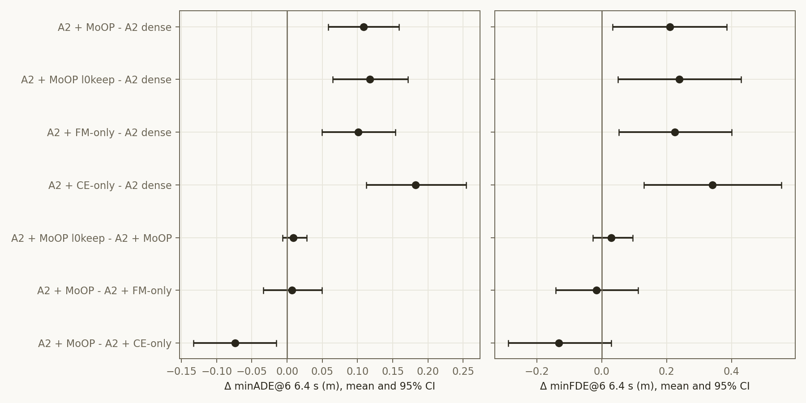

# Experiment: Alpamayo 2 Super에 ICLR27 MoOP 적용 — test500 개루프 (dense · MoOP · MoOP l0keep · FM-only · CE-only)

2026-11-09 · 모델 `nvidia/Alpamayo2-Super`(34B, rev `00554695`) · RTX 5880 Ada 2장 1쌍 × 2쌍(GPU 4·5, 6·7)
계획 `iclr27-rebuttal/plans/2026-11-09_a2-moop-test500.md` · 코드 `iclr27-rebuttal/code/{make_a2_moop_masks,run_a2_openloop,analyze_a2_test500}.py`, `run_a2_worker.sh`, `run_a2_arms.sh`
결과 `iclr27-rebuttal/outputs/a2_test500_{dense,moop,moop_l0keep,fm_only,ce_only}/`, 분석 `iclr27-rebuttal/outputs/a2_test500_analysis/`

**요약**
- 34.1%를 잘라낸 A2는 test500에서 dense보다 나빠진다.
  - minADE@6(6.4 s) 증가: MoOP +11.8%, FM-only +11.0%, CE-only +19.8%. 모두 유의하다.
- **A2에서 MoOP는 FM-only와 구분되지 않고**(+0.007 n.s.), **CE-only보다는 유의하게 낫다**(−0.074\*).
- 0번 층 Q head 보존(l0keep)은 차이가 없다(+0.009 n.s.).
- 생성 CoC는 모든 arm에서 퇴화하지 않는다(0.0–0.2%).
- 순서(MoOP ≈ FM-only > CE-only)는 A1.5와 같지만 격차가 작다.
  - CE-only의 손상: A2 +20%, A1.5 +88%
  - MoOP의 FM-only 대비 이득: A2 0, A1.5 −0.058(경계선)

## Purpose

- 논문의 MoOP(ICLR27 레시피)를 다른 규모의 모델(A2, 34B, 64층)에 그대로 적용했을 때의 주행 비용을 잰다.
- 단일 기준(FM-only, CE-only)보다 나은지 확인한다. 논문 표에서 A1.5의 대응 행과 비교할 수 있게 한다.
- 사용자 결정(11-09)
  - 예산: 층마다 같은 비율(39.86%)로 자르고, 이는 A2 전체의 34.1%다.
  - GPU: 4–7번
  - l0keep 대조 arm을 함께 돌린다. FM-only와 CE-only는 나중에 추가했다.
  - test500만 잰다.

## Setup

| 항목 | 값 |
|---|---|
| 중요도 | `alpamayo2-distill/outputs/a2_importance_v1` (calib_100, A1.5 `run_importance.py`와 같은 추정기; 11-08 검토 완료) |
| 기준 (make_slim 규칙 그대로) | MoOP = max(rank I_traj, rank I_CoC); FM-only = rank I_traj; CE-only = rank I_CoC — 층 안 순위, `select_mask_ratios` |
| 예산 | 모든 층(0번 포함)에서 Q 26/64 head, MLP 10,203/25,600 채널 제거 = 12.21B / 35.81B (34.1%). l0keep은 0번 층 Q 보존 + MLP 2,218채널 추가 제거(층당 34–35), 10,240 파라미터 부족 |
| 손대지 않은 것 | expert, KV group, vision tower, embedding |
| 마스크 적용 | VLM 텍스트 층의 `o_proj` 입력(Q head별)·`down_proj` 입력(채널별)에 0/1 forward pre-hook (= unit 제거) |
| 평가 | test500 (`eval_sets/test_500.parquet`, 500클립), A2용 7캠 캐시 `pre_processed/test500_a2` (Seongchan 토큰으로 Hub 스트리밍; `full_right` 토큰 무효). 롤아웃 1회(temperature 0.6, top_p 0.98) + k=8 디노이징, 클립 seed = sha256(42:clip_id), max_gen 256, teacher forcing 없음 — alpamayo2-distill `run_oodval.py` 경로(A1.5 `run_baseline.py`와 맞춤) |
| 지표 | minADE@6 / minFDE@6(8개 중 앞 6개의 최솟값) 1.6 / 3.2 / 6.4 s, CoC 퇴화율. 짝 Δ는 부트스트랩 200,000회 95% CI, Wilcoxon |
| 실행 | 2,500 클립-arm, 평균 13.7 s/클립, 오류 0, 11-09 13:56–19:49 KST |

**게이트 (모두 통과)**

| 게이트 | 결과 |
|---|---|
| G0 마스크: 같은 코드를 A1.5 `importance_v2`에 돌리면 출하본 `dual_u40_v2`, `dual_u40_l0keep_v2`, `traj_u40_v2`, `coc_u40_v2` 유지 집합이 unit 단위로 같다 | 4/4 일치 |
| G1 hook: 모두 1인 마스크 = hook 없음 (3클립, 궤적·CoC 비트 단위), MoOP 마스크는 출력을 바꾼다 | 통과 |
| G2 캐시: 500클립의 ego 텐서가 A1.5 test 캐시와 같다, 모든 영상 디코딩 가능 | 500/500 |
| G3 dense smoke: 종료 토큰 `<\|traj_future_start\|>` 정상 | 통과 |

## Results (Facts)

### 절대값 (500클립 평균, 중앙값은 minADE@6 6.4 s)

| arm | minADE@6 1.6 / 3.2 / 6.4 s | minFDE@6 1.6 / 3.2 / 6.4 s | 중앙값 | CoC 퇴화 | 생성 토큰 |
|---|---|---|---:|---:|---:|
| **A2 dense** | 0.052 / 0.216 / **0.921** | 0.134 / 0.586 / **2.572** | 0.576 | 0.0% | 13.4 |
| A2 + MoOP | 0.062 / 0.250 / **1.029** | 0.160 / 0.670 / 2.782 | 0.667 | 0.0% | 13.2 |
| A2 + MoOP l0keep | 0.061 / 0.251 / **1.038** | 0.159 / 0.676 / 2.812 | 0.663 | 0.0% | 12.9 |
| A2 + FM-only | 0.062 / 0.250 / **1.022** | 0.162 / 0.665 / 2.798 | 0.688 | 0.0% | 13.2 |
| A2 + CE-only | 0.077 / 0.288 / **1.103** | 0.197 / 0.738 / 2.914 | 0.731 | 0.2% | 13.7 |

### 짝 비교 (6.4 s; 1.6 / 3.2 s Δ minADE@6은 오른쪽 열)

| 비교 | Δ minADE@6 [95% CI] | 중앙값 Δ [95% CI] | Wilcoxon p | Δ minFDE@6 [95% CI] | Δ minADE@6 1.6 / 3.2 s |
|---|---|---|---|---|---|
| MoOP − dense | **+0.108 [+0.059, +0.159]** (+11.8%) | +0.045 [+0.021, +0.069] | 3e−7 | **+0.210 [+0.034, +0.386]** | +0.009\* / +0.034\* |
| l0keep − dense | **+0.117 [+0.065, +0.171]** (+12.8%) | +0.058 [+0.026, +0.080] | 3e−8 | **+0.239 [+0.050, +0.430]** | +0.009\* / +0.035\* |
| FM-only − dense | **+0.101 [+0.050, +0.154]** (+11.0%) | +0.048 [+0.026, +0.071] | 7e−9 | **+0.226 [+0.054, +0.401]** | +0.010\* / +0.034\* |
| CE-only − dense | **+0.182 [+0.112, +0.254]** (+19.8%) | +0.072 [+0.047, +0.120] | 9e−13 | **+0.342 [+0.131, +0.554]** | +0.025\* / +0.072\* |
| l0keep − MoOP | +0.009 [−0.006, +0.028] | +0.000 [−0.001, +0.002] | 0.67 | +0.030 [−0.028, +0.096] | −0.000 / +0.000 |
| MoOP − FM-only | +0.007 [−0.034, +0.050] | +0.004 [−0.012, +0.017] | 0.75 | −0.016 [−0.142, +0.112] | −0.001 / +0.000 |
| MoOP − CE-only | **−0.074 [−0.133, −0.016]** (−6.7%) | −0.032 [−0.057, −0.014] | 0.0016 | −0.132 [−0.287, +0.029] | −0.016\* / −0.038\* |

버킷별 Δ minADE@6 6.4 s (cruise 278 / decel_stop 65 / accel 75 / turn 82):

| 비교 | cruise | decel_stop | accel | turn |
|---|---:|---:|---:|---:|
| MoOP − dense | +0.109 | +0.094 | +0.038 | +0.182 |
| FM-only − dense | +0.114 | +0.034 | +0.070 | +0.140 |
| CE-only − dense | +0.147 | +0.184 | +0.223 | +0.263 |
| MoOP − CE-only | −0.038 | −0.090 | −0.185 | −0.081 |

### 참고: A1.5 같은 500클립 (Ada 1장, 논문 행; 다른 모델·하드웨어라 직접 비교하지 않는다)

| arm | minADE@6 6.4 s | minFDE@6 6.4 s | CoC 퇴화 | Δ minADE@6 vs dense |
|---|---:|---:|---:|---|
| A1.5 dense | 0.842 | 2.267 | 0.6% | — |
| A1.5 + MoOP (`dual_u40_v2`) | 0.950 | 2.546 | 3.0% | +0.108 [+0.055, +0.161] (+12.8%) |
| A1.5 + MoOP l0keep | 0.956 | 2.597 | 3.2% | +0.114 [+0.062, +0.169] |
| A1.5 + FM-only (`traj_u40_v2`) | 1.008 | 2.720 | 2.6% | +0.166 [+0.097, +0.240] (+19.7%) |
| A1.5 + CE-only (`coc_u40_v2`) | 1.584 | 4.500 | 15.0% | +0.742 [+0.605, +0.888] (+88.2%) |

A1.5 MoOP − FM-only −0.058 [−0.118, −0.001](p = 0.051), MoOP − CE-only −0.634 [−0.769, −0.509]. A1.5 FM-only·CE-only 실행은
1.6 / 3.2 s 값을 저장하지 않은 옛 형식이다. A1.5 제거율은 24.0%(2.66B / 11.08B)로 A2(34.1%)와 다르다.

## Analysis (Opinion)

- **A2에서도 압축의 주행 비용은 분명하다.**
  - MoOP의 비용은 +0.108 m(+11.8%)로, A1.5의 같은 행(+0.108 m, +12.8%)과 거의 같다.
  - 다만 A2는 더 많이 잘렸다(34.1% vs 24%). 그래서 "같은 비율이면 비용도 같다"고 읽을 수는 없다.
  - 짧은 horizon(1.6 s)에서도 Δ가 유의하다. 근미래 궤적부터 흔들린다.
- **A2에서 MoOP의 이득은 CE-only 대비로만 드러나고, FM-only와는 같다.**
  - A1.5에서는 MoOP가 FM-only보다 test500에서 경계선으로 나았다(−0.058, p = 0.051).
  - A2에서는 0이다(+0.007, CI ±0.04). 주행 지표만 보면 A2에서 CE 중요도를 합집합에 넣는 것의 이득이 없다.
  - 11-08 분석과 일관된다. A2 late 구간의 CE 중요도는 A1.5보다 vision 위치에 많이 걸려 있다. 그래서 두 기준이 고르는 unit의 차이가 주행에 미치는 효과가 작을 수 있다(가설).
  - 논문에서 MoOP의 FM-only 대비 핵심 이득은 **언어(LingoQA)**였다(A1.5 l0keep: 75.4% vs 48.2%). A2에서는 이것을 아직 재지 않았다. "A2에서 MoOP = FM-only"는 주행 지표에 한한 결론이다.
- **CE-only가 A2에서는 붕괴하지 않는다.**
  - A1.5 CE-only는 +88%이고 CoC 퇴화가 15%였다. A2 CE-only는 +20%이고 퇴화는 0.2%다.
  - A2가 선택 기준에 덜 민감하다. 규모(64층, 25,600채널)에 따른 여유이거나, A2의 CoC가 더 짧고 정형화되어 있기 때문일 수 있다(생성 13토큰 vs 15–49).
- **0번 층 보존은 A2에서 영향이 없다** (l0keep − MoOP +0.009 n.s., 중앙값 0.000).
  - A1.5에서 보존의 가치는 분산 축소였다(추출·시드마다 붕괴 여부가 갈림). 출하본 한 추출에서도 차이는 +0.006이었다.
  - A2도 이 한 번의 추출에서는 붕괴가 없다. 추출을 바꿔도 안전한지는 이 실험으로 알 수 없다.
- **주의**
  - calibration 추출 1개, 중요도 run 1개, test500 개루프만 쟀다.
  - A2는 GPU 2장에 층을 나눠 올렸다. A1.5 행은 카드 1장이라 하드웨어가 다르다.
  - 폐루프·LingoQA는 재지 않았다.

**다음 단계 (제안)**
1. **A2 LingoQA.** MoOP vs FM-only의 언어 차이를 본다. 논문 주장의 핵심 축이다. A2는 VQA 경로가 있다(모델 카드 LingoQA 79.2).
2. **A2 OOD-Val262 개루프.** 캐시 `ood_a2`가 이미 있어 세 arm 정도면 약 2시간이다.
3. 필요하면 다른 calibration 추출로 MoOP를 다시 만들어 붕괴 위험(0번 층)을 확인한다.
