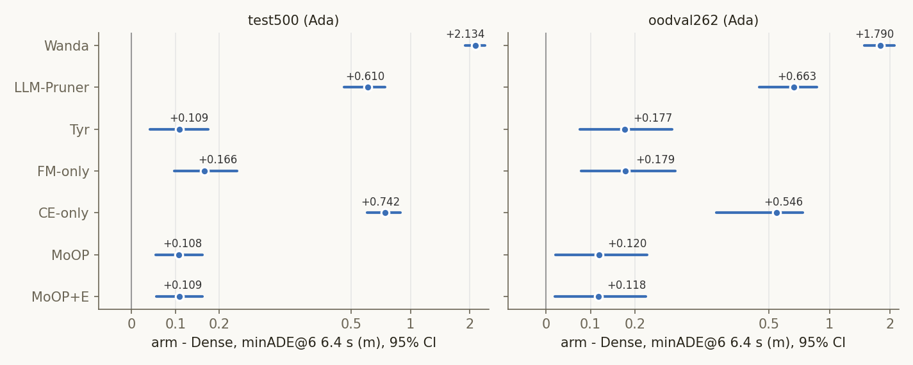

# Experiment: ICLR27 arm 개루프(Test500 · OOD-Val262) · LingoQA · CoC NLL의 95% CI

2026-11-09 · 논문 표 1·표 4를 만든 Ada 런의 클립·질문별 기록을 다시 집계(CPU)
**개정(2026-11-09 밤):** 첫 판의 빈칸을 Ada 재실행으로 채웠다. 재실행 결과는 게이트를 통과한 경우에만 썼다(7절).
- LLM-Pruner의 개루프 · LingoQA 행은 논문 체크포인트로 새로 돌렸다.
- FM-only · CE-only의 1.6 · 3.2 s 칸을 채웠다.
- 첫 판은 git 이력(`19d37e1`)에 있다.

코드 `iclr27-rebuttal/code/ci_openloop_lingoqa.py`, 재실행 `iclr27-rebuttal/code/run_ada_fill.sh` · `gate_ada_fill.py`, 계획 `plans/2026-11-09_ada-fill-lp-fm-ce.md`
결과 `outputs/iclr27-rebuttal/ci_openloop_lingoqa/` (`summary.txt` = 아래 표 전체, `metrics.json`, `config.json`, `paired_minade6_vs_dense.png`), 재실행 `outputs/iclr27-rebuttal/ada_fill/` (`gate/summary.txt`)

## Purpose

- **질문 1.** 논문 표 1(개루프 Test500 · OOD-Val262)의 각 arm 수치에 95% CI를 붙이면 어떻게 되나. 1.6 · 3.2 · 6.4 s 전부, minADE@6 · minFDE@6 둘 다.
- **질문 2.** 같은 클립에서 잰 arm끼리의 차이(arm − dense, arm − MoOP)는 어디까지 0과 갈리나. 특히 MoOP 대 Tyr · FM-only · LLM-Pruner.
- **질문 3.** 표 4의 LingoQA 정확도와 CoC NLL 열에 CI를 붙이면 무엇이 남나.

## Setup

| 항목 | 값 |
|---|---|
| arm (논문 이름 = 런) | Dense = `baseline_pred_{test,oodval}`, Wanda = `wanda_u40_v2_{test,oodval}`, Tyr = `tyr_u40_r_pred_{test,oodval}`, MoOP = `dual_u40_v2_pred_{test,oodval}`, MoOP+E = `dualexp_em93p75_{test,oodval}`. LLM-Pruner · FM-only · CE-only = `iclr27-rebuttal/ada_fill/{lp_r50,fm_only,ce_only}_{test500,oodval262}`(11-09 재실행). 전부 RTX 5880 Ada(설정 파일로 확인) |
| LLM-Pruner | 논문 체크포인트 `/mnt/nvme1n1/ad_vla/data/alpasim/drivers/lp_r50`(8월, soowon 빌드). NLL 행과 기존 Ada 10클립도 같은 체크포인트다. 다시 만든 `outputs/cvpr27/slim_lp_r50`은 A100 블록에만 쓴다 |
| FM-only · CE-only | 기존 런(`traj_u40_v2_*`, `coc_u40_v2_*`)은 1.6 · 3.2 s 필드가 생기기 전 런이다. 같은 체크포인트로 다시 돌려 그 필드를 얻었고, 6.4 s 값은 기존과 비트 단위로 같다(7절) |
| 세트 | Test500 = `eval_sets/test_500.parquet` 500클립, OOD-Val262 = `ood_val.parquet` 262클립 |
| 개루프 지표 | rollout만(TF 없음), 8개 샘플 중 앞 6개의 최솟값 = minADE@6 · minFDE@6. 1.6 · 3.2 · 6.4 s. k = 8, seed 42, max_gen 256. CoC 퇴화율 = `coc_degenerate` 평균 |
| LingoQA | Lingo-Judge, 500질문 = 100세그먼트 × 5질문, `lingo_vqa_<arm>/scored.json`의 `correct`. 기준선: 항상 "yes" 37.6%(항상 "no"는 37.0%) |
| NLL (표 4) | dense 모델이 Test500에서 직접 낸 CoC를 각 arm에 teacher-forcing한 토큰당 NLL(nats), 클립 평균. `nll_dense_<tag>_test` |
| CI | 부트스트랩 200,000회, percentile 95%, 시드 0. 개루프 · NLL은 클립 단위로, LingoQA는 세그먼트를 통째로 재표집(같은 장면의 질문 5개가 상관되므로). 짝 비교는 같은 클립(질문)에서 뺀 차이를 같은 재표집으로. p = 양측 부트스트랩 p(0회면 < 5e-06) |
| 시드 점검 | 모든 짝 CI를 시드 1로 다시 계산해 "0을 벗어남" 판정이 바뀌는 칸을 셈 |
| A100 블록 | 하드웨어 교차 확인: `outputs/cvpr27/a100/{dense,moop,lp_r50}_test2000`(Test500 클립만) · `_oodval`, `lingo_vqa_{dense,moop,lp_r50}`. Ada와 한 표에 섞지 않는다 |

## Results (Facts)

### 1. 논문 수치 재현

- 표 1(6.4 s) 32칸 중 31칸, 표 4 14칸 전부가 소수 셋째 자리까지 같다.
- 다른 한 칸은 Tyr OOD-Val262 minADE@6이다. 원자료는 1.17646이고 1.176으로 반올림해야 하는데 논문은 1.177이다(+0.001, 반올림 오류).

### 2. 개루프 절대값 (Ada, 평균 [95% 클립 부트스트랩 CI])

**Test500** (n = 500)

| arm | minADE@6 1.6 s | 3.2 s | 6.4 s | minFDE@6 1.6 s | 3.2 s | 6.4 s | 중앙값 ADE / FDE 6.4 s | CoC 퇴화 |
|---|---|---|---|---|---|---|---|---|
| Dense | 0.052 [0.047, 0.057] | 0.207 [0.189, 0.228] | 0.842 [0.765, 0.922] | 0.133 [0.119, 0.148] | 0.553 [0.496, 0.613] | 2.267 [2.009, 2.540] | 0.509 / 1.163 | 0.6% |
| Wanda | 0.213 [0.195, 0.232] | 0.775 [0.710, 0.843] | 2.975 [2.729, 3.233] | 0.559 [0.510, 0.610] | 2.080 [1.891, 2.276] | 8.269 [7.532, 9.038] | 1.959 / 5.081 | 87.6% |
| LLM-Pruner | 0.110 [0.099, 0.122] | 0.397 [0.356, 0.440] | 1.451 [1.312, 1.600] | 0.283 [0.251, 0.316] | 1.011 [0.896, 1.134] | 3.889 [3.485, 4.314] | 0.913 / 2.267 | 17.0% |
| Tyr | 0.068 [0.060, 0.076] | 0.245 [0.220, 0.271] | 0.950 [0.862, 1.044] | 0.169 [0.150, 0.190] | 0.624 [0.555, 0.698] | 2.570 [2.289, 2.867] | 0.621 / 1.489 | 0.8% |
| FM-only | 0.065 [0.058, 0.071] | 0.246 [0.223, 0.271] | 1.008 [0.917, 1.105] | 0.163 [0.146, 0.181] | 0.649 [0.581, 0.722] | 2.720 [2.423, 3.036] | 0.665 / 1.581 | 2.6% |
| CE-only | 0.097 [0.087, 0.108] | 0.381 [0.345, 0.420] | 1.584 [1.433, 1.746] | 0.249 [0.224, 0.277] | 1.038 [0.931, 1.152] | 4.500 [4.022, 5.007] | 1.035 / 2.472 | 15.0% |
| MoOP | 0.060 [0.055, 0.066] | 0.241 [0.220, 0.262] | 0.950 [0.869, 1.034] | 0.152 [0.136, 0.168] | 0.632 [0.571, 0.697] | 2.546 [2.276, 2.832] | 0.664 / 1.479 | 3.0% |
| MoOP+E | 0.060 [0.055, 0.066] | 0.241 [0.221, 0.263] | 0.951 [0.871, 1.035] | 0.152 [0.136, 0.168] | 0.632 [0.571, 0.697] | 2.539 [2.272, 2.822] | 0.669 / 1.454 | 3.0% |

**OOD-Val262** (n = 262)

| arm | minADE@6 1.6 s | 3.2 s | 6.4 s | minFDE@6 1.6 s | 3.2 s | 6.4 s | 중앙값 ADE / FDE 6.4 s | CoC 퇴화 |
|---|---|---|---|---|---|---|---|---|
| Dense | 0.065 [0.056, 0.075] | 0.258 [0.219, 0.304] | 1.000 [0.847, 1.177] | 0.175 [0.148, 0.206] | 0.684 [0.562, 0.827] | 2.496 [2.041, 3.020] | 0.574 / 1.118 | 0.0% |
| Wanda | 0.221 [0.193, 0.249] | 0.810 [0.712, 0.915] | 2.790 [2.461, 3.141] | 0.588 [0.513, 0.667] | 2.170 [1.891, 2.467] | 6.884 [5.983, 7.842] | 1.771 / 4.050 | 85.9% |
| LLM-Pruner | 0.135 [0.116, 0.156] | 0.483 [0.413, 0.560] | 1.662 [1.432, 1.916] | 0.350 [0.296, 0.408] | 1.244 [1.048, 1.461] | 4.153 [3.525, 4.844] | 0.987 / 2.236 | 17.9% |
| Tyr | 0.090 [0.078, 0.104] | 0.332 [0.287, 0.383] | 1.176 [1.012, 1.366] | 0.237 [0.202, 0.275] | 0.840 [0.706, 0.993] | 2.990 [2.504, 3.543] | 0.682 / 1.524 | 1.1% |
| FM-only | 0.079 [0.069, 0.090] | 0.317 [0.274, 0.367] | 1.178 [1.011, 1.371] | 0.214 [0.184, 0.248] | 0.846 [0.710, 1.001] | 2.960 [2.475, 3.515] | 0.713 / 1.553 | 3.1% |
| CE-only | 0.110 [0.094, 0.127] | 0.420 [0.361, 0.486] | 1.546 [1.328, 1.792] | 0.291 [0.248, 0.339] | 1.107 [0.933, 1.303] | 4.010 [3.364, 4.733] | 0.948 / 2.304 | 11.5% |
| MoOP | 0.074 [0.065, 0.085] | 0.290 [0.249, 0.337] | 1.119 [0.958, 1.307] | 0.198 [0.169, 0.231] | 0.752 [0.625, 0.900] | 2.851 [2.362, 3.410] | 0.729 / 1.342 | 3.4% |
| MoOP+E | 0.074 [0.064, 0.085] | 0.291 [0.250, 0.337] | 1.118 [0.957, 1.304] | 0.198 [0.169, 0.231] | 0.754 [0.628, 0.901] | 2.844 [2.357, 3.400] | 0.727 / 1.316 | 3.4% |

6.4 s minADE@6 절대값 CI의 반폭은 Dense · Tyr · FM-only · MoOP에서 Test500 ±0.08–0.10 m, OOD-Val262 ±0.17–0.18 m다. Dense · Tyr · FM-only · MoOP · MoOP+E의 절대값 CI는 두 세트 모두에서 서로 겹친다.

### 3. 짝 차이 (Ada, 같은 클립에서 뺀 차이, 평균 [95% CI], * = CI가 0을 벗어남)

**arm − Dense**

| 세트 | arm | dADE 1.6 s | 3.2 s | 6.4 s | dFDE 1.6 s | 3.2 s | 6.4 s | 중앙값 dADE / dFDE 6.4 s | p ADE / FDE 6.4 s |
|---|---|---|---|---|---|---|---|---|---|
| Test500 | Wanda | +0.161 [+0.144, +0.179]* | +0.568 [+0.506, +0.632]* | +2.134 [+1.894, +2.383]* | +0.427 [+0.380, +0.475]* | +1.527 [+1.346, +1.714]* | +6.001 [+5.276, +6.755]* | +1.173 / +3.246 | < 5e-06 / < 5e-06 |
| Test500 | LLM-Pruner | +0.058 [+0.048, +0.069]* | +0.189 [+0.153, +0.227]* | +0.610 [+0.484, +0.743]* | +0.150 [+0.122, +0.179]* | +0.458 [+0.355, +0.568]* | +1.621 [+1.259, +2.000]* | +0.260 / +0.625 | < 5e-06 / < 5e-06 |
| Test500 | Tyr | +0.016 [+0.011, +0.021]* | +0.037 [+0.020, +0.056]* | +0.109 [+0.042, +0.175]* | +0.037 [+0.023, +0.051]* | +0.071 [+0.016, +0.127]* | +0.303 [+0.104, +0.501]* | +0.053 / +0.145 | 0.0013 / 0.0027 |
| Test500 | FM-only | +0.013 [+0.009, +0.017]* | +0.039 [+0.023, +0.056]* | +0.166 [+0.098, +0.241]* | +0.031 [+0.019, +0.043]* | +0.096 [+0.047, +0.150]* | +0.453 [+0.230, +0.689]* | +0.096 / +0.250 | < 5e-06 / 3e-05 |
| Test500 | CE-only | +0.045 [+0.037, +0.054]* | +0.174 [+0.142, +0.207]* | +0.742 [+0.605, +0.889]* | +0.117 [+0.095, +0.140]* | +0.485 [+0.389, +0.587]* | +2.232 [+1.795, +2.693]* | +0.308 / +0.980 | < 5e-06 / < 5e-06 |
| Test500 | MoOP | +0.008 [+0.005, +0.012]* | +0.033 [+0.021, +0.046]* | +0.108 [+0.055, +0.161]* | +0.019 [+0.010, +0.029]* | +0.079 [+0.040, +0.119]* | +0.279 [+0.097, +0.462]* | +0.052 / +0.107 | 4e-05 / 0.0024 |
| Test500 | MoOP+E | +0.008 [+0.005, +0.012]* | +0.034 [+0.021, +0.046]* | +0.109 [+0.056, +0.161]* | +0.019 [+0.010, +0.029]* | +0.079 [+0.040, +0.119]* | +0.271 [+0.090, +0.454]* | +0.058 / +0.137 | 3e-05 / 0.003 |
| OOD-Val262 | Wanda | +0.156 [+0.131, +0.182]* | +0.552 [+0.464, +0.645]* | +1.790 [+1.491, +2.107]* | +0.412 [+0.345, +0.484]* | +1.486 [+1.235, +1.753]* | +4.388 [+3.544, +5.286]* | +1.019 / +2.217 | < 5e-06 / < 5e-06 |
| OOD-Val262 | LLM-Pruner | +0.070 [+0.053, +0.089]* | +0.224 [+0.167, +0.287]* | +0.663 [+0.478, +0.864]* | +0.174 [+0.128, +0.225]* | +0.559 [+0.401, +0.732]* | +1.657 [+1.146, +2.210]* | +0.326 / +0.706 | < 5e-06 / < 5e-06 |
| OOD-Val262 | Tyr | +0.025 [+0.015, +0.036]* | +0.074 [+0.043, +0.106]* | +0.177 [+0.076, +0.284]* | +0.062 [+0.035, +0.090]* | +0.155 [+0.069, +0.246]* | +0.494 [+0.185, +0.820]* | +0.096 / +0.210 | 0.00051 / 0.0014 |
| OOD-Val262 | FM-only | +0.014 [+0.006, +0.023]* | +0.059 [+0.030, +0.091]* | +0.179 [+0.079, +0.289]* | +0.039 [+0.016, +0.065]* | +0.161 [+0.076, +0.254]* | +0.464 [+0.180, +0.778]* | +0.101 / +0.306 | 0.00018 / 0.00098 |
| OOD-Val262 | CE-only | +0.045 [+0.031, +0.060]* | +0.161 [+0.114, +0.214]* | +0.546 [+0.382, +0.738]* | +0.116 [+0.079, +0.158]* | +0.423 [+0.291, +0.573]* | +1.514 [+1.026, +2.078]* | +0.289 / +0.782 | < 5e-06 / < 5e-06 |
| OOD-Val262 | MoOP | +0.009 [+0.003, +0.016]* | +0.032 [+0.006, +0.059]* | +0.120 [+0.021, +0.226]* | +0.023 [+0.004, +0.043]* | +0.068 [−0.009, +0.148] | +0.356 [+0.052, +0.682]* | +0.078 / +0.233 | 0.017 / 0.021 |
| OOD-Val262 | MoOP+E | +0.009 [+0.003, +0.016]* | +0.032 [+0.007, +0.059]* | +0.118 [+0.020, +0.224]* | +0.023 [+0.004, +0.043]* | +0.069 [−0.006, +0.149] | +0.348 [+0.044, +0.675]* | +0.074 / +0.220 | 0.018 / 0.024 |

**arm − MoOP** (양수 = MoOP가 더 좋음)

| 세트 | arm | dADE 1.6 s | 3.2 s | 6.4 s | dFDE 1.6 s | 3.2 s | 6.4 s | 중앙값 dADE / dFDE 6.4 s | p ADE / FDE 6.4 s |
|---|---|---|---|---|---|---|---|---|---|
| Test500 | Wanda | +0.152 [+0.135, +0.170]* | +0.534 [+0.474, +0.597]* | +2.026 [+1.794, +2.268]* | +0.407 [+0.361, +0.456]* | +1.447 [+1.270, +1.632]* | +5.723 [+5.016, +6.457]* | +1.059 / +3.119 | < 5e-06 / < 5e-06 |
| Test500 | LLM-Pruner | +0.050 [+0.040, +0.060]* | +0.156 [+0.122, +0.192]* | +0.502 [+0.388, +0.623]* | +0.131 [+0.104, +0.159]* | +0.379 [+0.283, +0.481]* | +1.343 [+1.012, +1.695]* | +0.189 / +0.522 | < 5e-06 / < 5e-06 |
| Test500 | Tyr | +0.007 [+0.003, +0.012]* | +0.004 [−0.012, +0.021] | +0.001 [−0.055, +0.058] | +0.018 [+0.005, +0.032]* | −0.009 [−0.056, +0.041] | +0.024 [−0.141, +0.192] | −0.001 / +0.028 | 0.99 / 0.78 |
| Test500 | FM-only | +0.004 [+0.001, +0.008]* | +0.005 [−0.008, +0.020] | +0.058 [+0.001, +0.118]* | +0.012 [+0.002, +0.022]* | +0.017 [−0.025, +0.059] | +0.174 [−0.004, +0.365] | +0.023 / +0.034 | 0.045 / 0.055 |
| Test500 | CE-only | +0.036 [+0.029, +0.045]* | +0.140 [+0.111, +0.171]* | +0.634 [+0.509, +0.768]* | +0.098 [+0.077, +0.120]* | +0.406 [+0.317, +0.500]* | +1.954 [+1.555, +2.381]* | +0.237 / +0.734 | < 5e-06 / < 5e-06 |
| Test500 | MoOP+E | −0.000 [−0.000, +0.000] | +0.000 [−0.001, +0.001] | +0.001 [−0.002, +0.004] | −0.000 [−0.001, +0.001] | −0.000 [−0.003, +0.003] | −0.007 [−0.018, +0.003] | +0.000 / +0.001 | 0.56 / 0.19 |
| OOD-Val262 | Wanda | +0.146 [+0.121, +0.173]* | +0.520 [+0.430, +0.616]* | +1.671 [+1.380, +1.980]* | +0.389 [+0.319, +0.463]* | +1.418 [+1.165, +1.686]* | +4.033 [+3.245, +4.872]* | +0.894 / +2.089 | < 5e-06 / < 5e-06 |
| OOD-Val262 | LLM-Pruner | +0.061 [+0.043, +0.080]* | +0.193 [+0.134, +0.257]* | +0.543 [+0.372, +0.729]* | +0.151 [+0.103, +0.204]* | +0.492 [+0.336, +0.661]* | +1.302 [+0.851, +1.782]* | +0.225 / +0.560 | < 5e-06 / < 5e-06 |
| OOD-Val262 | Tyr | +0.016 [+0.004, +0.028]* | +0.042 [+0.007, +0.079]* | +0.057 [−0.046, +0.157] | +0.039 [+0.009, +0.070]* | +0.088 [−0.005, +0.183] | +0.138 [−0.129, +0.391] | +0.002 / +0.108 | 0.27 / 0.29 |
| OOD-Val262 | FM-only | +0.004 [−0.003, +0.013] | +0.027 [−0.003, +0.058] | +0.059 [−0.035, +0.148] | +0.016 [−0.008, +0.041] | +0.094 [+0.010, +0.179]* | +0.108 [−0.134, +0.339] | +0.005 / +0.037 | 0.21 / 0.37 |
| OOD-Val262 | CE-only | +0.035 [+0.022, +0.050]* | +0.129 [+0.081, +0.183]* | +0.427 [+0.277, +0.596]* | +0.093 [+0.055, +0.135]* | +0.355 [+0.226, +0.499]* | +1.158 [+0.740, +1.639]* | +0.221 / +0.551 | < 5e-06 / < 5e-06 |
| OOD-Val262 | MoOP+E | −0.000 [−0.000, +0.000] | +0.001 [−0.001, +0.002] | −0.002 [−0.007, +0.003] | −0.000 [−0.001, +0.001] | +0.002 [−0.003, +0.007] | −0.007 [−0.027, +0.012] | +0.000 / −0.002 | 0.54 / 0.45 |

### 4. LingoQA (Ada, 정확도 % [95% 세그먼트 부트스트랩 CI], 차이는 pp)

| arm | 정확도 | − Dense | − MoOP | − 항상 "yes" (37.6%) |
|---|---|---|---|---|
| Dense | 73.2 [69.4, 76.8] | — | +4.4 [−0.4, +9.4] | +35.6 [+29.6, +41.4]* |
| Wanda | 9.2 [6.8, 11.8] | −64.0 [−68.6, −59.4]* | −59.6 [−64.2, −55.0]* | −28.4 [−33.8, −23.2]* |
| LLM-Pruner | 44.8 [40.0, 49.6] | −28.4 [−34.0, −23.0]* | −24.0 [−29.4, −18.6]* | +7.2 [+0.2, +14.0]* |
| Tyr | 34.2 [30.0, 38.6] | −39.0 [−44.6, −33.4]* | −34.6 [−40.4, −28.6]* | −3.4 [−10.2, +3.6] |
| FM-only | 37.0 [32.4, 41.8] | −36.2 [−41.6, −31.0]* | −31.8 [−37.2, −26.4]* | −0.6 [−7.2, +6.0] |
| CE-only | 30.2 [25.6, 34.8] | −43.0 [−48.4, −37.4]* | −38.6 [−44.0, −33.2]* | −7.4 [−14.2, −0.6]* |
| MoOP | 68.8 [64.4, 73.0] | −4.4 [−9.4, +0.4] | — | +31.2 [+24.6, +37.8]* |

### 5. 표 4 NLL 열 (Ada, dense CoC를 각 arm에 넣은 토큰당 NLL, n = 500)

| arm | NLL 평균 [95% CI] | 중앙값 | − Dense | − MoOP |
|---|---|---|---|---|
| Dense | 0.175 [0.161, 0.190] | 0.123 | — | −0.077 [−0.091, −0.063]* |
| Wanda | 2.183 [2.036, 2.334] | 1.761 | +2.008 [+1.867, +2.153]* | +1.931 [+1.792, +2.074]* |
| LLM-Pruner | 0.462 [0.419, 0.505] | 0.298 | +0.286 [+0.251, +0.323]* | +0.209 [+0.178, +0.243]* |
| Tyr | 0.516 [0.468, 0.568] | 0.385 | +0.341 [+0.304, +0.380]* | +0.264 [+0.235, +0.295]* |
| FM-only | 0.586 [0.540, 0.634] | 0.425 | +0.410 [+0.375, +0.447]* | +0.333 [+0.306, +0.362]* |
| CE-only | 0.313 [0.286, 0.340] | 0.218 | +0.137 [+0.120, +0.156]* | +0.060 [+0.046, +0.076]* |
| MoOP | 0.252 [0.228, 0.278] | 0.165 | +0.077 [+0.063, +0.091]* | — |

### 6. A100 블록 — 하드웨어 교차 확인 (Ada 표와 섞지 말 것)

LLM-Pruner는 여기서만 다시 만든 체크포인트(`outputs/cvpr27/slim_lp_r50`)다. 전 구간 표는 `summary.txt`에 있다.

| 세트 | arm | A100 minADE@6 / minFDE@6 6.4 s | Ada(논문 행) | A100 CoC 퇴화 |
|---|---|---|---|---|
| Test500 | Dense | 0.844 / 2.272 | 0.842 / 2.267 | 1.0% |
| Test500 | MoOP | 0.960 / 2.590 | 0.950 / 2.546 | 3.4% |
| Test500 | LLM-Pruner | 1.452 / 3.879 | 1.451 / 3.889 | 16.4% |
| OOD-Val262 | Dense | 1.001 / 2.497 | 1.000 / 2.496 | 0.4% |
| OOD-Val262 | MoOP | 1.101 / 2.798 | 1.119 / 2.851 | 4.2% |
| OOD-Val262 | LLM-Pruner | 1.612 / 4.010 | 1.662 / 4.153 | 17.2% |

- 짝 차이 LLM-Pruner − MoOP (A100): Test500 6.4 s dADE +0.492 [+0.376, +0.617]\*, OOD-Val262 +0.511 [+0.353, +0.686]\*. 1.6 · 3.2 s도 전부 0을 벗어난다.
- LingoQA (A100): Dense 72.6 [68.8, 76.4], MoOP 66.6 [62.2, 71.0], LLM-Pruner 45.4 [40.6, 50.4].
  - MoOP − LLM-Pruner +21.2 pp [+15.4, +26.8]\*.
  - **MoOP − Dense −6.0 pp [−10.8, −1.2]\***.

### 7. 재실행 게이트 (`outputs/iclr27-rebuttal/ada_fill/gate/summary.txt`)

- 실행: 2026-11-09 21:59–23:45 KST, RTX 5880 Ada 4–7번 카드, 19개 작업 모두 완료(실패 0).
- **G1 PASS:** FM-only · CE-only 재실행의 `ade_rollout_k` · `fde_rollout_k` · `gen_coc`가 기존 런과 Test500 500/500, OOD-Val262 262/262 클립에서 같다(arm 둘 다). 1.6 · 3.2 s 필드는 전 클립에 있다.
- **G2 PASS:** 논문 체크포인트 LLM-Pruner가 논문 수치를 재현한다.
  - Test500 1.4513 / 3.8885(논문 1.451 / 3.889).
  - OOD-Val262 1.6622 / 4.1534(논문 1.662 / 4.153).
  - LingoQA 44.8%(논문 44.8%).
  - 기존 Ada OOD 10클립은 전 필드가 비트 단위로 같다.
- 시드 점검: 짝 비교 전 칸에서 시드 0 → 1로 바꿔 "0을 벗어남" 판정이 바뀐 칸은 없다. CI는 `analyze_a100.boot_ci`와 같은 재표집이다(MoOP − Dense Test500 [0.0550, 0.1610]으로 확인).

## Analysis (Opinion)

- **비교는 짝 CI로 해야 한다.**
  - 절대값 CI는 클립 난이도 퍼짐(꼬리가 긴 분포)을 반영해 넓다. 그래서 Dense와 MoOP의 CI도 겹친다.
  - 그런데 모든 arm이 같은 클립을 풀었으므로, 짝 차이에서는 난이도가 상쇄된다. MoOP − Dense 짝 CI(Test500 6.4 s 폭 0.106 m)는 MoOP 절대값 CI 하나(0.165 m)보다도 좁다.
  - 두 절대값 CI가 겹치는지로 판정하는 것보다 훨씬 덜 보수적이다. 논문 표에 CI를 넣는다면 절대값 옆에 "Δ vs Dense [CI]"를 두는 편이 정확하다.
  - 절대값 CI가 겹친다는 이유로 "차이 없음"이라 쓰면 안 된다.
- **MoOP는 dense보다 확실히 나쁘다.**
  - 6.4 s minADE@6이 Test500 +0.108 m, OOD +0.120 m 나쁘다. OOD 3.2 s minFDE 한 칸(+0.068 [−0.009, +0.148])을 빼면 모든 구간에서 유의하다.
  - "dense에 가깝다"는 격차 크기로 말해야 하고, "유의한 차이가 없다"고 말하면 안 된다. 40% 압축의 대가로는 정상이다.
- **MoOP 대 Tyr · FM-only: 6.4 s에서는 구분되지 않고, MoOP의 우위는 단기 구간에 있다.**
  - Tyr − MoOP는 6.4 s에서 Test500 +0.001 [−0.055, +0.058], OOD +0.057 [−0.046, +0.157]이다. 그런데 1.6 s에서는 두 세트 모두 유의하다(ADE +0.007 / +0.016, FDE +0.018 / +0.039). OOD 3.2 s ADE도 유의하다.
  - FM-only − MoOP도 같은 모양이다. 새로 채운 1.6 s가 Test500에서 유의하고(ADE +0.004, FDE +0.012), OOD 3.2 s minFDE도 유의하다(+0.094). 6.4 s는 Test500 minADE만 경계(+0.058, p = 0.045)이고 나머지는 0을 포함한다.
  - 즉 표 1의 6.4 s 숫자만으로 "MoOP > Tyr, FM-only"를 주장할 수는 없다. 차이는 언어 쪽(LingoQA +34.6 · +31.8 pp, NLL −0.264 · −0.333)과 단기 궤적에 있다. 폐루프에서 본 그림(tyr_u40_r ≈ MoOP, 우위는 언어뿐)과 같다.
- **LLM-Pruner는 운전과 언어 모두에서 MoOP보다 확실히 나쁘다** (논문 체크포인트, Ada).
  - 6.4 s minADE@6 +0.502 m(Test500), +0.543 m(OOD)이고, 모든 구간에서 유의하다. LingoQA는 −24.0 pp다.
  - LingoQA는 항상 "yes" 기준선보다 겨우 높다(+7.2 pp [+0.2, +14.0]).
  - A100에서 다시 만든 체크포인트는 OOD에서 0.05 m 낮게 나온다(1.612 대 1.662). 재구성 차이인지 카드 차이인지는 이 데이터로 가를 수 없다. 논문 행은 이제 같은 체크포인트 · 같은 카드로 재현되었으니 상관없다.
- **MoOP+E는 MoOP와 같다.** 모든 구간에서 |Δ| ≤ 0.007 m이고 CI가 ±0.03 m 안에 있다. expert MLP 93.75% 절단은 개루프에서 비용이 보이지 않는다.
- **Tyr · FM-only의 LingoQA는 찍기 수준이다.**
  - 항상 "yes"(37.6%)와 구분되지 않는다(−3.4, −0.6 pp, CI가 0 포함). CE-only는 그보다도 유의하게 낮다(−7.4 pp).
  - 표 4 본문에서 "언어 능력 상실"을 말할 때 이 기준선을 함께 쓰면 설득력이 크다.
- **MoOP 대 Dense의 LingoQA 차이는 카드에 따라 판정이 갈린다.**
  - Ada −4.4 pp [−9.4, +0.4](유의하지 않음), A100 −6.0 pp [−10.8, −1.2](유의). 같은 체크포인트인데 카드만 바꿔도 MoOP가 2.2 pp 움직인다.
  - "LingoQA를 잃지 않는다"고 쓰지 말고 "dense 정확도의 94%를 유지(−4.4 pp, CI의 나쁜 쪽 끝 −9.4 pp)"처럼 크기로 쓰는 편이 안전하다.
- **다음 단계.**
  1. 논문 표 1의 Tyr OOD minADE를 1.177 → 1.176으로 고친다.
  2. 리버틀 문장은 "Δ vs Dense / vs MoOP [95% CI]" 형식으로 쓴다. 6.4 s에서 MoOP ≈ Tyr ≈ FM-only(운전)이고 언어에서 MoOP만 남는다는 구도가 숫자와 맞다. 단기(1.6 s) 궤적에서는 MoOP가 Tyr · FM-only보다 유의하게 낫다는 점을 보조 근거로 쓸 수 있다.
