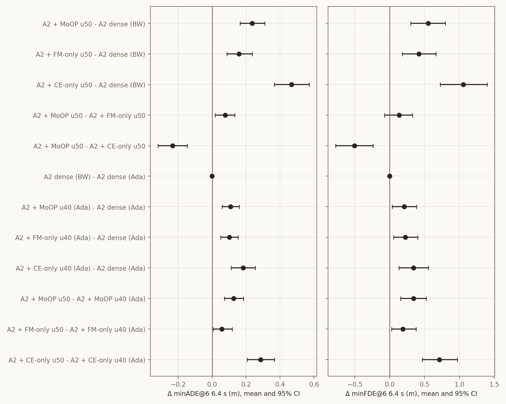

# Experiment: Alpamayo 2 Super u50 — test500 개루프 (dense · MoOP · FM-only · CE-only)

2026-11-10 · 모델 `nvidia/Alpamayo2-Super`(rev `00554695`) · RTX PRO 5000 Blackwell 2장 1쌍 × 2쌍(GPU 0·1, 2·3)
계획 `iclr27-rebuttal/plans/2026-11-09_a2-u50-test500.md` · 코드 `iclr27-rebuttal/code/{make_a2_moop_masks,run_a2_openloop,analyze_a2_test500}.py`(`--pct 50`, `--preset u50`), `run_a2_arms.sh`(`EXP_SUFFIX=_bw`)
결과 `iclr27-rebuttal/outputs/a2_test500_{dense,moop_u50,fm_only_u50,ce_only_u50}_bw/`, 분석 `iclr27-rebuttal/outputs/a2_test500_u50_analysis/`
u40 결과: `2026-11-09_a2-moop-test500.md`

**요약**
- 층마다 50%(A2 전체의 42.6%)를 자르면 dense 대비 minADE@6(6.4 s)가 이만큼 늘어난다. 셋 다 유의하다.
  - MoOP +0.236 (+25.6%)
  - FM-only +0.158 (+17.2%)
  - CE-only +0.468 (+50.9%)
- **u50에서는 MoOP가 FM-only보다 유의하게 나쁘다.**
  - minADE@6 6.4 s: +0.077 [+0.018, +0.133]\*, 중앙값 +0.046\*, p = 5e-7
  - 1.6 s와 3.2 s에서도 유의하다. minFDE@6 6.4 s만 n.s.(+0.134 [−0.074, +0.327])다.
  - u40에서는 +0.007 n.s.로 같았다.
- MoOP는 CE-only보다는 여전히 낫다(−0.232\*).
- u40→u50 추가 비용: MoOP +0.126\*, FM-only +0.056\*, CE-only +0.285\*. 비율을 올려도 FM-only가 가장 완만하게 나빠진다.
- CoC 퇴화는 모두 낮다: MoOP 0.6%, FM-only 1.2%, CE-only 4.6%. u40에서는 0–0.2%였다.
- 하드웨어 이동은 없다: Blackwell dense − Ada dense = −0.001 [−0.005, +0.004]. 그래서 u40(Ada) 행과 한 표에서 비교할 수 있다.
- A1.5 u50(A100, l0keep 계열, 다른 세트)에서는 방향이 반대다. FM-only가 MoOP l0keep보다 +0.566\* 나쁘고, CoC 퇴화는 24%다.

## Purpose

- 사용자 요청(11-09): 비율을 u50으로 올렸을 때 A2 test500 성능을 본다. MoOP, FM-only, CE-only를 dense와 비교한다.
- 검정한 가설:
  - H1: 비율이 오르면 비용도 커진다.
  - H2: u40의 동률(MoOP ≈ FM-only)이 u50에서도 유지되는가, 벌어지는가.
  - H3: CE-only가 가장 나쁘고, 퇴화가 커지는가.

## Setup

| 항목 | 값 |
|---|---|
| 중요도 | u40과 같다. `alpamayo2-distill/outputs/a2_importance_v1` (calib_100) |
| 기준 | MoOP = max(rank I_traj, rank I_CoC); FM-only = rank I_traj; CE-only = rank I_CoC. 층 안 순위로 `select_mask_ratios` |
| 예산 | make_slim의 u50 = 문자 그대로 0.50. 모든 층(0번 포함)에서 Q 32/64 head, MLP 12,800/25,600 채널 제거 = 15,267,266,560 / 35.81B (42.6%). u40은 34.1%. l0keep 없음 |
| 손대지 않은 것 | expert, KV group, vision tower, embedding |
| 평가 | u40과 같다. test500, `test500_a2` 캐시, 롤아웃 1회 + k=8, 클립 seed sha256(42:clip_id), max_gen 256 |
| 지표 | minADE@6 / minFDE@6 1.6 / 3.2 / 6.4 s, CoC 퇴화율. 짝 Δ는 부트스트랩 200,000회 95% CI, Wilcoxon |
| 하드웨어 | GPU 4–7은 다른 세션이 쓰고 있어 0–3(Blackwell)에서 돌렸다. **dense를 Blackwell에서 다시 쟀고**, u50 Δ는 모두 Blackwell dense 기준이다 |
| 실행 | 2,000 클립-arm, 약 12.7 s/클립, 오류 0, 11-09 22:27 – 11-10 02:43 KST |

**게이트 (모두 통과)**
- G0와 G0'(A1.5에서 같은 코드로 기존 마스크 재현): 6/6 unit 단위로 동일하다.
  - G0: u40 4종(`dual`, `dual_l0keep`, `traj`, `coc`)
  - G0': 비율을 그대로 쓰는 경로. `dual_u20_v2`, `dual_u30_v2`
- 분석 회귀: `--preset u40`을 다시 돌리면 기존 metrics, summary, config가 바이트 단위로 같다.
- 실행 확인: Blackwell dense의 첫 10클립은 CoC 텍스트가 Ada와 같다. minADE는 클립당 0.001–0.04 m 다르고, 평균 차이는 0이다(아래 표).

## Results (Facts)

### 절댓값 (500클립)

| arm | 하드웨어 | 제거 | minADE@6 1.6 s | 3.2 s | 6.4 s | minFDE@6 1.6 s | 3.2 s | 6.4 s | 중앙값 minADE@6 6.4 s | CoC 퇴화 | 생성 토큰 |
|---|---|---|---|---|---|---|---|---|---|---|---|
| A2 dense | Blackwell | — | 0.052 | 0.216 | **0.920** | 0.133 | 0.583 | 2.572 | 0.576 | 0.0% | 13.4 |
| A2 + MoOP u50 | Blackwell | 42.6% | 0.075 | 0.291 | **1.156** | 0.193 | 0.763 | 3.123 | 0.766 | 0.6% | 13.3 |
| A2 + FM-only u50 | Blackwell | 42.6% | 0.066 | 0.264 | **1.078** | 0.170 | 0.698 | 2.988 | 0.701 | 1.2% | 13.8 |
| A2 + CE-only u50 | Blackwell | 42.6% | 0.105 | 0.370 | **1.388** | 0.266 | 0.940 | 3.629 | 0.934 | 4.6% | 19.7 |
| A2 dense | Ada | — | 0.052 | 0.216 | 0.921 | 0.134 | 0.586 | 2.572 | 0.576 | 0.0% | 13.4 |
| A2 + MoOP u40 | Ada | 34.1% | 0.062 | 0.250 | 1.029 | 0.160 | 0.670 | 2.782 | 0.667 | 0.0% | 13.2 |
| A2 + FM-only u40 | Ada | 34.1% | 0.062 | 0.250 | 1.022 | 0.162 | 0.665 | 2.798 | 0.688 | 0.0% | 13.2 |
| A2 + CE-only u40 | Ada | 34.1% | 0.077 | 0.288 | 1.103 | 0.197 | 0.738 | 2.914 | 0.731 | 0.2% | 13.7 |

### 짝 Δ (6.4 s, 95% CI; \* = CI가 0을 벗어남)

| 짝 | Δ minADE@6 | 상대 | 중앙값 Δ | Wilcoxon p | Δ minFDE@6 | Δ minADE@6 1.6 s | Δ minADE@6 3.2 s |
|---|---|---|---|---|---|---|---|
| MoOP u50 − dense(BW) | +0.236 [+0.165, +0.310]\* | +25.6% | +0.118 [+0.085, +0.157]\* | 2.6e-19 | +0.551 [+0.302, +0.799]\* | +0.023 [+0.018, +0.028]\* | +0.075 [+0.057, +0.094]\* |
| FM-only u50 − dense(BW) | +0.158 [+0.086, +0.236]\* | +17.2% | +0.058 [+0.029, +0.083]\* | 4.3e-9 | +0.416 [+0.182, +0.666]\* | +0.014 [+0.009, +0.019]\* | +0.049 [+0.031, +0.069]\* |
| CE-only u50 − dense(BW) | +0.468 [+0.367, +0.573]\* | +50.9% | +0.257 [+0.193, +0.315]\* | 1.4e-29 | +1.057 [+0.723, +1.399]\* | +0.053 [+0.044, +0.062]\* | +0.154 [+0.128, +0.182]\* |
| **MoOP u50 − FM-only u50** | **+0.077 [+0.018, +0.133]\*** | +7.2% | +0.046 [+0.027, +0.075]\* | 5.2e-7 | +0.134 [−0.074, +0.327] | +0.009 [+0.004, +0.014]\* | +0.026 [+0.009, +0.042]\* |
| MoOP u50 − CE-only u50 | −0.232 [−0.319, −0.147]\* | −16.7% | −0.105 [−0.157, −0.079]\* | 9.2e-11 | −0.506 [−0.776, −0.240]\* | −0.030 [−0.038, −0.022]\* | −0.079 [−0.105, −0.055]\* |
| dense(BW) − dense(Ada) | −0.001 [−0.005, +0.004] | −0.1% | +0.000 | 0.31 | −0.001 [−0.013, +0.016] | −0.000 | −0.001 |
| MoOP u50 − MoOP u40 | +0.126 [+0.072, +0.184]\* | +12.3% | +0.070 [+0.039, +0.094]\* | 4e-11 | +0.340 [+0.158, +0.524]\* | +0.013\* | +0.040\* |
| FM-only u50 − FM-only u40 | +0.056 [+0.005, +0.118]\* | +5.5% | +0.018 [+0.008, +0.032]\* | 0.02 | +0.190 [+0.029, +0.377]\* | +0.003 (n.s.) | +0.014 (n.s.) |
| CE-only u50 − CE-only u40 | +0.285 [+0.206, +0.367]\* | +25.8% | +0.125 [+0.097, +0.170]\* | 5.5e-20 | +0.715 [+0.466, +0.971]\* | +0.027\* | +0.082\* |

- u50 − u40 짝은 카드 종류를 건넌다(Blackwell − Ada).
- 같은 카드끼리의 dense 이동이 −0.001이라 평균 비교로 쓸 수 있다. 다만 클립별 잡음(±0.01–0.04 m)은 CI에 들어 있다.
- u40 짝(Ada)은 기존 리포트의 값과 같다: MoOP +0.108\*, FM-only +0.101\*, CE-only +0.182\*.

### 버킷별 Δ minADE@6 6.4 s

| 짝 | cruise (278) | decel_stop (65) | accel (75) | turn (82) |
|---|---|---|---|---|
| MoOP u50 − dense(BW) | +0.203 | +0.220 | +0.276 | +0.321 |
| FM-only u50 − dense(BW) | +0.113 | +0.041 | +0.146 | +0.415 |
| CE-only u50 − dense(BW) | +0.386 | +0.680 | +0.242 | +0.783 |
| MoOP u50 − FM-only u50 | +0.090 | +0.178 | +0.130 | −0.094 |
| MoOP u50 − CE-only u50 | −0.183 | −0.460 | +0.033 | −0.462 |

### 마스크 겹침: MoOP가 자른 unit 중 FM-only도 자른 비율

| 비율 | 축 | 전체 | 0번 층 | 1–4층 | 5–31층 | 32–63층 |
|---|---|---|---|---|---|---|
| u40 | Q head | 0.844 | 0.923 | 0.827 | 0.899 | 0.797 |
| u40 | MLP | 0.789 | 0.927 | 0.956 | 0.819 | 0.739 |
| u50 | Q head | 0.882 | 0.938 | 0.891 | 0.921 | 0.846 |
| u50 | MLP | 0.832 | 0.934 | 0.980 | 0.855 | 0.792 |

- 0번 층에서 둘이 다르게 자른 Q head는 2개뿐이다.
  - u50: MoOP만 19, 23을 자르고, FM-only만 43, 62를 자른다.
  - u40: MoOP만 18, 51을 자르고, FM-only만 0, 43을 자른다.
- 둘의 차이는 주로 뒤쪽 층(32–63)의 MLP에 있다.

### 참고: A1.5 u50 (다른 조건, `cvpr27/reports/2026-11-05_baselines-ratio-sweep.md`)

| (A100, test_2000, l0keep 계열) | minADE@6 6.4 s | MoOP l0keep 대비 Δ | CoC 퇴화 |
|---|---|---|---|
| MoOP l0keep u50 (29.98%) | 1.079 | — | 3.2% |
| FM-only u50 (`trajlastcoc_u50_l0keep_v2`) | 1.645 | +0.566 [+0.482, +0.653]\* | 24.2% |
| CE-only u50 (`coc_u50_l0keep_v2`) | 1.280 | +0.201 [+0.153, +0.252]\* | 16.2% |

- 모델, 레시피(l0keep, FM-only 마지막 층 보정), 하드웨어, 세트가 모두 다르다. 방향을 비교하는 용도로만 쓴다.

## Analysis (Opinion)

**1. A2에서는 합집합(MoOP)이 높은 비율에서 주행을 오히려 해친다.**
- u40에서는 동률이었고, u50에서는 FM-only보다 +0.077 나쁘다. 평균, 중앙값, 1.6 s, 3.2 s에서 모두 유의하다.
- A1.5에서는 반대로 비율이 오를수록 합집합의 이점이 커진다(u50에서 FM-only 대비 +0.566). 그 이점은 FM-only가 CoC를 망가뜨리는 것을 막는 데서 왔다(FM-only CoC 퇴화 24%).
- A2의 FM-only는 u50에서도 CoC를 거의 망가뜨리지 않는다(1.2%). 그래서 합집합의 CE 쪽 몫은 지킬 것이 없다.
  - 그 몫은 궤적에 중요한 unit을 밀어내는 값만 치른다.
  - 그 결과가 뒤쪽 층 MLP 겹침 0.79와, 비율에 따른 MoOP 추가 비용(+0.126 대 FM-only +0.056)이다.
- 정리하면 "합집합의 이점은 단일 기준이 무너질 때만 생긴다". A2의 언어 경로는 34B·64층이라 그만큼 여유가 있어 보인다.
- 다만 이 해석은 마스크 겹침에서 나온 추론이고, 뒤쪽 층 MLP를 바꿔 끼우는 실험으로 검증하지는 않았다.

**2. 0번 층이 원인일 가능성은 낮지만 배제하지는 못했다.**
- A1.5에서는 0번 층 Q head 조합이 cruise 붕괴를 갈랐다.
- 여기서는 두 arm의 0번 층 차이가 head 2개뿐이다.
- MoOP − FM-only 격차는 cruise에 몰리지 않고 버킷 전반에 퍼져 있다(cruise +0.090, decel_stop +0.178, accel +0.130, turn −0.094).
- A2 u40에서는 l0keep이 효과가 없었다.
- 그래도 u50에서 0번 층을 바꿔 끼운 arm은 돌리지 않았다.

**3. 논문/리버틀에 주는 의미**
- "MoOP는 FM-only와 주행이 같고 언어가 낫다"는 논문의 주장은 A2 u40에서는 주행 쪽이 성립한다.
- A2 u50에서는 주행에서 대가를 치른다. 그 대가로 언어(LingoQA)를 얻는지는 A2에서 아직 재지 않았다.
- 리뷰어가 "다른 모델·높은 비율에서도 되는가"를 물으면 A2 u50은 주행에서 반례다.
- 그래서 A2 LingoQA가 없으면 이 표를 단독으로 내기 어렵다.

**4. 주의할 점**
- calibration 추출과 중요도 측정이 각각 한 번이다.
- 두 arm은 같은 중요도 측정에서 나왔으므로, 따로 잰 arm 사이의 시드 잡음 문제는 아니다.
- 한 추출에서 나온 결과다. A1.5에서는 0번 층 탓에 같은 레시피도 추출에 따라 0.05–0.10 m 흔들렸다.
- 개루프 test500만 잰 결과다.

**다음 후보 (지시가 있을 때만)**
- A2 LingoQA: MoOP와 FM-only를 u40과 u50에서 비교한다. 합집합이 언어에서 무엇을 사는지가 이 결과 해석의 핵심이다.
- 원인 분리 arm 2개: (a) MoOP u50의 0번 층 Q를 FM-only 것으로 바꾼 arm, (b) MoOP u50의 32–63층 MLP를 FM-only 것으로 바꾼 arm. arm당 Blackwell 2쌍으로 약 1시간이다.
- A2 u50 l0keep(MoOP와 FM-only): A1.5 비율 실험과 레시피를 맞춰 직접 비교할 수 있게 한다.
