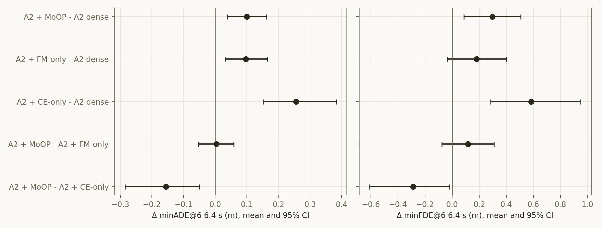
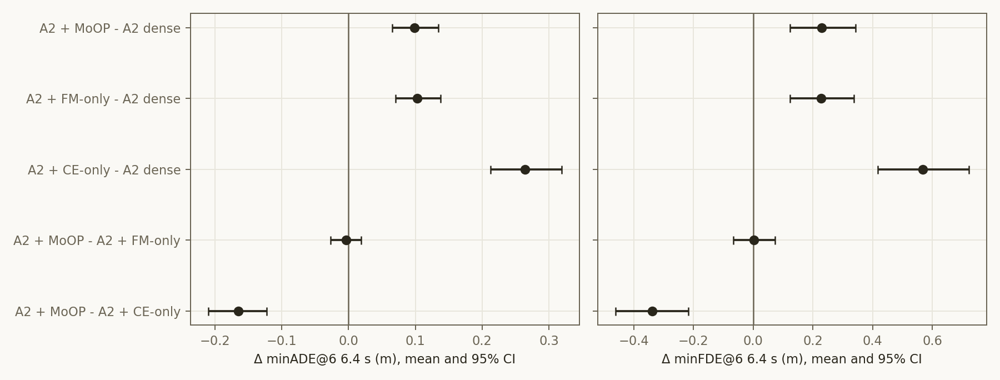

# Experiment: Alpamayo 2 Super u40 — OOD-Val262 · OOD-train1271 개루프 (dense · MoOP · FM-only · CE-only, KISTI GH200)

2026-11-11 · 모델 `nvidia/Alpamayo2-Super`(rev `00554695`) · KISTI 한강 5thEx, GH200 120GB 4장(node1773), 카드당 A2 한 벌
계획 `iclr27-rebuttal/plans/2026-11-10_a2-u40-ood-gh200.md` · 코드 `iclr27-rebuttal/code/{run_a2_openloop.py, a2_ood_gh200.sbatch, push_/launch_/pull_a2_ood_gh200.sh, analyze_a2_test500.py --preset u40_oodval|u40_oodtrain}`
결과 `iclr27-rebuttal/outputs/a2_gh200/a2_{oodval,oodtrain}_{dense,moop,fm_only,ce_only}/`, 분석 `iclr27-rebuttal/outputs/a2_{oodval,oodtrain}_u40_analysis/`
앞선 결과: test500 u40 `2026-11-09_a2-moop-test500.md`, u50 `2026-11-10_a2-u50-test500.md`

**요약**
- A2를 u40(34.1%)으로 자르면 두 OOD 세트 모두에서 dense보다 나빠진다(minADE@6 6.4 s 기준, 모두 유의).

  | arm | OOD-Val262 | OOD-train1271 |
  |---|---|---|
  | MoOP | +9.7% | +10.6% |
  | FM-only | +9.4% | +11.0% |
  | CE-only | +24.8% | +28.3% |

- **MoOP와 FM-only는 구분되지 않는다.**
  - OOD-Val +0.004 [−0.054, +0.059], OOD-train −0.004 [−0.027, +0.019]
  - test500(+0.007 n.s.)과 같은 결론이다. OOD-train은 1,271클립이라 CI가 ±0.023 m로 좁다.
- **MoOP는 CE-only보다 유의하게 낫다.** OOD-Val −0.156\*, OOD-train −0.165\*.
- **A1.5와의 대비는 같은 하드웨어(GH200 OOD-train)에서도 유지된다.**
  - A1.5에서는 MoOP가 FM-only보다 −0.146 [−0.192, −0.099]\* 낫다. A2에서는 이 차이가 0이다.
  - A2의 FM-only는 A1.5의 FM-only처럼 무너지지 않는다. A1.5는 +27.6%, A2는 +11.0%다.
- CoC 퇴화는 A2의 모든 arm에서 0–1.1%다. A1.5 CE-only는 11%다.

## Purpose

- **요청(11-10).** "u40에 대해 MoOP, FM only, CE only에서 OOD-val OOD-train을 진행해줘. kisti6 서버 사용하려고 해."
- **dense 추가.** 같은 대화에서 합의했다. GH200 행끼리 Δ를 내려면 dense도 GH200에서 재야 한다.
- **검정한 질문**
  - test500에서 본 구도(MoOP ≈ FM-only > CE-only)가 분포 밖 데이터에서도 유지되는가.
  - A1.5 대비 A2의 비용과 기준 간 격차는 어떤가.

## Setup

| 항목 | 값 |
|---|---|
| arm | test500 u40과 **같은 마스크 파일**: MoOP = max(rank I_traj, rank I_CoC), FM-only = rank I_traj, CE-only = rank I_CoC. 층마다 Q 26/64, MLP 10,203/25,600 제거 = 12.21B / 35.81B (34.1%). dense는 hook 없음 |
| 세트 | OOD-Val262: manifest `ood_val`, A2 캐시 `ood_a2`. OOD-train1271: manifest `ood_train`, A2 캐시 `ood_train_a2`. 이 캐시는 11-10에 cvlab21에서 새로 만들었고, 기존 4캠 캐시와 ego 1,271/1,271 일치, 전부 디코딩 정상 |
| 프로토콜 | test500과 같다: 롤아웃 1회(temperature 0.6, top_p 0.98) + k=8, 클립 seed sha256(42:clip_id), max_gen 256 |
| 지표 | minADE@6 / minFDE@6 1.6 / 3.2 / 6.4 s, CoC 퇴화. 짝 Δ는 부트스트랩 200,000회, Wilcoxon |
| 하드웨어 | GH200 120GB. 카드당 A2 한 벌(66.7 GB), 모델 로드 11–13초, **평균 9.57 s/클립**(Ada 2장 13.7 s, Blackwell 2장 12.7 s) |
| 환경 | 기존 /scratch aarch64 venv(torch 2.8.0+cu129, transformers 4.57.1)를 그대로 쓰고 `alpamayo2_super`를 sys.path로 얹었다. 데이터·가중치·출력은 `/appsdata/e1997a06/a2_ood`에 뒀다(/scratch 그룹 파일 쿼터 99.9%) |
| 실행 | 잡 1251209, 4-GPU 홀더 1개. 24작업, 6,132 클립-arm, 실패 0. 11-10 19:45 – 11-11 00:07 KST. 끝난 뒤 남은 대기 시간은 scancel로 반납했다 |
| A1.5 참고 행 | OOD-Val: 논문 Ada 행(dense `baseline_pred_oodval`, MoOP `dual_u40_v2_pred_oodval`, FM/CE-only `ada_fill`). OOD-train: 11-09 GH200 실행(`iclr27-rebuttal/gh200/`). 다른 모델이고 OOD-Val은 다른 하드웨어이므로 참고용이다 |

**게이트 (모두 통과)**
- **G0, cvlab21 쪽**
  - 코드 md5(48개 파일), 마스크 sha256
  - 가중치 blob 29개, 캐시 265개·1,274개 파일의 이름과 크기
- **G0, 한강 쪽**
  - 15/15 shard가 정상 연결된다.
  - 마스크 절단 수는 1,664 / 652,992다.
  - manifest는 262 / 1,271클립이고 캐시 누락은 0이다.
  - import가 정상이다.
- **G1, GH200**
  - 전부 1인 hook은 hook 없음과 비트 단위로 같다. OOD-Val 2클립 ADE 1.1396 / 7.4513, CoC 동일.
  - MoOP 마스크를 씌우면 출력이 바뀐다.
  - dense는 EOS로 끝난다.
- **분석 회귀.** `--preset u40` 재실행 결과가 기존 test500 metrics와 바이트 단위로 같다.

## Results (Facts)

### OOD-Val262 (262클립)

| arm | minADE@6 1.6 s | 3.2 s | 6.4 s | minFDE@6 1.6 s | 3.2 s | 6.4 s | 중앙값 minADE@6 6.4 s | CoC 퇴화 |
|---|---|---|---|---|---|---|---|---|
| A2 dense | 0.065 | 0.262 | **1.034** | 0.172 | 0.708 | 2.705 | 0.597 | 0.0% |
| A2 + MoOP | 0.072 | 0.292 | **1.134** | 0.190 | 0.763 | 3.001 | 0.742 | 1.1% |
| A2 + FM-only | 0.068 | 0.287 | **1.131** | 0.183 | 0.763 | 2.885 | 0.764 | 0.4% |
| A2 + CE-only | 0.095 | 0.357 | **1.290** | 0.247 | 0.919 | 3.288 | 0.795 | 0.4% |
| A1.5 dense (Ada) | 0.065 | 0.258 | 1.000 | 0.175 | 0.684 | 2.496 | 0.574 | 0.0% |
| A1.5 + MoOP (Ada) | 0.074 | 0.290 | 1.119 | 0.198 | 0.752 | 2.851 | 0.729 | 3.4% |
| A1.5 + FM-only (Ada) | 0.079 | 0.317 | 1.178 | 0.214 | 0.846 | 2.960 | 0.713 | 3.1% |
| A1.5 + CE-only (Ada) | 0.110 | 0.420 | 1.546 | 0.291 | 1.107 | 4.010 | 0.948 | 11.5% |

A1.5 행은 논문 표 1의 OOD-Val 값(1.000 / 1.119 / 1.178 / 1.546)과 같다.

### OOD-train1271 (1,271클립)

| arm | minADE@6 1.6 s | 3.2 s | 6.4 s | minFDE@6 1.6 s | 3.2 s | 6.4 s | 중앙값 minADE@6 6.4 s | CoC 퇴화 |
|---|---|---|---|---|---|---|---|---|
| A2 dense | 0.062 | 0.250 | **0.935** | 0.165 | 0.647 | 2.364 | 0.583 | 0.0% |
| A2 + MoOP | 0.070 | 0.278 | **1.034** | 0.182 | 0.717 | 2.593 | 0.647 | 0.2% |
| A2 + FM-only | 0.070 | 0.276 | **1.038** | 0.182 | 0.721 | 2.590 | 0.654 | 0.1% |
| A2 + CE-only | 0.102 | 0.359 | **1.200** | 0.261 | 0.889 | 2.931 | 0.726 | 0.1% |
| A1.5 dense (GH200) | 0.063 | 0.245 | 0.928 | 0.166 | 0.632 | 2.354 | 0.539 | 0.6% |
| A1.5 + MoOP (GH200) | 0.075 | 0.286 | 1.038 | 0.195 | 0.732 | 2.541 | 0.624 | 2.8% |
| A1.5 + FM-only (GH200) | 0.085 | 0.325 | 1.184 | 0.224 | 0.844 | 2.897 | 0.707 | 2.8% |
| A1.5 + CE-only (GH200) | 0.118 | 0.428 | 1.505 | 0.304 | 1.102 | 3.737 | 0.891 | 11.0% |

### 짝 Δ minADE@6 6.4 s [95% CI] (\* = CI가 0 밖)

| 짝 | OOD-Val262 | OOD-train1271 | (참고) test500 u40 |
|---|---|---|---|
| A2 MoOP − dense | +0.101 [+0.038, +0.162]\* (+9.7%) | +0.099 [+0.065, +0.135]\* (+10.6%) | +0.108\* (+11.8%) |
| A2 FM-only − dense | +0.097 [+0.031, +0.166]\* (+9.4%) | +0.103 [+0.070, +0.138]\* (+11.0%) | +0.101\* (+11.0%) |
| A2 CE-only − dense | +0.256 [+0.153, +0.383]\* (+24.8%) | +0.264 [+0.212, +0.319]\* (+28.3%) | +0.182\* (+19.8%) |
| **A2 MoOP − FM-only** | **+0.004 [−0.054, +0.059]** (p = 0.77) | **−0.004 [−0.027, +0.019]** (p = 0.97) | +0.007 [−0.034, +0.050] |
| A2 MoOP − CE-only | −0.156 [−0.285, −0.050]\* | −0.165 [−0.210, −0.122]\* | −0.074\* |
| A1.5 MoOP − dense | +0.120 [+0.021, +0.226]\* (+12.0%) | +0.111 [+0.058, +0.167]\* (+11.9%) | +0.108\* (+12.8%) |
| A1.5 FM-only − dense | +0.179 [+0.079, +0.289]\* (+17.9%) | +0.256 [+0.194, +0.326]\* (+27.6%) | +19.7%\* |
| **A1.5 MoOP − FM-only** | −0.059 [−0.149, +0.034] | **−0.146 [−0.192, −0.099]\*** | −0.058 (p = 0.051) |
| A1.5 MoOP − CE-only | −0.427 [−0.596, −0.278]\* | −0.467 [−0.544, −0.392]\* | — |

- **1.6 s · 3.2 s 구간**
  - A2 MoOP − FM-only는 두 세트 모두 n.s.다(|Δ| ≤ 0.005).
  - A2 MoOP − CE-only는 두 구간 모두 유의하다: OOD-train 1.6 s −0.032\*, 3.2 s −0.081\*.
- **minFDE@6 6.4 s**
  - A2 MoOP − FM-only는 OOD-Val +0.116 [−0.076, +0.309], OOD-train +0.003 [−0.067, +0.073]이다.

### 버킷별 Δ minADE@6 6.4 s, OOD-train1271

| 짝 | cruise (686) | decel_stop (270) | accel (224) | turn (91) |
|---|---|---|---|---|
| A2 MoOP − dense | +0.082 | +0.123 | +0.086 | +0.185 |
| A2 FM-only − dense | +0.081 | +0.139 | +0.069 | +0.244 |
| A2 CE-only − dense | +0.181 | +0.498 | +0.156 | +0.471 |
| A2 MoOP − FM-only | +0.001 | −0.016 | +0.018 | −0.059 |
| A1.5 MoOP − FM-only | −0.094 | −0.394 | +0.004 | −0.163 |

## Analysis (Opinion)

**1. A2 u40의 결론은 세 세트에서 같다.**
- 결론: MoOP ≈ FM-only이고, 둘 다 CE-only보다 낫다.
- test500, OOD-Val, OOD-train 모두에서 MoOP − FM-only가 0에 붙어 있다.
- OOD-train은 1,271클립이라 CI가 ±0.023 m로 좁다. 그래서 "A2 u40에서 합집합의 주행 이득은 없다"는 결론을 동등성 쪽으로 말할 수 있다.
- dense 대비 비용(+10–11%)도 세트와 거의 무관하다.

**2. A1.5와의 차이는 FM-only의 거동에서 온다.**
- 같은 GH200·같은 OOD-train 클립에서 비교하면 이렇다.
  - MoOP의 비용은 두 모델이 같다(A1.5 +11.9%, A2 +10.6%).
  - FM-only의 비용은 A1.5 +27.6%, A2 +11.0%다.
- 즉 A1.5에서 합집합이 FM-only보다 나았던 것(−0.146\*)은 A1.5 FM-only가 망가졌기 때문이다.
  - A1.5 FM-only는 decel_stop 버킷 −0.394가 크고 CoC 퇴화도 있다.
  - A2의 FM-only는 망가지지 않으므로 합집합이 메울 손실이 없다.
- 이는 test500 u50 리포트의 해석("합집합의 이점은 단일 기준이 무너질 때만 생긴다")과 맞는다.
- 한편 CE-only는 A2에서도 A1.5에서도 가장 나쁘다. 다만 A2에서는 CoC를 망가뜨리지 않는다(퇴화 0.1–0.4%).

**3. 논문/리버틀에 주는 의미**
- **다른 모델(A2)에서 MoOP가 통하는가에 대한 답.** u40에서는 주행 비용이 A1.5와 같은 수준(약 +11%)이고, CE-only보다는 세 세트 모두에서 유의하게 낫다.
- **FM-only보다 나은가에 대한 답.** A2 주행 지표에서는 세 세트 모두 "같다"이다.
  - 논문에서 MoOP가 FM-only를 앞서는 근거는 언어(LingoQA)였는데, A2에서는 아직 재지 않았다.
  - A2 LingoQA 없이 이 표를 내면 "MoOP = FM-only"로 읽힌다.

**4. 주의할 점**
- **calibration과 중요도.** calibration 추출과 중요도 측정이 각각 한 번이다.
- **세트 간 비교.** 세 세트는 하드웨어가 다르다(test500 Ada, OOD GH200). arm 간 Δ는 같은 카드끼리 계산했고, 세트 간에는 Δ의 크기만 나란히 놓았다.
- **A1.5 참고 행.**
  - OOD-Val의 A1.5 행은 Ada에서 잰 값이다.
  - A1.5 FM-only는 논문 FM-only(`traj_u40_v2`)다.
- **summary 표기.** 러너의 shard summary 문구에는 세트 이름이 "test500"으로 박혀 있다. config에는 `ood_val` / `ood_train`으로 바르게 기록돼 있고, 결과에는 영향이 없다.

**다음 후보 (지시가 있을 때만)**
- **A2 LingoQA.** MoOP, FM-only, CE-only, dense를 비교한다. 가장 중요한 빈칸이다.
- **A2 u50 OOD.** u50 test500에서 처음 MoOP가 FM-only보다 나빠졌다(+0.077\*). OOD에서도 그런지 본다. 한강 GH200에서 약 4.5시간 걸린다.
