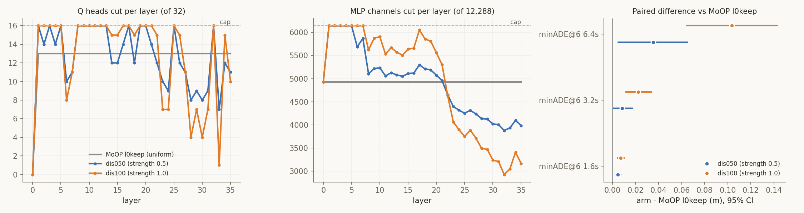

# Experiment: MoOP 레이어 예산을 중요도 불일치로 배분 — Test500 개루프

2026-11-11 · RTX 5880 Ada 4–7번, 11-11 12:21–13:03 KST
계획 `iclr27-rebuttal/plans/2026-11-10_moop-disagreement-allocation-test500.md`
코드 `iclr27-rebuttal/code/make_disagree_masks.py`(마스크 · G0), `run_disagree_alloc.sh`(빌드 · 평가), `analyze_disagree_alloc.py`(분석)
결과 `outputs/iclr27-rebuttal/disagree_alloc/` (`alloc_summary.json`, `slim_dis{050,100}/`, `dis{050,100}_test500/`, `analysis/`의 `summary.txt` · `metrics.json` · `config.json` · `cuts_and_deltas.png`)

## Purpose

- **가설.** MoOP는 층마다 max(rank I_traj, rank I_CoC)로 남길 유닛을 고른다. 두 기준의 상위 집합이 많이 다른 층에서는 예산 안에 두 기준의 상위 유닛을 다 담지 못한다. 그런 층을 덜 자르고 불일치가 작은 층을 더 자르면, 같은 총 제거량에서 개루프 궤적 오차가 줄어든다.
- **질문.** 같은 제거량에서 불일치 기반 배분이 균일 배분(MoOP l0keep)보다 Test500 개루프에서 나은가.

## Setup

| 항목 | 값 |
|---|---|
| 불일치 | 층마다, Q head와 MLP 채널 따로: 1 − \|T ∩ C\| / \|T ∪ C\|. T와 C는 I_traj와 I_CoC 각각의 상위 유닛 집합이고, 크기는 MoOP l0keep이 그 층에서 남기는 개수(Q 19, MLP 7,359/7,360)다. 중요도는 `importance_v2`(calib_100)다. 35번 층은 I_traj가 0이라 30–34번 층 평균을 쓴다 |
| 배분 | 1–35번 층의 절단 수 = 평균 × (1 − 강도 × z). z는 불일치를 평균 0, 최대 \|z\| = 1로 옮긴 값이다. 강도 0.5 = `dis050`, 1.0 = `dis100` |
| 상한 (사용자 요청) | 어느 층도 유닛의 절반 넘게 자르지 않는다(Q ≤ 16/32, MLP ≤ 6,144/12,288). 넘친 몫은 상한에 안 걸린 층에 비례해 넘긴다 |
| 0번 층 | MoOP l0keep과 같다: Q head 32개 보존, MLP 4,929채널 절단 |
| 총량 | 축별로 MoOP l0keep과 같다: Q head 455개, MLP 177,437채널. 제거 파라미터 2,657,447,936개(VLM 24.0%). expert · KV · vision은 그대로다 |
| 층 안 선택 | MoOP 점수(max of rank_norm)가 낮은 유닛부터 자른다 |
| 비교 기준 (다시 돌리지 않음) | MoOP l0keep = `outputs/swap_ship_L0fullM_500`(마스크가 `dual_u40_l0keep_v2`와 같음). Dense = `outputs/baseline_pred_test`. 모두 Ada |
| 평가 | Test500 500클립, rollout만, k = 8, seed 42, max_gen 256. minADE@6 · minFDE@6, 1.6 · 3.2 · 6.4 s |
| 통계 | 클립 단위 짝 부트스트랩 200,000회, 시드 0(시드 1 재확인). 사전 등록 판정(6.4 s minADE@6, MoOP l0keep 대비): CI < 0 개선, ±0.03 m 안 동등, CI > 0 악화 |
| 게이트 | G0 강도 0이 MoOP l0keep을 유닛 단위로 재현 · 파라미터 수 일치 · 0번 층 동일 · 상한 준수 — 통과. G1 빌드: 제거 파라미터 2,657,447,936, 남김 집합 = 마스크, `importance_v2`, expert 그대로 — 두 arm 통과. G2 첫 10클립 정상(클립당 7초, NaN 없음). G3 두 arm 500/500 |

**실제 배분** (층 구간 평균 절단 수; MoOP l0keep은 1–35번 층 모두 Q 13, MLP 4,928–4,929)

| arm | 1–5 | 6–17 | 18–29 | 30–35 | 상한에 걸린 층 |
|---|---|---|---|---|---|
| dis050 Q / MLP | 15.2 / 6,144 | 14.2 / 5,247 | 12.1 / 4,574 | 10.5 / 3,989 | Q 3, 5, 11, 13, 17 · MLP 1–5 |
| dis100 Q / MLP | 16.0 / 6,144 | 14.8 / 5,777 | 12.1 / 4,455 | 8.8 / 3,168 | Q 18개 층 · MLP 1–7 |

- 불일치는 깊이에 따라 거의 단조롭게 커진다. 그래서 두 arm 모두 "앞 · 중간 층을 더, 뒤 층을 덜" 자른다.
- 상한 때문에 두 arm의 1–5번 층 MLP는 같다(6,144). 두 arm의 차이는 6–21번 층(dis100이 더 자름)과 22–35번 층(dis100이 덜 자름)에서 난다.

## Results (Facts)

### 1. 절대값 (Test500, 평균 [95% CI])

| arm | minADE@6 1.6 s | 3.2 s | 6.4 s | minFDE@6 1.6 s | 3.2 s | 6.4 s | 중앙값 ADE / FDE 6.4 s | CoC 퇴화 |
|---|---|---|---|---|---|---|---|---|
| Dense | 0.052 [0.047, 0.057] | 0.207 [0.189, 0.228] | 0.842 [0.765, 0.922] | 0.133 [0.119, 0.148] | 0.553 [0.496, 0.613] | 2.267 [2.009, 2.540] | 0.509 / 1.163 | 0.6% |
| **MoOP l0keep (균일)** | 0.060 [0.054, 0.066] | 0.241 [0.220, 0.263] | **0.956** [0.872, 1.045] | 0.154 [0.139, 0.171] | 0.634 [0.569, 0.703] | **2.597** [2.312, 2.900] | 0.671 / 1.424 | 3.2% |
| dis050 (강도 0.5) | 0.065 [0.059, 0.071] | 0.249 [0.228, 0.272] | 0.991 [0.905, 1.083] | 0.162 [0.146, 0.179] | 0.649 [0.584, 0.719] | 2.669 [2.381, 2.978] | 0.647 / 1.430 | 2.4% |
| dis100 (강도 1.0) | 0.067 [0.061, 0.073] | 0.263 [0.240, 0.287] | 1.059 [0.971, 1.153] | 0.170 [0.153, 0.188] | 0.692 [0.623, 0.765] | 2.837 [2.541, 3.150] | 0.729 / 1.565 | 4.0% |

### 2. 짝 차이 (같은 클립, * = CI가 0을 벗어남)

| 비교 | dADE 1.6 s | 3.2 s | 6.4 s | dFDE 1.6 s | 3.2 s | 6.4 s | 중앙값 dADE / dFDE 6.4 s | 나빠진 클립 |
|---|---|---|---|---|---|---|---|---|
| dis050 − MoOP l0keep | +0.005 [+0.002, +0.007]* | +0.008 [−0.000, +0.017] | **+0.035 [+0.005, +0.065]*** | +0.008 [+0.001, +0.014]* | +0.016 [−0.011, +0.042] | +0.071 [−0.026, +0.169] | +0.028 / +0.079 | 56.8% |
| dis100 − MoOP l0keep | +0.007 [+0.004, +0.010]* | +0.022 [+0.011, +0.034]* | **+0.103 [+0.064, +0.143]*** | +0.016 [+0.008, +0.024]* | +0.058 [+0.026, +0.090]* | +0.239 [+0.108, +0.370]* | +0.063 / +0.157 | 63.4% |
| dis100 − dis050 | +0.002 [−0.000, +0.005] | +0.014 [+0.005, +0.023]* | +0.068 [+0.039, +0.099]* | +0.008 [+0.000, +0.016]* | +0.042 [+0.016, +0.069]* | +0.168 [+0.064, +0.276]* | +0.028 / +0.088 | 60.4% |
| MoOP l0keep − Dense | +0.008 [+0.005, +0.011]* | +0.033 [+0.020, +0.047]* | +0.114 [+0.062, +0.169]* | +0.022 [+0.012, +0.031]* | +0.081 [+0.040, +0.125]* | +0.330 [+0.155, +0.516]* | +0.059 / +0.141 | 63.6% |

- **사전 등록 판정:** dis050 **악화**(+0.035 [+0.005, +0.065], p = 0.023), dis100 **악화**(+0.103 [+0.064, +0.143], p < 5e-06).
- 강도를 0 → 0.5 → 1.0으로 올리면 6.4 s minADE@6이 0.956 → 0.991 → 1.059로 단조롭게 나빠진다.
- 시드 1로 다시 계산해도 판정이 바뀐 칸은 없다.

### 3. 주행 상황별 (6.4 s minADE@6, arm − MoOP l0keep)

| arm | cruise (278) | decel_stop (65) | accel (75) | turn (82) |
|---|---|---|---|---|
| dis050 | +0.035 [+0.002, +0.068]* | +0.000 [−0.094, +0.080] | +0.082 [−0.009, +0.177] | +0.021 [−0.076, +0.111] |
| dis100 | +0.071 [+0.025, +0.117]* | +0.102 [−0.005, +0.203] | +0.159 [+0.041, +0.274]* | +0.163 [+0.046, +0.290]* |

## Analysis (Opinion)

- **가설은 개루프에서 지지되지 않는다. 균일 배분이 여전히 가장 낫다.**
  - 불일치가 큰 층에 예산을 몰아준 두 arm 모두 MoOP l0keep보다 나쁘다.
  - 강도와 비례해서 나빠진다(+0.035 → +0.103). 즉 균일 배분에서 이 방향으로 멀어질수록 손해다.
- **이전 결과와 같은 결론이다.**
  - 7월 격자의 "agree"(상위 집합 합집합 비례)도 dual에서 uniform보다 나빴다.
  - 11-08 정리의 결론도 "dual에서 균일 배분을 이긴 배분이 없다"였다.
  - 이번에는 그때 걸렸던 교락을 걷어냈다: 0번 층 보존, `importance_v2`, Test500 500클립, 축별 총량 고정. 그래도 결론이 같다.
- **손해는 앞 · 중간 층을 더 자른 데서 오는 것으로 보인다. 다만 불일치와 깊이를 가를 수는 없다.**
  - 불일치가 깊이와 거의 같이 움직여서, 이 배분은 사실상 앞 · 중간 층에서 예산을 빼 뒤 층에 주는 배분이다. 깊이 대조군은 넣지 않았다(D3).
  - 두 arm은 1–5번 층이 같다. 그래서 dis100의 추가 손해(+0.068\*)는 6–21번 층을 더 자르고 22–35번 층을 덜 자른 몫이다. 중간 층의 용량이 궤적에 중요하다는 해석과 맞는다.
  - expert가 KV 캐시를 0–15번 층에서 특히 민감하게 읽는다는 기존 기록과도 같은 방향이다.
  - 반대 방향(후반 층에 절단 집중)은 7월에 CoC 붕괴를 냈다. 그러니 균일 배분은 양쪽에서 모두 버티는 지점으로 보인다.
- **손해는 넓게 퍼져 있다.**
  - dis100은 클립의 63%가 나빠지고, cruise · accel · turn에서 각각 유의하다.
  - dis050은 cruise에서만 유의하다. 손해가 장면 일부에 몰린 게 아니라 전반적인 궤적 품질 저하다.
- **CoC 퇴화율은 엇갈린다.** dis050 2.4%(MoOP 3.2%보다 낮음), dis100 4.0%이고, 검정하지 않았다. 언어(LingoQA)는 재지 않았다.
- **Test500 편향은 결론을 바꾸지 않는다.** 11-09 재분석에서 Test500은 MoOP l0keep에 불리한 클립 구성으로 보였다. 그런데도 MoOP l0keep이 이겼으니, 편향을 걷어내면 격차는 오히려 커질 수 있다.
- **논문 · 리버틀 문구.**
  - 쓸 수 있는 문장: "중요도 불일치에 비례해 층 예산을 다시 나누면, 같은 제거량에서 균일 배분보다 개루프 궤적이 나빠진다(+0.035\*, +0.103\*, 강도에 비례)."
  - 근거를 넓히려면 val500이나 A100 test_2000에서 한 번 더 재면 된다(arm당 약 30분, Ada 4장). 결론이 뒤집힐 가능성은 낮아 보인다.
